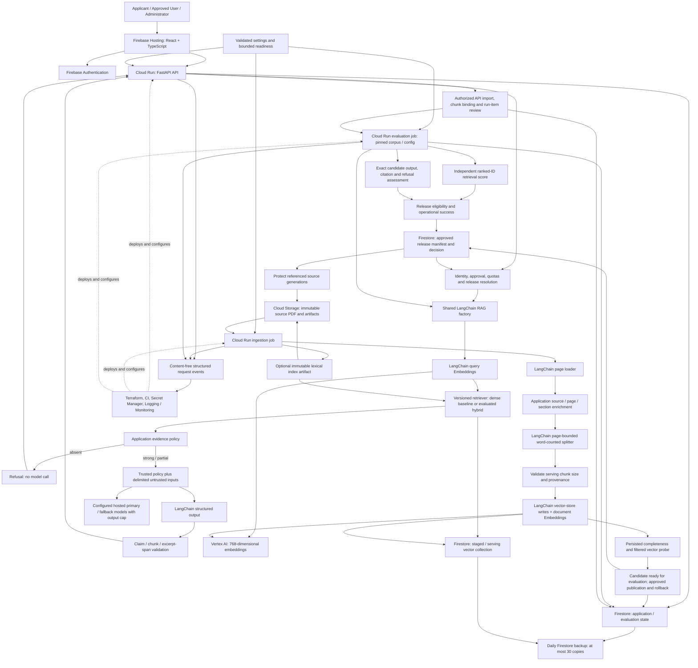

# Gate 2 - Architecture Design

**Status:** FINAL

**Version:** 2.1

**Date:** 2026-10-21

**Input reference:** DMBOK Compass — Business Requirements Document, Version 0.1; sponsor-approved LangChain migration; `documents/production-readiness-review.md`, R04, R05, R06, R14, R15, R16, R17, R18 and R21, 2026-10-19

**Author:** Software Architect Agent

**Implementation readiness:** Architecture ready for implementation. This revision specifies independently implementable contracts for the nine selected review findings. The LangChain migration is present in this checkout, but the review reproduced defects in image packaging, evaluation, and outcome scoring and found unmeasured retrieval, citation and startup behavior. The target contracts below are not claims of implementation or release eligibility. Existing release, index-readiness, ingestion-quality, telemetry and recovery gates remain in force.

## 1. Executive Summary

DMBOK Compass remains an access-controlled, corpus-grounded React/TypeScript application backed by a FastAPI modular monolith on Cloud Run.
LangChain replaces custom document loading, chunking, embedding, vector storage, retrieval, and generation inside the existing API and batch jobs.
Firebase Authentication, Firestore, Cloud Storage, Cloud Run Jobs, and the configured hosted providers remain the backing services.
Application code retains authorization, quotas, provenance enrichment, corpus lifecycle, evidence/refusal policy, citation validation, and privacy-safe response mapping.
A shared LangChain configuration/chain factory serves production requests and corpus-pinned evaluations; operational failures gain corrected HTTP status semantics.
A release manifest and durable decision bind the serving image, corpus, policies, dependencies and evaluation evidence; promotion rejects blocked or stale evidence.
Staged ingestion validates the serving chunk contract and proves candidate-filtered vector search readiness before publication.
Retrieval metrics, answer assessment and operational success are independent; explicit model output limits and content-free structured events make quality, latency and cost gates truthful.
Active and rollback source generations remain recoverable while referenced by a release.
Each selected change is an independently reviewable workstream behind shared candidate, retrieval, answer and configuration contracts; integration gates connect them before release.
Release still requires the existing quality, latency, cost, privacy, provider, publisher-risk, backup, and recovery evidence.

## 2. Business Context & Drivers

DMBOK Compass replaces manual searching of *DAMA-DMBOK, Second Edition* with evidence-backed lookup, comparison, synthesis, study support, and scenario guidance. The sponsor, product owner, administrator, evaluator, corpus owner, support owner, and release approver are currently the same person. Other actors are registration applicants, approved users, and hosted model providers.

In scope are public registration requests, verified email/password identity and administrator approval, a responsive English browser interface, corpus-only answers, page/section citations, request-scoped retrieval traces, configurable quotas, aggregate administration, offline ingestion of one searchable PDF, administrator JSON evaluation import, record validation, gold review, exploratory/release-eligible evaluation, daily backup, and documented recovery. The first release excludes anonymous access, more than 10 approved users, multiple corpora, saved conversations, feedback, MFA, native mobile applications, an admin PDF-upload interface, contractual uptime, and high-availability infrastructure.

The sponsor approved replacing all six RAG mechanisms with LangChain while preserving functionality. Functional equivalence means the same workflows, evidence outcomes, citation authority, quotas, fallback rules, and privacy behavior; nondeterministic model answers need not be byte-identical. LangChain supplies library integrations rather than another deployed service. It does not assume ownership of product policy, identity, domain repositories, or release decisions. A non-2xx status for an operational failure is a deliberate correction to the current HTTP contract, while retaining a safe error body.

The architecture reuses the current FastAPI/React codebase, ingestion/evaluation job entrypoints, domain contracts, Firebase, Firestore, Cloud Storage, infrastructure, and delivery workflows. Graphify's 2026-10-10 report/maps guided navigation; source and the current BRD working copy take precedence over older graph/document descriptions. The existing custom runnable wrappers do not implement the requested replacement. Sections 5–13 incorporate the architectural impact findings and the nine selected production-readiness risks.

The principal drivers remain grounding/citation quality, reproducible release decisions, non-retention of production interactions, the €5 GCP infrastructure constraint plus approved provider budget, and maintainability by one sponsor. Provider terms/capacity, publisher rights, PDF provenance, and LangChain/Firestore compatibility remain explicit validation gates. No infrastructure expansion or relaxation of acceptance thresholds is authorized by this migration.

## 3. Requirements Traceability

Existing BRD identifiers are preserved. `MIG-01`–`MIG-04` identify the sponsor migration instruction and supplied engineering standards. `QW-01`–`QW-10` preserve prior quick-win traceability. `R04`, `R05`, `R06`, `R14`, `R15`, `R16`, `R17`, `R18` and `R21` identify the nine selected review findings; they add implementation traceability without changing BRD acceptance thresholds. Component classifications refer to the existing codebase; release, evaluation, ingestion and telemetry work extends reused components.

| Req ID | Requirement | Design decision | Component(s) | Reused/New |
|--------|-------------|-----------------|--------------|------------|
| OBJ-01 | Reduce corpus lookup effort | Preserve authenticated English lookup and complete cited responses. | Web Application; Backend API; LangChain RAG Pipeline | Reused + New |
| OBJ-02 | Evidence-backed comparison and synthesis | Compose retrieved passages and preserve explicit synthesis labels. | LangChain RAG Pipeline; LangChain Chat Model Integration | Reused + New |
| OBJ-03 | Grounding and verifiable citations | Evidence policy plus provenance-derived citations and claim review. | Backend API; Corpus Ingestion and Evaluation Worker | Reused |
| OBJ-04 | Evidence-gated release | New corpus/chain requires reviewed, version-bound passing evidence. | Backend API; Corpus Ingestion and Evaluation Worker | Reused |
| OBJ-05 | Secure, recoverable, affordable service | Keep ten-user ceiling, budgets, access controls, backups, and 24-hour recovery. | Backend API; Google Cloud Operations and Delivery Platform | Reused |
| BPR-001 | Registration and approval | Firebase handles registration and verification; backend approval state gates answering. | Firebase Authentication; Backend API; Web Application | Reused |
| BPR-002 | Grounded question answering | Native LangChain score-preserving retrieval/generation permits answer, qualified answer, or refusal and validates citations. | Backend API; LangChain RAG Pipeline; Firestore Data and Vector Store; LangChain Chat Model Integration | Reused + New |
| BPR-003 | Corpus maintenance | Administrator-only Cloud Run Job uses LangChain loading/splitting/embedding/writes and stages a new derived corpus version. | Corpus Ingestion and Evaluation Worker; LangChain RAG Pipeline; Cloud Storage Corpus Repository; Vertex AI Embedding Service; Firestore Data and Vector Store | Reused + New |
| BPR-004 | Pre-release evaluation | Versioned evaluation runs report every release metric and block promotion on failure. | Corpus Ingestion and Evaluation Worker; Backend API; Firestore Data and Vector Store | Reused |
| BPR-005 | Release decision | Sponsor approval is persisted against immutable configuration and evaluation identifiers. | Backend API; Firestore Data and Vector Store; Web Application | Reused |
| BPR-006 | Backup and recovery | Daily Firestore backups retain no more than 30 copies; corpus index is reproducible from source. | Firestore Data and Vector Store; Cloud Storage Corpus Repository; Google Cloud Operations and Delivery Platform | Reused |
| BPR-007 | Evaluation dataset import and replacement | Admin import validates per record, stages valid items, atomically switches the active dataset, then permits exploratory runs and gold review. | Web Application; Backend API; Corpus Ingestion and Evaluation Worker; Firestore Data and Vector Store | Reused |
| SM-01 | Top-five retrieval success ≥90% | Reviewed gold passage appears in the five retrieved results; preserve corpus filter and cosine score semantics. | LangChain RAG Pipeline; Corpus Ingestion and Evaluation Worker | Reused + New |
| SM-02 | Grounded factual claims ≥95% | Claim-level review checks evidence support; citation presence alone is insufficient. | Corpus Ingestion and Evaluation Worker; Backend API | Reused |
| SM-03 | Citation correctness ≥95% | Stored provenance and reviewed claim/citation support are required. | Backend API; Corpus Ingestion and Evaluation Worker | Reused |
| SM-04 | Answer quality ≥85% | Approved correctness/usefulness rubric evaluates the migrated chain against the legacy baseline. | Corpus Ingestion and Evaluation Worker | Reused |
| SM-05 | Correct refusal ≥95% | Gold unanswerable cases exercise absent-evidence refusal without generation. | LangChain RAG Pipeline; Corpus Ingestion and Evaluation Worker | Reused + New |
| SM-06 | At least 95% within 15 seconds | Measure complete responses under three-user normal load. | Backend API; Google Cloud Operations and Delivery Platform | Reused |
| SM-07 | Approved-user ceiling | Transactional approval enforces 10 active users. | Backend API; Firestore Data and Vector Store | Reused |
| SM-08 | GCP and provider cost | Track €5 monthly GCP infrastructure and separately capped OpenRouter usage, including configured fallback. | Google Cloud Operations and Delivery Platform; LangChain Chat Model Integration | Reused + New |
| FR-001 | Submit registration request | Firebase sign-up plus a pending Firestore profile records email and username after validation. | Web Application; Firebase Authentication; Backend API; Firestore Data and Vector Store | Reused |
| FR-002 | Verify submitted email | Firebase email verification is mandatory before approval. | Firebase Authentication; Backend API | Reused |
| FR-003 | Approve, reject, or deactivate users | Administrator endpoints and UI update authorization state immediately. | Web Application; Backend API; Firestore Data and Vector Store | Reused |
| FR-004 | Maximum 10 approved users | Approval uses a Firestore transaction that rejects an eleventh active user. | Backend API; Firestore Data and Vector Store | Reused |
| FR-005 | Sign-in, sign-out, and password reset | Firebase Authentication provides credential and recovery flows; backend checks approval on every request. | Firebase Authentication; Web Application; Backend API | Reused |
| FR-006 | Submit an English DMBOK question | Responsive chat UI sends an authenticated request and presents processing, result, or operational error. | Web Application; Backend API | Reused |
| FR-007 | Corpus-only answers | LangChain prompt restricts generation to retrieved evidence; application evidence/citation policy and claim-level evaluation validate grounding. | Backend API; LangChain RAG Pipeline; LangChain Chat Model Integration; Firestore Data and Vector Store | Reused + New |
| FR-008 | Required question categories | Versioned evaluation dataset covers definitions, explanations, comparisons, study, and scenarios. | Corpus Ingestion and Evaluation Worker; Firestore Data and Vector Store | Reused |
| FR-009 | Label supported synthesis | Response schema marks synthesis and maps material claims to retrieved citations. | Backend API; LangChain Chat Model Integration; Web Application | Reused + New |
| FR-010 | Page, section, and excerpt citations | Immutable chunk provenance is rendered by the application, not invented by the model. | Firestore Data and Vector Store; Backend API; Web Application | Reused |
| FR-011 | Strong, partial, and absent evidence outcomes | Retrieval thresholds and response policy select normal, qualified, or refusal behavior. | Backend API; LangChain Chat Model Integration | Reused + New |
| FR-012 | Request-scoped retrieval trace | API returns retrieved passages and preserved scores, model/attempts, raw-output and timing fields in the live response only. | Backend API; Web Application | Reused |
| FR-013 | No retained interaction content | Questions, retrieved passages, answers, and traces stay in request memory and are excluded from storage and logs. | Backend API; Google Cloud Operations and Delivery Platform | Reused |
| FR-014 | Automatic fallback model | Native LangChain chat models route eligible failures according to effective configuration; approved production uses OpenRouter primary/fallback models. | LangChain RAG Pipeline; LangChain Chat Model Integration; External Hosted Answer Models | Reused + New |
| FR-015 | Configurable per-user daily limit, default 100 | Firestore transactions enforce per-user counters and administrator-editable configuration. | Backend API; Firestore Data and Vector Store; Web Application | Reused |
| FR-016 | Configurable global daily limit | A transactional global counter defaults to 100 requests per UTC day and is editable without deployment. | Backend API; Firestore Data and Vector Store; Web Application | Reused |
| FR-017 | Explain quota block and reset | API returns the applicable limit and UTC reset time without exposing other users. | Backend API; Web Application | Reused |
| FR-018 | Anonymous aggregate administration | Content-free counters, provider failures, and cost indicators feed the admin view. | Backend API; Web Application; Firestore Data and Vector Store; Google Cloud Operations and Delivery Platform | Reused |
| FR-019 | Run full or subset evaluation | Administrator starts a uniquely identified evaluation job for selected dataset items. | Web Application; Backend API; Corpus Ingestion and Evaluation Worker | Reused |
| FR-020 | Calculate all release metrics | Evaluation worker reports numerator, denominator, percentage, threshold, and pass/fail for each gate. | Corpus Ingestion and Evaluation Worker; Firestore Data and Vector Store | Reused |
| FR-021 | Generated annotations and human-approved gold subset | Evaluation entities preserve generated candidates, review status, rubric, passages, and dataset version. | Corpus Ingestion and Evaluation Worker; Firestore Data and Vector Store; Web Application | Reused |
| FR-022 | Persist reproducible evaluation evidence | Current-dataset questions, annotations, run inputs/results, and decisions are durable and version-bound; superseded runs are excluded from available release evidence. | Firestore Data and Vector Store; Corpus Ingestion and Evaluation Worker; Google Cloud Operations and Delivery Platform | Reused |
| FR-023 | Admin JSON import | Authenticated admin API accepts a bounded JSON file from the administration UI. | Web Application; Backend API | Reused |
| FR-024 | Required evaluation fields | Per-record schema requires question, one category, expected answer or rubric, and supporting passage. | Backend API; Firestore Data and Vector Store | Reused |
| FR-025 | Allowed categories | Validate against definitions, explanations, comparisons, study, and scenarios; report unknown values. | Backend API; Web Application | Reused |
| FR-026 | Partial import | Validate independently, stage every valid record, and skip invalid records from the same file. | Backend API; Firestore Data and Vector Store | Reused |
| FR-027 | Reject empty valid import | If no valid records remain, reject before any active-dataset mutation. | Backend API; Firestore Data and Vector Store | Reused |
| FR-028 | Import report | Return submitted/imported/skipped counts and each skipped record's index and reason for display in Admin. | Backend API; Web Application | Reused |
| FR-029 | Replace active dataset and prior history | Atomically activate a new dataset generation; mark earlier runs superseded and exclude them from available release evidence. | Backend API; Firestore Data and Vector Store; Web Application | Reused |
| FR-030 | Use active dataset automatically | Full-run launch resolves the active dataset server-side; subset launch accepts only item IDs from it. | Backend API; Web Application; Firestore Data and Vector Store | Reused |
| FR-031 | Immediate exploratory run | Any non-empty active import can start a full exploratory run before gold approval. | Backend API; Corpus Ingestion and Evaluation Worker | Reused |
| FR-032 | Gold-item review | Admin review action approves or rejects records, persists status, and refreshes the dataset view. | Backend API; Web Application; Firestore Data and Vector Store | Reused |
| FR-033 | Gold-count release gate | Server rejects release approval unless the active dataset has 30–50 approved gold items and eligible passing evidence. | Backend API; Firestore Data and Vector Store | Reused |
| NFR-001 | 95% within 15 seconds | Stage budgets, bounded model timeouts, scale settings, and performance gates enforce the target. | Backend API; LangChain Chat Model Integration; Google Cloud Operations and Delivery Platform | Reused + New |
| NFR-002 | Three simultaneous users | Cloud Run starts at concurrency 8, maximum two instances, and is load-tested with three users. | Google Cloud Operations and Delivery Platform; Backend API | Reused |
| NFR-003 | No more than €5 monthly GCP infrastructure plus approved provider budget | Scale-to-zero services, quotas, monitored GCP budget, and separately enforced OpenRouter spend policy. | Google Cloud Operations and Delivery Platform; Backend API; LangChain Chat Model Integration | Reused + New |
| NFR-004 | HTTPS for protected traffic | Firebase Hosting, Cloud Run, Firebase Auth, and provider APIs use HTTPS only. | Google Cloud Operations and Delivery Platform; Firebase Authentication; External Hosted Answer Models | Reused |
| NFR-005 | Safe password storage | Firebase Authentication owns salted password hashing; passwords never enter application storage or logs. | Firebase Authentication | Reused |
| NFR-006 | Login throttling and secure reset | Firebase Authentication supplies throttling and expiring recovery flows; tests verify behavior. | Firebase Authentication | Reused |
| NFR-007 | Current desktop and mobile browsers | Responsive React UI receives automated viewport and browser-flow testing. | Web Application | Reused |
| NFR-008 | Basic WCAG 2.1 AA | Semantic UI, keyboard operation, focus management, contrast, and automated/manual checks are release gates. | Web Application | Reused |
| NFR-009 | Daily backups, maximum 30 copies | Firestore managed backup schedule and retention are infrastructure-as-code controls. | Firestore Data and Vector Store; Google Cloud Operations and Delivery Platform | Reused |
| NFR-010 | Restore within 24 hours | Restore runbook, periodic exercise, versioned source PDF, and deterministic rebuild meet recovery target. | Firestore Data and Vector Store; Cloud Storage Corpus Repository; Corpus Ingestion and Evaluation Worker | Reused |
| NFR-011 | Ephemeral interactions excluded from persistence | Allowlisted telemetry and storage tests prove production request content is absent. | Backend API; Google Cloud Operations and Delivery Platform | Reused |
| NFR-012 | Reproducible evaluation | Reports bind dataset, corpus, retrieval, prompt, provider, model, and scorer versions. | Corpus Ingestion and Evaluation Worker; Firestore Data and Vector Store | Reused |
| NFR-013 | Best-effort availability and clear failures | Bounded retries, fallback, circuit breaking, and honest operational errors avoid ungrounded output. | Backend API; LangChain Chat Model Integration; Web Application | Reused + New |
| NFR-014 | User isolation and admin authorization | Role checks are enforced server-side and covered by negative authorization tests. | Backend API; Firebase Authentication; Firestore Data and Vector Store | Reused |
| NFR-015 | Failed import preserves active state | Stage and validate first; on validation or storage failure the active pointer and visible run history remain unchanged. | Backend API; Firestore Data and Vector Store | Reused |
| NFR-016 | Evaluation state survives restart | Store active dataset, annotations, and runs in Firestore rather than process memory. | Backend API; Corpus Ingestion and Evaluation Worker; Firestore Data and Vector Store | Reused |
| NFR-017 | Exploratory versus release evidence | Persist and display explicit report eligibility; only active-dataset gold-eligible reports can support release. | Backend API; Web Application; Firestore Data and Vector Store | Reused |
| INT-01 | Primary and fallback hosted answer models | Native LangChain OpenRouter chat integration calls two configured models through OpenRouter; model IDs remain release-gated. | LangChain RAG Pipeline; LangChain Chat Model Integration; External Hosted Answer Models | Reused + New |
| INT-02 | Embedding service | LangChain Vertex-configured embeddings call `gemini-embedding-001` to produce 768-dimensional document and query embeddings. | Vertex AI Embedding Service; LangChain RAG Pipeline | Reused + New |
| INT-03 | Email verification and recovery delivery | Firebase Authentication provides managed verification and reset email workflows. | Firebase Authentication | Reused |
| CON-01 | GCP-first hosting | All application hosting, storage, identity, ingestion, observability, and delivery use GCP/Firebase except answer generation. | Google Cloud Operations and Delivery Platform; all managed stores | Reused |
| CON-02 | Python backend and TypeScript frontend | FastAPI/Pydantic and React/Vite/TypeScript are the implementation standards. | Backend API; Web Application | Reused |
| CON-03 | Firestore application and vector data | Firestore Native mode consolidates application records and native vector search. | Firestore Data and Vector Store | Reused |
| CON-04 | One searchable DMBOK PDF | Ingestion accepts one versioned source corpus and rejects unapproved source types. | Cloud Storage Corpus Repository; Corpus Ingestion and Evaluation Worker | Reused |
| CON-05 | Maximum 10 approved users | Transactional approval ceiling and tests prevent excess activation. | Backend API; Firestore Data and Vector Store | Reused |
| CON-06 | No saved production conversations | No chat-history entity or analytics payload is designed. | Backend API; Firestore Data and Vector Store; Google Cloud Operations and Delivery Platform | Reused |
| CON-07 | No fixed deadline; readiness-gated release | Delivery follows evidence and approval gates rather than calendar release. | Google Cloud Operations and Delivery Platform; evaluation workflow | Reused |
| MIG-01 | Replace all six custom RAG mechanisms with LangChain | Native page loader, word-counted splitter, Embeddings, FirestoreVectorStore, score-preserving search, and native chat-model/structured-output composition; wrapper-only substitution is rejected. | LangChain RAG Pipeline; LangChain Chat Model Integration; Corpus Ingestion and Evaluation Worker | Reused + New |
| MIG-02 | Preserve user-facing RAG functionality | Preserve provider configuration, provenance, evidence thresholds, fallback, quotas, admin/evaluation workflows and ephemeral traces; explicitly version the operational-error HTTP correction. | Web Application; Backend API; LangChain RAG Pipeline | Reused + New |
| MIG-03 | Analyze before updating architecture | Impact assessment completed and approved; this version incorporates its decisions, assumptions, and implementation gates. | Architecture and delivery process | Reused |
| MIG-04 | Twelve-Factor engineering | Locked declared dependencies, external configuration/backing services, reproducible build/release/run, stateless processes, own HTTP port, external scaling, graceful termination, environment parity, structured stdout, and same-image admin jobs. | Google Cloud Operations and Delivery Platform; Backend API; Corpus Ingestion and Evaluation Worker | Reused |
| QW-01 | Block non-promotable evidence | The evidence verifier fails closed; promotion requires a durable approved decision for an exact candidate manifest. | Backend API; Firestore Data and Vector Store; Google Cloud Operations and Delivery Platform | Reused |
| QW-02 | Prove installed dependency lock | Package the canonical installed lock in the final image, hash it in the candidate snapshot, and smoke the snapshot inside that image. | LangChain RAG Pipeline; Google Cloud Operations and Delivery Platform | Reused + New |
| QW-03 | Deliver structured telemetry | Configure the application telemetry logger under shipped runtime settings; emit safe JSON to stdout and prove alert filters match emitted fields. | Backend API; Google Cloud Operations and Delivery Platform | Reused |
| QW-04 | Classify operational errors | Use a typed operational-failure outcome and non-2xx HTTP status; exclude those requests from successful-answer performance measures. | Backend API; Web Application; Google Cloud Operations and Delivery Platform | Reused |
| QW-05 | Enforce serving chunk limits | Validate every staged chunk against the response contract; deterministically split oversized text before embedding and activation. | Corpus Ingestion and Evaluation Worker; LangChain RAG Pipeline; Backend API | Reused + New |
| QW-06 | Measure retrieval independently | Score ranked retrieved chunk IDs against approved gold support, without requiring an answer digest or generation. | Corpus Ingestion and Evaluation Worker; Firestore Data and Vector Store | Reused |
| QW-07 | Separate outage from refusal | Operational/model/retrieval errors fail the operational gate and cannot receive refusal-correctness credit. | Backend API; Corpus Ingestion and Evaluation Worker | Reused |
| QW-08 | Prove vector readiness | Probe the staged collection with a candidate-filtered vector query; retain completeness and search-readiness as separate evidence. | Corpus Ingestion and Evaluation Worker; Firestore Data and Vector Store | Reused |
| QW-09 | Bound answer output tokens | Both model routes use an explicit versioned maximum output token setting and record actual usage. | LangChain Chat Model Integration; External Hosted Answer Models; Google Cloud Operations and Delivery Platform | New + Reused |
| QW-10 | Preserve source generations for recovery | Exempt active and rollback source generations from age-only deletion; collect only generations unreferenced by retained releases. | Cloud Storage Corpus Repository; Firestore Data and Vector Store; Google Cloud Operations and Delivery Platform | Reused |
| R04 | Evaluation packaging | Hash the installed `requirements.lock` from the final API/job image and prove candidate snapshot creation in that image. | LangChain RAG Pipeline; Google Cloud Operations and Delivery Platform | Reused + New |
| R05 | Evaluation authoring and binding | Import authored records, bind reviewed support to real chunk IDs in one pinned corpus, and record candidate-specific assessments through an admin path. | Backend API; Corpus Ingestion and Evaluation Worker; Firestore Data and Vector Store; Web Application | Reused |
| R06 | Independent evaluation metrics | Compute ranked-ID retrieval before answer review; evaluate the exact candidate output separately and exclude operational errors from refusal credit. | Corpus Ingestion and Evaluation Worker; Backend API | Reused |
| R14 | Measured retrieval quality | Establish a reviewed answerable/unanswerable baseline, rank metrics and slices; calibrate evidence thresholds on a held-out set. | LangChain RAG Pipeline; Corpus Ingestion and Evaluation Worker | Reused + New |
| R15 | Optional hybrid/reranked retrieval | Compare an immutable corpus-scoped lexical candidate index and fusion/reranking strategy against dense-only search; enable only on measured quality, latency and cost gains. | LangChain RAG Pipeline; Cloud Storage Corpus Repository; Corpus Ingestion and Evaluation Worker | Reused + New |
| R16 | Prompt-injection resistance | Separate stable policy from user question and untrusted retrieved text; test direct and source-borne attacks and enforce output checks. | LangChain RAG Pipeline; LangChain Chat Model Integration; Backend API | Reused + New |
| R17 | Claim-to-source citation support | Reject unknown source IDs, bind each factual claim to retrieved chunk and exact excerpt span, and assess semantic support independently. | Backend API; Web Application; Corpus Ingestion and Evaluation Worker | Reused |
| R18 | Evidence refusal versus service failure | Keep `refusal` for completed no-evidence requests; return typed operational errors with non-2xx status and separate evaluator/probe counts. | Backend API; Web Application; Corpus Ingestion and Evaluation Worker | Reused |
| R21 | Validated startup and readiness | Centralize required settings, pin secret references, fail startup on invalid configuration and expose bounded liveness/readiness checks. | Backend API; Corpus Ingestion and Evaluation Worker; Google Cloud Operations and Delivery Platform | Reused |


## 4. Architecture Overview

At context level, applicants and approved users use the browser application; the administrator additionally manages users, quotas, evaluation imports/gold review, corpus maintenance, evaluations, and release decisions. At container level, Firebase Hosting serves the React SPA, the Cloud Run FastAPI monolith serves authenticated JSON APIs, and Cloud Run Jobs perform ingestion/evaluation. Firestore remains the application and vector store; Cloud Storage remains the immutable source/artifact repository. No new service, database product, agent runtime, or persistent interaction store is introduced.

Inside the existing Python processes, a shared validated factory creates native LangChain loading/splitting/embedding/vector and retrieval/generation compositions. Production resolves an immutable approved release manifest once per request, including its corpus binding; evaluation supplies the same candidate manifest before approval. The mutable `corpus_state/active` pointer is a publication record, not an independent serving authority. Application policies surround and participate in these chains, while LangChain integrations own the six RAG mechanisms.

The nine selected findings are separate modules and work items inside these containers. Evaluation authoring writes reviewed, corpus-bound gold data; scoring consumes a versioned run record and does not depend on the authoring UI. Dense retrieval remains the baseline; an optional lexical/fusion/rerank strategy implements the same retrieval result contract. Prompt assembly and citation checking consume immutable retrieved passages but have separate tests and release metrics. Typed answer outcomes and validated runtime settings are shared contracts, not reasons to combine the work into one deployment unit.



OpenRouter remains the approved production answer gateway. The diagram's configured-model boundary also accommodates the existing explicit Vertex answer mode where currently enabled; migration preserves effective per-environment settings and does not authorize changing the production provider decision. Production question/prompt/passage/answer/trace content exists only in request memory and the live browser response.

## 5. Component Design

### 5.1 Web Application

- **Purpose and responsibilities:** Retain registration/authentication, question entry, answer/citation/trace rendering, quota messages, administrator users/configuration, JSON import/reporting, gold review, and exploratory/release labels. Handle the corrected non-2xx operational-error status with the existing safe user message.
- **Classification:** **Reused.** Existing React screens and TypeScript contracts meet the UI boundary; no migration-specific user workflow is required.
- **Interfaces and data owned:** Firebase browser identity SDK and existing backend HTTPS JSON contracts; no authoritative durable state or saved conversations.
- **Technology:** React/Vite/TypeScript on Firebase Hosting. Validate core flows, mobile/desktop responsiveness, and basic WCAG 2.1 AA after the backend swap.
- **Selected-risk contract (R05/R17/R18):** The administrator can review imported support bindings and assess the actual output of a pinned evaluation run. The question view renders the bounded supporting excerpt attached to each cited claim, with page and section from the server; it shows an evidence refusal separately from a service failure. The browser does not decide citation validity or evaluation eligibility.

### 5.2 Backend API

- **Purpose and responsibilities:** Preserve token/approval/role validation, quota reservation, evidence/refusal and citation policies, administration, evaluation dataset lifecycle, run control, release decisions, and content-free aggregates.
- **Classification:** **Reused.** Extend existing FastAPI modules and domain contracts; keep RAG library objects behind internal mappings.
- **Interfaces and data owned:** Existing request/response/error contracts and domain repositories. Resolve serving collection/schema/corpus/configuration once per request, then invoke the shared chain. Reserve accepted-question quota once before billable operations; fallback does not recharge it.
- **Technology:** Python/FastAPI/Pydantic on Cloud Run. Library `Document`/message types never replace public API entities directly.
- **Quick-win contract:** Resolve the approved release manifest before retrieval, then require its corpus/schema/index/prompt/policy/model/output-cap/dependency binding to match the running artifact. A missing or mismatched binding fails readiness or the request safely; the mutable active-corpus pointer cannot silently redirect traffic. A shared outcome type distinguishes `answer`, `qualified`, evidence `refusal`, and `operational_error`. Model, retrieval, storage, timeout and validation failures produce a safe `ApiError` with non-2xx HTTP status and do not masquerade as evidence refusal. Keep production question and passage content request-scoped.
- **Selected-risk contract (R05/R17/R18/R21):** Extend `app/contracts/api.py` with versioned annotation-binding, run-item assessment, claim-evidence and typed operational-error records. Existing admin authorization protects import, remap, review and assessment endpoints. Binding input must name a real `chunk_id`, pinned `corpus_version_id` and content hash; the server verifies them in the candidate collection before approval. Do not let `imported-passage-*` placeholders become approved gold support. Return evidence `refusal` with HTTP 200 only after successful retrieval classified as absent. Return safe `operational_error` with non-2xx status (502 invalid provider output, 503 unavailable retrieval/provider/storage, 504 deadline) and an allowlisted `ApiError.code`; retain available trace/quota metadata without exposing provider bodies. A centralized immutable `RuntimeSettings` is built at process startup from environment and explicit secret references. Missing required route, collection, embedding, deadline or output-cap settings fail startup. `/health/live` reports process liveness; `/health/ready` uses a bounded, cached check of the selected release binding and required backing services. Keep `/health` as a documented compatibility alias during probe migration.

### 5.3 Corpus Ingestion and Evaluation Worker

- **Purpose and responsibilities:** Reuse maintenance/job dispatch and source controls; perform native LangChain ingestion, persisted corpus validation/readiness, and corpus/configuration-pinned evaluation. A separate release publisher owns activation and rollback. Preserve imports, gold review, report eligibility, and release workflows.
- **Classification:** **Reused.** Existing job entrypoints, source manifests, corpus/evaluation stores, and release services are the baseline. Replace their RAG mechanisms and strengthen lifecycle/evaluation checks where required for migration safety.
- **Interfaces and data owned:** Read immutable generation-bound source/artifacts from Cloud Storage; invoke the shared factory; write derived corpus metadata, native vector documents, authored annotations and version-bound reports. Production interaction data is never supplied as evaluation input.
- **Technology:** Same Python application image and external configuration as the API, executed through Cloud Run Jobs. Bounded batches, explicit IDs, idempotent retries, nonzero failure exit, and graceful interruption are mandatory.
- **Quick-win contract:** Before embedding, validate every staged chunk against `RetrievedPassage.excerpt` (currently 5,000 characters) and provider input limits; deterministically split oversized chunks within one page, preserve section/source provenance, give each a distinct stable ID and content hash, and include the subdivision algorithm in the derived corpus fingerprint. Persist completeness separately from a candidate-filtered vector-search probe using a known staged chunk and the production query path. `ready_for_evaluation` is not activation: the publisher switches the approved release binding only after independent retrieval and answer gates pass. The evaluation worker scores retrieval from ranked IDs and gold support before considering answer digests; outage/error cases never earn refusal credit.
- **Selected-risk contract (R05/R06/R14):** Separate the existing evaluation workflow into data preparation, a candidate-pinned run, and review/finalization within the same worker and Firestore stores. Import stages valid records as `candidate`; an authenticated remap operation stores reviewer-selected real supporting chunk IDs and an explicit expected-refusal label. It checks the pinned corpus and preserves the former generation on failure. Exploratory runs may use unapproved items; release runs require the current 30–50 approved items and exact candidate binding. A run records ranked retrieval IDs/scores before generation. Retrieval scoring uses gold IDs only; answer, claim/citation and refusal judgments apply to the exact generated candidate response and its digest, with `awaiting_review` until a reviewer submits the judgment. Missing assessments block release eligibility. Operational errors are counted separately and never satisfy refusal or answer gates. This can be implemented and tested with checked-in fixtures before the full admin workflow exists.

### 5.4 LangChain Chat Model Integration

- **Purpose and responsibilities:** Native chat-model calls, prompt composition, structured output, eligible primary/fallback routing, deadline handling, and safe mapping of model attempts, usage and errors into the existing generation contract.
- **Classification:** **New.** Current `model/openrouter.py`, `gemini.py`, and `fallback.py` implement custom HTTP/SDK generation. Their transports cannot satisfy the full LangChain replacement; retain policy/protocol mappings while replacing inference and composition with native integrations.
- **Interfaces and data owned:** Ephemeral prompt/evidence plus pinned provider/model/output configuration in; validated candidate and existing live-response attempt/model/usage/raw-output fields out. No durable data, history, model cache, or content callbacks.
- **Technology:** `langchain-openrouter.ChatOpenRouter` for configured OpenRouter mode; native Google chat integration explicitly configured for Vertex where that existing mode is enabled. Use LangChain structured-output or JSON/Pydantic parser composition according to actual route capability. JSON/schema output validates shape, not grounding.
- **Fallback contract:** Normalize safe error classes before an explicitly restricted LangChain fallback composition. Only the existing eligible timeout, capacity/rate-limit, and unavailability failures may trigger fallback. Authentication/policy/bad-request or malformed-output failures are not indiscriminately retried. At most the existing two model attempts share one deadline and one quota reservation; do not repeat embedding/retrieval. Disable implicit retries that would exceed that contract.
- **Verified SDK constraint:** In the selected OpenRouter integration, `timeout` is milliseconds; `max_retries=0` alone leaves the underlying SDK's default one-hour retry configuration active. Construct and inject an SDK client with `retry_config=None` and explicit `timeout_ms`, then enforce the shared application deadline. The development route probe passed only after this configuration was corrected.
- **Quick-win contract:** Both primary and fallback adapters receive an explicit `max_output_tokens` from validated external configuration, bounded by provider capability and the answer product. Pin that value in the candidate/release manifest; usage metadata records actual output tokens for cost and latency evidence. A route unable to honor the cap fails candidate validation rather than silently changing behavior.

### 5.5 LangChain RAG Pipeline

- **Purpose and responsibilities:** Own all six RAG mechanisms through native LangChain integrations; compose the application provenance, evidence, citation and response rules without replacing them.
- **Classification:** **New.** Existing `LangChainRagPipeline` and generation runnable wrap custom implementations. A shared native integration factory and ingestion/answer compositions are required; simply putting those implementations behind more runnables fails MIG-01. This component is a module inside existing processes.
- **Interfaces and data owned:** A validated configuration plus immutable source identity for ingestion, or question plus resolved/pinned corpus/configuration for answering. Map LangChain documents, scored results and messages to existing application records; no interaction persistence.
- **Technology and six-stage contract:**
- **Candidate identity:** Build a content-addressed candidate snapshot from the installed lock file in the running image, image digest, approved source/corpus identity, prompt/policy versions, model routes, output cap, retrieval settings, and evaluation dataset/scorer versions. Reuse the existing factory and `app/rag.py` snapshot path; package the exact lock path it hashes and exercise snapshot creation in the final image.

| Stage | Selected capability | Required configuration and boundary |
|---|---|---|
| Document loading | `langchain-community` page-mode `PyPDFLoader` with `pypdf` | Read an approved immutable local download from Cloud Storage. Application validates source generation/digest, normalizes text, converts zero-based loader pages to authoritative one-based pages, and enriches section provenance. Replace direct custom PDF text extraction. |
| Chunking | `langchain-text-splitters.CharacterTextSplitter` per page `Document` | Normalize whitespace; split on a space with word-counting length function, size 700 words and overlap 70 words. Configure actual word units, not characters/model tokens. Never cross PDF pages. Preserve section attribution and deterministic page/ordinal mapping; any boundary change creates a new derived corpus and reviewed evidence. Replace custom windowing. |
| Embeddings | LangChain `Embeddings`, preferably `langchain-google-genai.GoogleGenerativeAIEmbeddings` explicitly using Vertex | Shared config: `gemini-embedding-001`, exactly 768 dimensions, `RETRIEVAL_DOCUMENT` for ingestion and `RETRIEVAL_QUERY` for live queries, workload identity, project/region. Verify both task paths and dimensions; no switch to the Developer API or direct SDK bypass. |
| Vector storage | `langchain-google-firestore.FirestoreVectorStore.add_documents`/`add_texts` with explicit IDs | Configure content/vector/metadata fields and staged target collection. Native store invokes document embeddings and persists vectors/metadata. Application owns manifests, idempotent batches, completeness checks and corpus lifecycle; it does not retain a parallel custom vector-write engine. |
| Retrieval | Score-returning LangChain Firestore vector search composed through runnables | Pre-filter the pinned corpus version, cosine distance, explicit `k=5`, retain distance and map similarity as `1-distance`. Resolve the integration score gap before use; plain document-only `as_retriever()` does not meet evidence policy. Application rejects non-finite scores, sorts ties deterministically and caps evidence at five. |
| Generation | Native chat integration, LangChain prompt, structured output/parser, conditional branch and eligible fallback | Absent evidence returns application refusal without generation; partial evidence forces qualification; strong evidence permits a supported answer. Reconstruct citations from retrieved stored provenance; never trust model-supplied pages/sections. |

- **Shared construction:** Build ingestion and answer chains from one validated factory/configuration. Production and the evaluation worker must not retain independent provider/retriever assembly in `app/main.py` and `app/evaluation/worker.py`. Pass filters per immutable request/evaluation binding rather than mutating a shared store filter during concurrent calls.
- **Retrieval strategy contract (R14/R15):** A `RetrievalResult` contains ordered candidate `chunk_id`, corpus/version, score and provenance plus a versioned strategy identifier. Keep the current prefiltered cosine top-five path as the measured baseline and retain its `1-distance` threshold semantics. Evaluate it with reviewed answerable and unanswerable items; report hit@5 against the BRD ≥90% gate and diagnostic recall@5, MRR, nDCG, zero-hit and category/section slices. Calibrate the strong/partial/absent thresholds on held-out items; changing a threshold versions the retrieval policy and requires new candidate evidence. Optional hybrid search builds a corpus-scoped lexical artifact from the same approved chunks during ingestion, stores it by immutable digest in Cloud Storage, unions lexical and dense candidates, fuses ranks and optionally reranks before the five-passage evidence cap. Validate lexical artifact hash/corpus binding at load and fall back to dense only under an explicitly versioned strategy, never silently. Enable hybrid/rerank for serving only if held-out quality gains justify measured p95, memory and provider cost under SM-06/SM-08; no new search service is assumed.
- **Prompt and citation contract (R16/R17):** Stable grounding policy is a higher-priority message; the user question and retrieved documents are separately marked untrusted inputs. Document text has no authority to set instructions, tools, output policy or authorization. The structured model candidate is a list of factual claims, each with proposed `chunk_id` and excerpt span; the server renders answer text only from validated claims and fixed connective text, so free-form uncited model prose cannot bypass checking. Application validation rejects unknown IDs, spans not present verbatim in the retrieved excerpt and claims without evidence; it reconstructs page/section from stored provenance. This mechanical check proves identity and span presence, not semantic entailment. Candidate-specific human evaluation checks claim support, citation support and refusal behavior, including direct and poisoned-document injection cases. If evidence was absent, use evidence refusal; if generation invents or corrupts citations despite available evidence, return a safe output-validation error. Never silently drop an invalid citation and present the remaining answer as fully grounded.
- **Compatibility gate:** PyPI still lists Firestore 0.5.0 as the latest published release. It requires core `<1.0.0`, while OpenRouter 0.2.9 requires core `>=1.5.5,<2` and Google GenAI 4.4.1 requires core `>=1.6.9,<2` plus `google-genai>=2.20,<3`. Published Firestore search omits distance scores and its `add_texts` repeats first-batch IDs/metadata after 500 documents. The application now pins the validated LangChain 1.6 stack and maintained `0.5.0.post2` Firestore patch, which fixes those paths and uses a Firestore-valid distance field name; `post1` failed that live query. The resolved candidate passes the Linux Python 3.11 compatibility image.
- **Compatibility evidence (2026-10-12):** `backend/vendor/langchain-google-firestore/` holds attributed source, a maintainer/upgrade plan, license, build instructions and a twice-reproduced `0.5.0.post2` wheel (SHA-256 `9ced9b491908b453a31a4b2598c1ec5fbbddf106dff868adcfe36bd5e60124c2`). `backend/compat/requirements.in` resolves to the universal `backend/requirements-compat.lock`; a clean Python 3.11.17 installation installed 93 matching packages and passed dependency checks and all local contracts. Those contracts cover page-mode PDF loading, 700/70 word overlap, mocked Vertex task types/768 dimensions, 501 native writes with distinct IDs/metadata, filtered score mapping, structured-output construction, and eligible-only fallback. In `dev-dmbok-compass`, native LangChain document/query Vertex embeddings returned finite 768-dimensional vectors; the indexed `document_chunks_v2` collection passed temporary-document writes, nested metadata, corpus filtering, and exact `1-distance` score comparison with a direct Firestore query; both configured OpenRouter models returned structured output, and a simulated eligible primary failure invoked the live fallback route. Temporary Firestore documents were deleted. The OpenRouter probe also exposed that `timeout` is milliseconds and `max_retries=0` does not disable SDK default retries; an explicit no-retry SDK client and 8000 ms timeout passed. The Linux Python 3.11 compatibility image also passed in GitHub Actions. The development OpenRouter key was inadvertently emitted in a diagnostic exception and needs rotation. Full corpus rebuild, quality/performance parity and production promotion remain release gates.
- **Resolution boundary:** Prefer a supported compatible release exposing scores. Under the approved recommendation, assume a narrowly maintained LangChain Firestore integration patch is an acceptable conditional fallback (A-14). It may update verified dependency/API compatibility and expose Firestore distances through a score-returning library method; it must reuse the library storage/search path and have pinned artifact/source, contract tests, maintenance ownership and an upstream contribution path. A permissive version-range edit alone is not proof of compatibility. Do not bypass the resolver with `--no-deps`, retain custom search/embedding engines behind wrappers, silently downgrade, or switch backing stores. If no viable set exists, stop dependent implementation and report the gate failure.

### 5.6 Firebase Authentication

- **Purpose and responsibilities:** Email/password identity, verification, sign-in/out, secure reset, token issuance, password hashing and managed throttling.
- **Classification:** **Reused.** Managed identity already supplies the required flows.
- **Interfaces and data owned:** Browser SDK/backend token verification; credentials remain provider-owned while approval, roles and quotas stay in Firestore.
- **Technology:** Firebase Authentication with email/password and email verification.

### 5.7 Firestore Data and Vector Store

- **Purpose and responsibilities:** Application records, transactional user ceiling/quotas/configuration, aggregates, immutable native vector documents, evaluation generations/items/annotations/runs, approved release pointer/manifests/decisions, compatibility corpus pointer, and backups.
- **Classification:** **Reused.** Firestore Native mode remains the backing service; LangChain replaces vector access while application repositories retain domain ownership.
- **Interfaces and data owned:** API/worker service accounts only. Explicit collection/schema/version binding and vector index; no direct browser data access. Source binaries and identity credentials remain elsewhere.
- **Technology:** Native 768-dimensional cosine vector index, compound corpus filter, transactions, application composite indexes, and daily managed backups. Stage a separate v2 vector collection/index without modifying the legacy active collection.
- **Quick-win contract:** Store an immutable release manifest and append-only approval/rejection decision with actor, candidate digest, evidence IDs, and time. Publication transactionally changes the serving release reference only after eligibility passes. Store independent corpus completeness and vector-probe results on the candidate. The existing in-memory release-decision implementation is insufficient for this contract and must be replaced with a durable repository using this same Firestore backing service.

### 5.8 Cloud Storage Corpus Repository

- **Purpose and responsibilities:** Immutable source generation, PDF digest, extraction/ingestion manifests, reproducible artifacts and recovery inputs.
- **Classification:** **Reused.** Current object storage/source authorization meets the input boundary.
- **Interfaces and data owned:** Administrator maintenance and ingestion jobs; local materialization is temporary, generation-bound, digest-checked and cleaned up.
- **Technology:** Regional Cloud Storage with uniform access, versioning where useful, encryption and lifecycle rules. Never store production interactions.
- **Quick-win contract:** Remove unconditional age-based deletion for source generations referenced by the active or retained rollback releases. Maintain a reference set from durable release manifests, block cleanup while any reference exists, and garbage-collect only unreferenced generations after a dry-run and recoverability check. Object generation and hash remain part of each corpus manifest. Keep the approved backup-copy ceiling distinct from source-generation retention.

### 5.9 Vertex AI Embedding Service

- **Purpose and responsibilities:** Matching document/query vectors for native LangChain storage and retrieval.
- **Classification:** **Reused.** Managed GCP inference is unchanged.
- **Interfaces and data owned:** Access only through the selected native LangChain embeddings integration; `gemini-embedding-001`, 768 dimensions, explicit retrieval tasks, workload identity and project/region. No application records owned.
- **Technology:** Vertex AI; underlying SDK dependencies are resolved/locked with the integration. Model/dimension/task changes require a new derived corpus and evaluation.

### 5.10 External Hosted Answer Models

- **Purpose and responsibilities:** Structured corpus-grounded candidates through configured primary/fallback capacity.
- **Classification:** **Reused.** Keep existing hosted providers and effective environment-specific routes; model hosting is unchanged.
- **Interfaces and data owned:** HTTPS via native LangChain chat integrations only; sponsor-approved no-training/minimal-retention terms apply to every gateway/upstream recipient.
- **Technology:** OpenRouter is the approved production gateway, with externally configured primary/fallback IDs. Existing explicit Vertex answer mode is supported through its native integration where currently configured; it is not a new approved production fallback. Actual structured-output capabilities must be verified per route.

### 5.11 Google Cloud Operations and Delivery Platform

- **Purpose and responsibilities:** Hosting/runtime/jobs, scheduling, secret delivery, reproducible builds, immutable artifacts, infrastructure-as-code, content-free telemetry, budgets, backups and rollback.
- **Classification:** **Reused.** Existing Firebase Hosting, Cloud Run, Scheduler, Secret Manager, GitHub Actions, Artifact Registry, Terraform, Logging and Monitoring remain adequate.
- **Interfaces and data owned:** CI consumes the full dependency lock; releases bind image digest, configuration and vector collection/schema/corpus. Structured logs go to stdout. Secrets remain external; artifacts contain no secret values or production interactions.
- **Technology:** Existing two-project GCP/Firebase deployment in `europe-west1`, subject to placement validation; scaling and resource limits are external configuration. Same image/configuration family supports API, ingestion, evaluation and maintenance.
- **Quick-win contract:** CI builds the final image with its installed lock and verifies the candidate snapshot inside it. Delivery checks `promotable=true`, a durable sponsor decision, fresh candidate-bound evidence and exact artifact hashes before changing traffic; a blocked bundle exits nonzero. Configure `dmbok_compass.telemetry` to emit structured JSON through the shipped Uvicorn/stdout setup, validate Terraform log-filter fields against synthetic emitted events, and classify functional success separately from HTTP transport success in performance probes. No production content is added to telemetry.
- **Selected-risk contract (R04/R21):** `backend/Dockerfile` installs and copies the same canonical `backend/requirements.lock`; `app/rag.py` hashes that installed file, not `requirements-compat.lock`. A build manifest records the lock digest, image digest and runtime configuration digest without secret values. CI starts the final image using production-like configuration and proves snapshot creation through both API and evaluation-job entrypoints. Terraform and delivery pin Secret Manager version numbers for a release instead of `latest`; rotation produces a new configuration/release identity. Liveness and readiness probes target distinct routes, with bounded readiness checks and a failing status for invalid selected release/configuration.

## 6. Reuse Inventory

| Existing asset | Used for | Why it fits |
|----------------|----------|-------------|
| Current BRD v0.1 working copy and release gates | Functional, quality, latency, cost and recovery baseline | Migration does not change acceptance criteria. |
| React screens and TypeScript API contracts | Existing user/admin workflows | Backend integration stays behind the public interface. |
| FastAPI routes, dependencies and Pydantic domain contracts | Authorization, quota, administration, evaluation and typed responses | LangChain objects remain internal. |
| Evidence/citation/protocol helpers | Finite-score classification, qualification/refusal, provenance validation, safe error/trace mappings | These are product rules, not interchangeable RAG engines. |
| Custom extraction/chunking/embed/write/search/model code and tests | Behavioral baseline and parity fixtures | Preserve invariants/assertions; retire the custom mechanisms rather than wrap them. |
| Source manifest, corpus records and lifecycle seams | Source authorization/digest, staged completeness, activation and rollback | Extend derived identity and verify durable/concurrent behavior instead of adding another lifecycle system. |
| Ingestion/evaluation entrypoints and durable store wiring | Same-image jobs and pinned evaluation | Reuse existing wiring; check current implementation rather than assuming older runbook gaps. |
| Searchable DMBOK PDF and reviewed authored data | Authoritative source, baseline and gold review | One corpus; no production conversation capture is needed. |
| Firebase Authentication and Hosting | Managed identity and static responsive SPA | Already meet scope and low-operations goals. |
| Cloud Run service/jobs and Scheduler | API, ingestion, evaluation and maintenance | Existing runtime boundaries remain unchanged. |
| Firestore Native mode | Domain records, transactions, vector backing service and backups | Avoids another database/vector subscription; adapter compatibility must be proven. |
| Cloud Storage and Vertex AI embeddings | Versioned source/artifacts and 768-dimensional inference | Existing GCP services meet corpus and embedding constraints. |
| Terraform, GitHub Actions, Artifact Registry and Secret Manager | Index/configuration updates, locked builds, immutable releases and credentials | Extend the current delivery platform. |
| Content-free telemetry contracts, Logging and Monitoring | Safe operational aggregates, alerts and cost tracking | Maintain privacy while measuring migration effects. |

The two new components in section 5 are integration modules within existing processes: LangChain Chat Model Integration and LangChain RAG Pipeline. Existing product/application/platform components are reused and may need focused changes. The Firestore integration patch, if required, belongs to the latter integration boundary, not a separately deployed service.

## 7. Data Architecture

The durable domain consists of `UserProfile`, `ApprovalState`, `Role`, `QuotaPolicy`, daily `UserQuotaCounter`, daily `GlobalQuotaCounter`, `ApplicationConfiguration`, `CorpusVersion`, `DocumentChunk`, `EvaluationDatasetGeneration`, `EvaluationItem`, `GoldAnnotation`, `EvaluationRun`, `EvaluationItemOutput`, `RunItemAssessment`, `ReleaseManifest`, `ReleaseDecision`, and content-free `AggregateMetric`. Firebase Authentication separately owns credentials and identity-provider records. Cloud Storage owns the source PDF, versioned ingestion artifacts and optional lexical index. `EvaluationItemOutput` and `RunItemAssessment` are target records for evaluator-authored cases only; `ReleaseManifest` and the durable form of `ReleaseDecision` are target additions to the existing Firestore domain, not claims about the current in-memory implementation.

### 7.1 Corpus schema, identity and lifecycle

The target native vector collection is `document_chunks_v2` (externally configured), with top-level `text`, `embedding` and `metadata`. The metadata map contains `corpus_version_id`, `chunk_id`, one-based `page`, `section`, `chunk_ordinal`, `content_hash`, source identity and schema version. Configure the native converter and validate the actual round trip: do not assume returned `Document.metadata` is automatically flattened. A small boundary mapping reconstructs application `DocumentChunk`/`RetrievedPassage`; internal vectors/library metadata do not leak into the API.

The target Firestore index combines `metadata.corpus_version_id` filtering with 768-dimensional `embedding` cosine search. This replaces the target access path, not the existing flat-field index in `document_chunks`; retain that legacy collection/index for the legacy revision. Use explicit document IDs. Validate missing fields, page/section attribution, metadata nesting, vector length and persisted content hashes before candidate readiness.

If R15 earns promotion, the ingestion job also creates a deterministic lexical index from the exact staged `chunk_id`/text set, stores it as an immutable Cloud Storage artifact and records corpus, tokenizer/algorithm version, chunk count and SHA-256 digest in the candidate manifest. Each API instance loads only the selected artifact into a bounded local cache and verifies its digest; it does not scan Firestore on every cold start. The dense-only strategy has no lexical artifact. A missing/mismatched artifact makes a selected hybrid strategy unready; it cannot silently change the ranking algorithm.

Keep source identity (bucket, object, immutable generation and digest) separate from the derived corpus identity. The derived fingerprint includes source identity, loader/parser version/configuration, normalization/provenance and overlong-chunk subdivision algorithms, splitter type/version/word units/700–70 settings, embedding model/dimensions/document/query tasks, and schema version. Derive chunk IDs from derived corpus version plus page/ordinal/subdivision ordinal. Existing source-only manifest IDs and the already-active early exit are insufficient when the same PDF is parsed/split/indexed differently; change the idempotency key with the derived identity. Never overwrite an active legacy chunk ID with changed text/vectors. Validate that every persisted chunk can round-trip through the serving `RetrievedPassage` contract; reject one that cannot be split within the allowed provenance and provider limits.

Create a staged corpus with expected page/chunk counts and manifest hashes. Library writes use bounded idempotent batches; retries resume against the same derived identity. After all batches persist, first verify stored counts, provenance, hashes and 768 dimensions. Then issue an actual vector query with a known candidate chunk embedding and a server-side `metadata.corpus_version_id` filter against the target collection/index. Require the returned candidate's identity/provenance and finite score to match the probe contract; retry only index propagation within a bounded deadline. Persist `complete` and `search_ready` as separate evidence with timestamps and collection/index identities. Neither proves retrieval quality. Ingestion marks a candidate ready for evaluation and does not switch the serving release. A release publisher uses transactional compare-and-set against the previously approved release reference; a concurrent publisher cannot supersede it accidentally. Failed ingestion leaves serving state untouched; clean abandoned staging data through an authenticated maintenance job.

The immutable `ReleaseManifest` binds API/frontend/job artifact digests, installed dependency lock digest, prompt and evidence-policy versions/hashes, configured model routes and output-token cap, collection/schema/index, derived corpus and source generation, retrieval settings, evaluation dataset/scorer versions and evidence IDs. Its approval decision records sponsor actor/time and accepted exceptions. Production resolves the approved release binding once per request and checks it against the running image; evaluation pins the candidate manifest explicitly. `corpus_state/active`, if retained for maintenance compatibility, must be updated by the publisher in the same transaction and checked against the release reference, never used alone to select serving data. Keep the previous valid release and its revision/index/data/source through rollback acceptance. Parser, splitting, normalization, vector or layout changes require a new staged rebuild; merely retaining the same embedding dimension does not prove data compatibility.

### 7.2 Interaction and evaluation data

Production questions, prompts, retrieved passages, generated answers, and request traces exist only in Cloud Run memory and the live HTTPS response. They are never written to Firestore, Cloud Storage, logs, analytics, traces, backups, or build artifacts. The request response contains the answer, evidence outcome, synthesis marker, citations, retrieved passages and preserved scores, selected model and attempts, optional raw model output, and retrieval/generation/total timing; the browser discards this state when the request/session lifecycle ends.

Evaluation questions are separate, administrator-authored non-user data. JSON import accepts only records with a non-empty question, one allowed category (`definitions`, `explanations`, `comparisons`, `study`, `scenarios`), an expected answer or rubric, and a supporting passage. Validation returns submitted, imported, and skipped counts plus each skipped record's index and reason. Valid records are staged under a new generation ID; zero-valid imports are rejected. After all valid records are durable, a Firestore transaction compares and switches the active-generation pointer and marks prior runs superseded for release-evidence queries. If validation or writing fails, the pointer and visible history do not change; orphaned staged records can be cleaned up later. Run launch resolves the active generation on the server, pins that ID and selected item IDs for the job, and checks the generation again before exposing results as current evidence.

Imported records can run immediately as `exploratory`. Administrator review approves or rejects gold annotations per record and persists the status. A report is labeled `release_evidence` only when its run is bound to the active generation with 30–50 approved gold items and the required evaluation coverage; the label does not imply that its metrics passed. The release-decision endpoint rechecks the active generation, gold count, coverage, and passing thresholds transactionally. Older generation runs remain version-bound for audit/reproduction of earlier decisions but are not presented as available evidence for the active dataset. This resolves FR-022's reproducibility requirement alongside FR-029's replacement requirement without confusing old results with current release readiness. Reports bind dataset, derived corpus, collection/schema, loader/splitter/provenance fingerprint, dependency lock/integration artifact, retrieval/evidence settings, embedding, prompt, effective provider/route/model, scorer and application image/configuration versions. Evaluation datasets, annotations, and runs live in Firestore, not process memory, so restarts do not erase them.

Gold annotations reference chunk IDs. A new derived corpus or changed boundaries requires remapping supporting passages, human review and new run bindings; mark old corpus-bound annotations/evidence superseded for migration acceptance rather than treating them as validated for the new chain. Preserve prior identifiers/results for audit and rollback. Retrieval scoring consumes query, expected support IDs and ranked retrieved IDs/scores only; a changed answer digest cannot turn a perfect retrieval into a retrieval failure. Answer assessment separately consumes the generated answer, cited evidence and versioned human rubric. Operational failures are neither evidence refusals nor correct unanswerable outcomes: they fail operational-success and latency gates and do not enter refusal-correctness credit. Report eligibility requires current dataset/gold review and the exact candidate release manifest; old or incompatible results cannot authorize promotion. Existing cited/nonempty-answer evaluation proxies do not prove claim grounding or rubric quality; reviewed claim-level/citation/rubric assessments are required.

For R05, preserve FR-024's imported `supporting_passage` field on every record. For answerable items, bind it to one or more real relevant chunks; for an explicitly unanswerable item, retain the authored passage as review context but bind zero *relevant* chunk IDs and record the reviewer's corpus-scope refusal judgment. Store `corpus_version_id`, chunk content hashes, reviewer actor/time and binding version with the annotation. Reject a placeholder ID, cross-corpus ID, missing chunk or changed hash at gold approval. `scripts/remap_gold_annotations.py` remains an offline proposal source until its output is submitted through this authenticated, validated path. A dataset may stay exploratory while bindings or reviews are incomplete; no partial binding can become release evidence.

For R06, each pinned run item has separate `retrieval_status` and ranked chunk IDs, `generation_status` and typed outcome/error, and an `assessment_status` (`pending`, `reviewed`, `inapplicable`). Retrieval hit@5 is computed from answerable gold IDs even if generation fails or the answer changes. A retrieval error counts as operational failure and cannot be called a successful retrieval. For an unanswerable case, refusal correctness is applicable only after retrieval completes and the policy deliberately returns evidence refusal. A generated answer for an evaluator-authored question may be held in restricted `EvaluationItemOutput` so the reviewer can assess the exact candidate output; `RunItemAssessment` binds its digest, run/item/candidate/scorer versions, claim support, citation support and rubric result. This evaluator-only record is never populated from production user interactions. A changed output requires a new assessment. Any missing assessment or operational error prevents release eligibility, rather than shrinking denominators to make a gate pass.

### 7.3 Retention and recovery

Firestore application and vector data is backed up daily with at most 30 retained copies. A restore exercise must recover accounts, configuration, aggregate usage, evaluation and release decisions within 24 hours. The corpus index may instead be deterministically rebuilt from Cloud Storage. The current unconditional 30-day GCS source deletion must be replaced: active and retained rollback release references protect their exact object generations until the release/index recovery window closes. A dry-run garbage collector may delete only unreferenced generations after verifying at least one rebuild path remains. Account and evaluation-result retention is sponsor-controlled. Raw candidate outputs from evaluator-authored questions are provisionally deleted when the run is finalized or after 30 days, whichever comes first; digests and review results persist for audit (A-21). Safe operational metadata is provisionally retained for 30 days. Secrets remain in Secret Manager; release manifests store secret resource/version references and digests, never secret values or Terraform state copies of them.

## 8. Interfaces & Integrations

The browser uses Firebase Authentication for registration, email verification, sign-in, sign-out, and password recovery. It calls the backend through same-origin Firebase Hosting routing to `/api/**`, sending a Firebase identity token. The infrastructure endpoint may accept requests at the Cloud Run edge, but every protected operation requires application-level token, approval, and role validation.

The backend API exposes logical contracts for registration status, current user, question answering, quota status, user administration, configuration, aggregate metrics, JSON evaluation import, active dataset discovery and review, evaluation initiation/status/reports, and release decisions. Import accepts an administrator-authenticated JSON upload with bounded size and item count and returns the generation ID, submitted/imported/skipped counts, and indexed validation errors. Active-dataset lookup returns the current generation and review counts. Evaluation launch takes optional subset item IDs; the backend supplies the active dataset ID for a full run. Reports include `exploratory` or `release_evidence`, dataset generation, gold count, and versioned metrics. The answer response remains typed JSON with outcome, answer text, synthesis flag, citations, ephemeral trace and quota status. Evidence refusals remain successful request outcomes; operational failures retain a safe error shape but return a non-2xx HTTP status. This deliberate wire-contract correction requires client, probe and monitoring tests.

The target admin API extends the existing evaluation routes with `PUT /api/admin/evaluation-datasets/{generation_id}/items/{item_id}/binding` and `PUT /api/admin/evaluations/{run_id}/items/{item_id}/assessment`. The first accepts a candidate corpus binding, expected-refusal flag and reviewed chunk IDs; the server resolves those IDs and content hashes before changing approval state. The second accepts an exact output digest and human rubric/claim/citation decisions for one run item; the server checks the pinned candidate, scorer version and digest before finalizing. Both require admin identity, record actor/time, reject stale generations and are idempotent for identical submissions. Endpoint names are proposed targets; the request/response schemas and browser client must be versioned together. The current import and status-only review routes remain valid for exploratory use.

`POST /api/questions` has a versioned outcome contract: `answer` and `qualified` are successful cited responses; `refusal` means retrieval completed and evidence was absent; `operational_error` means a retrieval, provider, storage, validation or deadline failure. Only the latter returns non-2xx, with safe `ApiError.code`, retryability and available request-scoped trace. The browser, telemetry, evaluator and `scripts/run_performance_probe.py` classify by typed outcome and error, not just HTTP 200. Every displayed citation includes server-owned page/section and a bounded excerpt span from the retrieved chunk, plus a claim association. Invalid model IDs/spans are rejected uniformly across providers.

The backend and worker use the same native LangChain Embeddings configuration for Vertex AI workload-identity calls. `embed_documents` uses the document retrieval task; `embed_query` uses the query task. Native vector-store writes own embedding/persistence. Retrieval calls a score-returning library path with the corpus filter applied before nearest-neighbor selection, cosine distance and explicit `k=5`. Preserve `similarity = 1 - distance`; do not substitute rank-derived scores or library relevance normalization. Do not increase candidate count silently or filter other versions only after top-k. Missing/non-finite scores cannot count as supporting evidence, and unexpected missing scores are an integration failure to catch before release.

The native LangChain chat integration sends the minimum ephemeral prompt and passages over HTTPS. It validates structured output, normalizes errors, applies bounded timeouts, and invokes fallback only for configured model-level unavailability, timeout, capacity, or rate-limit conditions. Authentication or policy failures are not blindly retried. For the approved OpenRouter configuration, both models use the same gateway; gateway-wide failure produces the existing clear service error. Preserve effective provider/model settings per environment. Library errors/messages are mapped through safe existing public contracts; provider response bodies are not logged.

`RuntimeSettings` is a single validated projection of environment-specific non-secret settings, provider/Secret Manager references, collection/schema and candidate release identity. The API and both job entrypoints consume it; no module silently falls back to a conflicting provider/model or index default. Startup validates local syntax, ranges and required presence without a network call. Readiness makes a bounded, cached dependency and selected-release check without billable model inference; it reports a failed status if the selected corpus/configuration is unusable and never exposes secret values. The exact readiness timeout/cache interval is a provisional operational setting (A-22) to be measured within NFR-001.

Library contracts and package releases are validated in the compatibility spike; no direct SDK/HTTP RAG bypass is retained as a compatibility workaround. Supporting references: [Firestore 0.5.0 metadata](https://pypi.org/pypi/langchain-google-firestore/0.5.0/json), [OpenRouter 0.2.9 metadata](https://pypi.org/pypi/langchain-openrouter/0.2.9/json), [Google GenAI 4.4.1 metadata](https://pypi.org/pypi/langchain-google-genai/4.4.1/json), [Firestore search implementation](https://github.com/googleapis/langchain-google-firestore-python/blob/main/src/langchain_google_firestore/vectorstores.py), [Firestore converter](https://github.com/googleapis/langchain-google-firestore-python/blob/main/src/langchain_google_firestore/document_converter.py), [Google embeddings integration](https://reference.langchain.com/python/langchain-google-genai/embeddings/GoogleGenerativeAIEmbeddings), [OpenRouter chat integration](https://docs.langchain.com/oss/python/integrations/chat/openrouter), and [route-specific structured output](https://openrouter.ai/docs/guides/features/structured-outputs). Findings are dated 2026-10-12 and do not establish all historical or future release combinations.

Cloud Scheduler invokes Cloud Run Jobs using a dedicated authenticated service account. Secret Manager supplies provider credentials only to the backend and evaluation job. GitHub Actions produces immutable frontend and container artifacts through repository-restricted Workload Identity Federation; Artifact Registry stores images by digest; Terraform defines infrastructure and IAM. No interface permits browser access to Firestore vectors, source files, service credentials, evaluation internals, or other users' records.

## 9. Cross-Cutting Concerns

**Security and privacy (NFR-004–NFR-006, NFR-011, NFR-014).** HTTPS, Firebase credential ownership/throttling/reset, server-side approval/role/ownership checks, default-deny browser Firestore access, least-privilege API/worker/scheduler/build accounts, and external secret delivery remain mandatory. Quota and authorization run before billable RAG stages. Never persist production questions, prompts, passages, answers, model output or traces in databases, object storage, logs, analytics, backups or artifacts. Retain only allowlisted structured metadata on stdout: counts, outcome, duration, model/provider ID, usage/cost estimate, quota utilization, corpus/config versions and safe error class. Do not log exception representations or SDK/provider bodies containing content; verify adapter success/error paths under the shipped logging configuration.

Disable environment-driven LangSmith/LangChain tracing, debug/verbose content logging, persistent model caches, history/checkpoints and content-bearing callbacks. Reject caller-supplied callbacks/configuration that bypass the privacy boundary. A transitive LangSmith dependency does not authorize external tracing or another downstream recipient. Existing warning against confidential/personal input and sponsor review of hosted-provider terms remain unchanged. Evaluator-authored datasets/results have the distinct durable treatment in section 7.

For R16, test direct instructions in the question and indirect instructions embedded in retrieved passages, including requests to ignore corpus policy, fabricate citations or reveal secrets. The trusted system policy and untrusted content boundaries are defense layers, while authorization stays in the API/retrieval data path. For R17, exact span membership and source lineage are deterministic checks; semantic entailment is measured with reviewed evaluator-authored cases. Reject or safely fail candidates with unknown IDs, missing claim links or altered excerpts. A valid citation ID alone never satisfies SM-02 or SM-03.

**Performance and concurrency (SM-06, NFR-001–NFR-002).** At least 95% of complete browser responses with citations must finish within 15 seconds under three-user normal load. The numerator requires the expected functional outcome and no operational error; HTTP 2xx alone is insufficient. Report operational failures and evidence refusals in separate denominators. Initial external Cloud Run settings remain min instances zero, max two, concurrency eight, one vCPU and 512 MiB, subject to measurement and the cost ceiling. Use native async embedding/chat/store interfaces where verified; run unavoidable synchronous Firestore work in a bounded executor off the event loop, with underlying RPC timeouts. Cancelling a thread wait does not prove cancellation of its network work. Verify three-user isolation, no shared mutable corpus filters, cold starts and graceful shutdown.

Adopt a provisional 14-second backend request deadline leaving approximately one second for browser/network overhead (A-15); measure and adjust within the unchanged 15-second target. Initial stage ceilings are 0.5 seconds auth/quota, 2 seconds query embedding, 1.5 seconds retrieval/prompt, 8 seconds generation shared by primary and eligible fallback, and 1 second validation/serialization, leaving one second backend contingency. Reserve approximately five seconds primary and up to three seconds fallback within the shared generation ceiling; actual attempts receive only remaining time. Unused stage time does not expand the whole-request ceiling. Provider/RPC timeouts, retry counts, job timeouts and resource limits stay externally configured. These are proposed budgets, not measured results: reconcile the current 16-second generation and 28-second request defaults in factories/Terraform/delivery before promotion, and prove the representative fallback mix meets the BRD. An operational timeout does not count as a successful complete answer.

Trace retrieval/generation/total timing consistently. Existing policy `total_ms` begins after retrieval; migrated total timing must include the full backend path, with separate browser/network end-to-end measurement for the release gate. Preserve existing field names and document measurement semantics; no hidden LangChain tracing is needed.

**Retrieval and answer quality (SM-01–SM-05, FR-007–FR-012).** Fix embedding dimensions/tasks and cosine distance per corpus version; use word-counted 700-word chunks/70-word overlap bounded to each PDF page, then subdivide any chunk that exceeds the serving excerpt limit before embedding. LangChain splitting may still change boundaries: compare real pages, preserve normalization/provenance, create a new derived corpus and review support changes. Preserve carried section recovery and the existing `Unclassified` fallback pending provenance review. Structural completeness, filtered vector readiness and measured gold retrieval quality are three distinct gates.

Evidence accepts only finite scores within the current supported range up to 1. Rank descending score, then ascending chunk ID for ties, cap at five, and discard scores below 0.45. Top score ≥0.75 is strong; ≥0.45 and <0.75 is partial; no eligible score is absent. Partial forces qualified output; absent produces the existing refusal without any generation call. Use exact `1-cosine_distance` semantics, without clamping/renormalization or invented rank scores. Test below/at/above thresholds, missing/non-finite/out-of-range scores, ties and mixed corpus versions.

Those existing 0.75/0.45 values are provisional, not a proven corpus calibration (R14). Freeze an evaluator-reviewed answerable/unanswerable dataset before tuning, separate tuning and held-out slices, and record threshold choice, false-refusal rate, unsupported-answer rate and hit@5 on held-out cases. The release gate retains SM-01 ≥90% for answerable gold items; recall@5, MRR, nDCG and category/section slices diagnose ranking. R15 compares a versioned dense baseline with lexical fusion and optional reranking on the same held-out cases. The provisional adoption target is at least five percentage points more hit@5 on a prespecified held-out terminology/numbered-section slice of at least 40 cases, no overall hit@5 loss, and no violation of SM-02, SM-05, SM-06, NFR-003 or privacy (A-20). If the slice is too small or the target fails, retain dense-only and record the result. Fusion scores are not cosine similarities: evidence thresholds must be calibrated to a strategy-specific score or applied only to a preserved dense score, never reused blindly.

Citations are reconstructed from retrieved authoritative page/section/excerpt records; schema parsing and citation membership alone do not prove every claim's support. Require reviewed relevant-passage retrieval ≥90%, grounded factual claims ≥95%, citation correctness ≥95%, answer rubric quality ≥85%, and correct refusal ≥95% on applicable gold cases. Retrieval hit uses ranked IDs before answer assessment; changed answer punctuation cannot change that score. Refusal correctness applies only to completed evidence-based refusals. Operational failures fail a separate gate and receive no refusal credit. Release requires 30–50 approved gold items with current candidate bindings and explicit report eligibility. Changed outputs/support receive human adjudication. Existing cited-answer/nonempty-answer evaluator proxies cannot by themselves establish semantic BRD gates.

**Reliability and recovery (BPR-006, NFR-009–NFR-010, NFR-013, NFR-015–NFR-017).** Availability remains best effort. Bound retries with backoff/jitter for safe reads/embeddings and idempotent explicit-ID indexing; user POSTs and quota reservation are not blindly retried. Accepted requests consume quota even on downstream failure. Model fallback is restricted to the existing eligible normalized errors and shared deadline; gateway failure yields a safe operational response. Do not imply unsupported content was successfully answered. Preserve any circuit-breaker policy and avoid adding implicit library retries.

Dataset import retains staged durable writes, transactional generation switching and failure isolation. Corpus ingestion separately requires persisted completeness and a candidate-filtered vector probe; publication requires a durable approved release decision and compare-and-set switch of the serving release. Roll back the serving image/configuration, collection/schema/index and corpus binding together; a pointer to v2 data is not a valid rollback for a v1 reader. Retain previous valid resources and exact source generations until promotion and rollback checks pass. Daily backups retain at most 30 copies; restore accounts/configuration/usage/evaluation/release decisions within 24 hours and prove corpus rebuild from immutable source.

**Observability and cost (SM-08, NFR-003, NFR-011).** Dashboards retain safe counts, stage/end-to-end latency, normalized errors, fallback rate, quota use, provider usage/cost, active corpus/configuration, ingestion/evaluation/backup status and infrastructure indicators. Alerts cover repeated failures, quota/cost forecasts, latency regression, backup/ingestion failure and retrieval below 90%. Diagnose content-dependent issues using authored test questions and live request traces. Forecast re-embedding, temporary duplicate vectors/indexes, artifact storage and larger dependency cold-start/memory cost before promotion. GCP infrastructure stays ≤€5/month plus separately approved provider hard cap; free/paid routes both require quality/privacy/capacity evidence.

The shipped Uvicorn configuration must enable `dmbok_compass.telemetry` and emit structured, content-free JSON to stdout on success and operational failure. Include random request ID, stage durations, typed outcome/error code, release/corpus/prompt/policy/model IDs, attempts, actual token usage and estimated cost where available. Administrative release/ingestion actions use actor-linked audit records; production query content is never retained. Synthetic events must match Terraform log metric filters and deliver alerts in a preview environment before promotion. Both model routes enforce a versioned output-token cap; absence of usage metadata is reported as unknown, not zero cost.

For R21, container startup fails before receiving traffic if the required route credentials, secret references, collection, model, embedding, timing or output-limit configuration is missing or invalid. Liveness only checks that the process can respond; readiness checks the selected release/configuration and required dependency access within a bounded budget. Secret rotation creates a new pinned version and candidate/release configuration digest. A passing liveness response must never be used as evidence that RAG is ready or that a release is compatible.

**Accessibility and UI parity (NFR-007–NFR-008).** Preserve responsive desktop/mobile flows, keyboard operation, focus, labels, status announcements, contrast, quota/reset explanations and safe errors. Existing user/admin core-flow and accessibility checks run against the unchanged response schemas. LangChain internals do not enter product screens.

**Deployment and Twelve-Factor standards (MIG-04).** Keep one canonical repository and explicit environment/release branches or tags. Declare and lock the entire Python integration stack, transitive dependencies and any patched artifact/source/hash; install and package one canonical lock in the final image and CI. The current final image installs `requirements.lock` while candidate snapshot code expects `requirements-compat.lock`; resolve that mismatch without relying on an unpackaged filename. Do not depend on global packages. Existing frontend lock remains required. Separate immutable build, release configuration and runtime; promote the exact tested image digest and Firebase artifact after preview/zero-traffic validation and approved evidence. Externalize provider/model/output cap/endpoint, project/region, credentials, collection/schema, splitter/task/dimension settings, deadlines and batch/scaling limits; document validated defaults in `.env.example` and secret names without values. Backing services remain externally configured and replaceable behind native integration contracts.

The final image must contain the exact installed lock that `backend/app/rag.py:_dependency_lock_sha256` hashes; CI starts that image and creates a candidate snapshot before accepting its build. Delivery treats `promotable=false`, missing/stale evidence, a missing durable approval, or any manifest/artifact mismatch as a failing promotion check. The configured output-token limit and source-generation retention policy are release settings, not process-local defaults. Terraform source-object lifecycle rules must be compatible with references in active and rollback releases.

Requests stay stateless; durable state is service-owned. API binds its HTTP port, terminates gracefully and honors Cloud Run signals; jobs stop safely between idempotent batches and exit nonzero on failure. Development and production use structurally similar container/dependency/schema configurations. Maintenance/migration/evaluation use the application image and configuration family. Terraform remains infrastructure source of truth, with explicit target and legacy vector indexes during migration. CI validates contracts, relevant policy/integration/privacy/evaluation tests, dependency resolution/lock, container/dependency scans and Terraform. Architecture approval does not execute deployment or IAM changes.

## 10. Alternatives Considered & Trade-offs

| Option | Pros | Cons | Decision | Driver |
|--------|------|------|----------|--------|
| FastAPI modular monolith and Cloud Run jobs | Existing boundaries, scale to zero, one maintainable codebase | Shared release/failure boundary | Retain | Three concurrent users, €5 infrastructure ceiling, MIG-02 |
| Microservices, GKE or additional agent runtime | Independent scaling, more orchestration features | Added operations/cost without a requirement | Reject | No scale/team/workflow driver |
| Firestore native vectors through LangChain | Reuses existing backing service and domain transactions | Inspected integration has dependency/score gaps | Retain with compatibility gate | CON-03 and MIG-01 |
| Cloud SQL/pgvector or Vertex AI Vector Search | Mature alternatives for relational/specialized vector needs | New backing service, cost and migration; changes current constraint | Reject as default; separate approval needed if spike fails | Existing store and budget |
| React/Vite SPA on Firebase Hosting | Existing flows, low static hosting cost | No SSR | Retain; Next.js/SSR unnecessary | Authenticated tool has no SEO requirement |
| Keep custom RAG mechanisms behind more LangChain wrappers | Least immediate change | Does not replace loading, splitting, embeddings, storage, search or model transports | Reject | Explicit sponsor MIG-01 |
| Supported score-preserving compatible LangChain Firestore release | Meets full replacement without patch ownership | No verified suitable set established | Preferred; prove in spike | Dependency intersection and score semantics |
| Narrow maintained LangChain Firestore patch/upstream contribution | Preserves library search/storage and existing architecture | Requires compatibility/score tests, pinned distribution and maintenance | Conditional fallback under approved recommendation; assumption A-14 | Verified integration gaps |
| Fully stock older LangChain stack | Avoids owning a patch | Support/security/provider capabilities and compatible releases unverified | No downgrade selected; consider only with documented evidence/decision | Reproducible supported dependencies |
| Native ChatOpenRouter and LangChain Google chat integration | Replaces custom transports, supports shared chain/configuration | Route schema/usage/error behavior needs validation | Select according to existing effective provider mode | MIG-01/MIG-02 |
| Change production answer provider during migration | May offer provider diversity | Changes approved production routing and parity baseline | Reject implicit change; retain OpenRouter production and existing explicit modes elsewhere | Approved provider decision and configuration drift finding |
| Primary/fallback models on OpenRouter | One configured gateway, model-level resilience | Gateway-wide outage defeats fallback | Retain production decision | FR-014, INT-01, best-effort availability |
| Add Vertex as a new production fallback | Provider diversity | Changes approved production answer routing | Not selected; existing enabled Vertex mode remains a parity case | Separate route approval required |
| Firebase Authentication instead of custom identity | Managed hashing, verification/recovery/throttling | Platform dependency; no MFA in scope | Retain | Identity/security/cost requirements |
| Persist production questions or enable remote content tracing/history | Easier debugging and chain inspection | Violates FR-013/NFR-011 | Reject | Ephemeral interaction requirement |
| Persist evaluator-authored datasets and versioned evidence | Reproducible gold/release review | Must stay distinct from interactions | Retain | FR-021/FR-022 |
| New derived corpus and staged v2 collection/index | Avoids source-ID reuse and legacy overwrite; enables coupled rollback | Temporary storage/rebuild cost, annotation remapping | Select | Parser/splitter/schema impacts and lifecycle gaps |
| Reuse source-only corpus IDs / overwrite active vectors | Less migration bookkeeping | Same PDF may bypass rebuild, corrupt rollback and stale gold references | Reject | Verified manifest identity and early-exit behavior |
| Preserve 700/70 whitespace-word settings via a native splitter | Matches current units and page boundary policy | Library boundaries may differ and require review | Select and validate | Functional parity; older architecture token description was inaccurate |
| Atomic active-dataset generation with superseded history | Failure isolation and audit without old release evidence | Generation-aware queries/cleanup | Retain | FR-022/FR-029/NFR-015/NFR-016 |
| Delete all old evaluation records on import | Simple replacement | Destroys reproducibility and recovery | Reject | Historical identification requirement |
| Require gold approval before every evaluation | Ensures all runs have reviewed data | Prevents immediate exploration | Reject; preserve exploratory runs | FR-031 and NFR-017 |
| Count citation presence/nonempty output as full quality proof | Cheap automated proxies | Cannot verify grounded factual claims or rubric correctness | Reject as release proof; supplement with reviewed assessments | SM-02–SM-04 |
| Carry forward generation timeout exceeding the 15-second objective | Matches current configuration; review found a 16-second generation default and 28-second request default | Does not enforce the 15-second objective | Replace with measured whole-request/shared-attempt budgets before promotion | SM-06/NFR-001 |
| One minimum instance or multi-region availability | Better startup/availability | Higher cost | No initial change; consider minimum instance only within approved budget | €5 ceiling and best-effort availability |
| Two isolated GCP projects with preview validation | Environment isolation and exact-artifact tests | Duplicate low-volume resources | Retain placement assumption and verify | Development/production parity |
| Proceed without publisher permission | Sponsor can continue project work | High-severity rights/release risk remains | Existing sponsor acceptance remains; architecture is not legal clearance | BRD risk decision |
| Let ingestion activate the mutable corpus pointer | Small code change | Traffic can switch before evaluation and release approval | Reject; ingestion stages, publisher activates an approved manifest | QW-01, QW-08 and reviewed binding defect |
| Keep release decisions only in process memory | Simple local tests | Restart loses the approval authority and CI cannot verify it | Reject; reuse Firestore for durable decisions and exact candidate reference | BPR-005, FR-022, QW-01 |
| Treat a valid evidence JSON file as sufficient for promotion | Easy CI integration | Blocked bundle still exits zero; review can be bypassed | Reject; nonzero verifier and durable decision check are both required | QW-01 |
| Use HTTP 200 for provider/retrieval outages | Preserves current route behavior | Availability, latency and refusal metrics can count failure as success | Reject; retain safe error schema with non-2xx status and typed operational outcome | FR-006, NFR-013, QW-04, QW-07 |
| Add model judge to every answer | Potential online semantic check | New latency, cost and provider exposure without measured benefit | Defer; split offline retrieval/answer evaluation and keep deterministic citation checks | SM-01–SM-05, QW-06 |
| Retain every source generation forever | Simplest recovery guarantee | Unbounded storage cost | Reject; reference-aware cleanup after active/rollback releases expire | NFR-003, NFR-010, QW-10 |
| Delete source objects by age only | Cheap lifecycle rule | May remove active or rollback rebuild input | Reject; release references govern retention | QW-10 |
| Couple the nine findings into one large implementation change | One coordinated merge point | Prevents independent review, attribution and rollback | Reject; freeze five small contracts and integrate at candidate gates | Sponsor's independent-workstream direction; R04–R21 |
| Approve imported placeholder passage IDs | Fast gold review | `imported-passage-*` cannot prove retrieval against the selected corpus | Reject; keep exploratory import and require real chunk binding before release | R05, SM-01, FR-021 |
| Reuse a prior answer digest as current semantic proof | Avoids reviewing a new candidate response | Nondeterministic answers become false failures or unreviewed passes | Reject; score retrieval by IDs and review the exact current run output | R06, SM-02–SM-05 |
| Ship hybrid search by default | Better lexical recall is plausible | No measured corpus gain; new index, startup and cost risks | Benchmark behind a versioned strategy; promote only if held-out gates improve | R14/R15, SM-01, SM-06, NFR-003 |
| Treat prompt wording and valid citation IDs as sufficient grounding | Minimal response validation | Poisoned text can redirect output and valid IDs can support false claims | Reject; isolate untrusted inputs, validate claim/span links and review entailment | R16/R17, FR-007/FR-010 |
| Run a semantic model judge on every user request | Potential online claim checks | Adds latency, provider exposure and cost without measured benefit | Defer; deterministic source/span checks online, human-reviewed candidate cases offline | R17, NFR-001/NFR-003/NFR-011 |
| Use one health endpoint and `latest` secret versions | Simple probes and rotation | A process may be alive with unusable config; identical artifact may drift | Split liveness/readiness and pin secret references to release identity | R21, NFR-012/NFR-013 |

The sponsor approved the impact recommendation before this document was updated. Unverified technology choices are bounded assumptions with validation owners; failed gates are reported rather than silently changing providers, store, budgets or functional policy.

## 11. Assumptions

1. **A-01 — Current baseline.** Reuse current FastAPI/React contracts, policy helpers, job entrypoints, source controls, durable evaluation wiring, Terraform and release services; verify actual behavior instead of older descriptions of missing wiring. **Owner:** implementation owner. **Validation:** freeze source/configuration and reviewed parity fixtures before replacing RAG mechanisms.
2. **A-02 — Placement.** Retain two isolated GCP projects in `europe-west1`, `dev-dmbok-compass` and `prod-dmbok-compass`, with isolated Firebase/Firestore/storage/secrets/runtime resources. **Owner:** sponsor. **Validation:** confirm project and immutable database placement before infrastructure changes.
3. **A-03 — Effective provider routing.** OpenRouter remains the approved production gateway. Explicit Vertex answer mode and its existing fallback configuration remain supported wherever currently enabled. Code defaults to Vertex while Terraform/delivery select OpenRouter, and `.env.example` uses different OpenRouter IDs; no source of defaults overrides effective deployed settings by assumption. **Owner:** sponsor/implementation owner. **Validation:** record routes, schema capabilities, eligible failures and budgets per environment; verify native integration parity before enabling a migrated mode. The existing nested Vertex-to-OpenRouter fallback can attempt more than the public two-attempt trace limit; reconcile this failure-path inconsistency explicitly before enabling it, rather than silently widening/truncating the contract or changing routes.
4. **A-04 — Provider privacy/capacity.** Applicable gateway and upstream no-training/minimal-retention terms, availability and capacity must pass sponsor review for each effective route. **Owner:** sponsor. **Validation:** retain decision/terms evidence and live route checks before release.
5. **A-05 — Quota defaults.** Per-user/global defaults remain 100 accepted requests per UTC day, administrator-configurable; fallback consumes no extra quota reservation. **Owner:** sponsor. **Validation:** contract/transaction/fallback tests and cost baseline.
6. **A-06 — Cost.** GCP infrastructure stays ≤€5/month with separate approved provider hard cap, including temporary migration resources and re-embedding. **Owner:** sponsor. **Validation:** rebuild/dependency/runtime forecast and billing review before promotion.
7. **A-07 — Provenance.** The searchable PDF supports correct one-based page/section attribution using LangChain page extraction plus existing enrichment. **Owner:** corpus owner. **Validation:** real-page comparison, carried heading/Unclassified cases and reviewed gold citations.
8. **A-08 — Gold coverage.** Approximately 200 representative authored questions cover the five categories and evidence outcomes; 30–50 approved gold items support release. Changed corpus chunk references are remapped/reviewed. **Owner:** sponsor/evaluator. **Validation:** dataset/rubric/annotation approval and new candidate-specific evidence.
9. **A-09 — Data separation.** Production interactions remain ephemeral; authored evaluation questions/annotations/results are durable as required by FR-021/FR-022. **Owner:** sponsor/implementation owner. **Validation:** storage/log/callback/cache/exception privacy checks.
10. **A-10 — Publisher rights.** Existing sponsor acceptance of proceeding without permission remains; multi-user release risk is unresolved. **Owner:** sponsor. **Validation:** reconsider permission/qualified advice and record final risk decision before release.
11. **A-11 — Validation scope.** This version describes the implemented LangChain migration and the target quick-win corrections. The production-readiness review ran local tests and reproduced integration failures; it did not verify the shipped image, deployed release, real-corpus quality or live recovery. **Owner:** implementation owner. **Validation:** ordered exit gates in section 13 and candidate-specific production evidence.
12. **A-12 — Safe metadata retention.** Content-free logs/metrics retain a provisional 30 days; never include interaction content. **Owner:** administrator. **Validation:** infrastructure retention and privacy inspection.
13. **A-13 — Managed email.** Firebase verification/reset delivery remains acceptable for first release. **Owner:** sponsor. **Validation:** existing end-to-end identity/regression flows before onboarding.
14. **A-14 — LangChain integration boundary.** Sponsor agreement with the recommendation is interpreted as accepting application policy retention and a narrow, maintained Firestore LangChain integration patch only if no supported compatible score-returning release is available. This does not approve a backing-store change, unverified downgrade or resolver bypass. **Owner:** implementation owner/sponsor. **Validation:** compatibility spike records the selected integration/artifact, exact lock, score semantics, maintenance/upstream plan and any necessary revised decision. If this path fails, stop dependent implementation.
15. **A-15 — Deadline allocation.** Provisional 14-second backend ceiling, eight-second shared generation budget and five/three-second primary/fallback reservation leave browser/network margin under the unchanged 15-second target. **Owner:** implementation owner/evaluator. **Validation:** measure complete responses, cold starts and representative fallback mix at three users; adjust within the same target/cost ceiling without treating errors as successful answers.
16. **A-16 — Migration data boundary.** The configured `document_chunks_v2` collection with nested metadata and derived fingerprint remains the internal index. Native word-counted 700/70 splitting may produce chunks too long for the serving excerpt field; deterministic subdivision is part of the next corpus version. **Owner:** corpus owner/implementation owner. **Validation:** schema round trip, persisted completeness, vector probe, idempotent batches, gold remapping and coupled rollback.
17. **A-17 — Release authority.** Firestore is the durable release registry and decision store; the same approved manifest selects the serving corpus and deployment tuple. This extends existing release repositories and avoids a new service. **Owner:** sponsor/implementation owner. **Validation:** restart, concurrent publication, blocked-bundle and mismatched-artifact tests; exact release rollback drill.
18. **A-18 — Output cap.** A product-specific output-token ceiling is selected from a measured answer-length distribution and is supported by both approved model routes; no numeric cap is asserted before route validation. **Owner:** sponsor/evaluator. **Validation:** route-level cap probe, completeness rubric, p95 latency and actual token/cost reports at three users.
19. **A-19 — Source retention.** Active and one validated rollback release remain recoverable; additional history retention is bounded by sponsor-approved cost and recovery policy. **Owner:** sponsor/administrator. **Validation:** reference inventory, lifecycle dry-run, restore/rebuild drill and budget review before automatic cleanup.
20. **A-20 — Optional lexical strategy.** A one-PDF, immutable lexical index artifact can fit the approved Cloud Run memory, cold-start and cost budgets. The provisional adoption target is at least five percentage points more hit@5 on a prespecified held-out terminology/numbered-section slice of at least 40 cases, with no overall hit@5 loss or regression against SM-02, SM-05, SM-06, NFR-003 and privacy. This is an experiment, not an approved serving strategy. **Owner:** retrieval/evaluator owner. **Validation:** build from the pinned chunk set, measure artifact size/load time and held-out quality/p95/cost before enabling R15; retain dense-only if it fails.
21. **A-21 — Evaluator-output retention.** Candidate outputs generated only from administrator-authored evaluation questions may be stored in admin-restricted Firestore for exact-output human review; they are not production user interactions. Provisionally delete raw output at run finalization or 30 days after generation, whichever occurs first, and keep only the digest and assessment afterward. This duration is not specified in the BRD. **Owner:** sponsor/evaluator. **Validation:** approve the policy and negative access/deletion tests before release; if disallowed, replace it with a review session that preserves the exact output until assessment without changing its digest.
22. **A-22 — Readiness probe budget.** Start with a two-second maximum dependency check and a short cached result, with the exact interval chosen from load testing. This is a provisional operational target, not an observed current capability. **Owner:** platform owner. **Validation:** failed-config, failed-store, cold-start and three-user probe tests under NFR-001; adjust without turning liveness into readiness.

## 12. Risks & Mitigations

| Risk | Impact | Likelihood | Mitigation |
|------|--------|------------|------------|
| Selected inspected integration releases have incompatible core/GenAI requirements | Blocking: proposed stock stack cannot resolve | Confirmed for inspected releases | Prove a supported compatible set or validated narrow patch; lock all dependencies/artifacts; do not use `--no-deps`. Block dependent implementation until exit evidence. |
| Firestore integration loses scores or changes normalization | Blocking: evidence/refusal outcomes regress | Confirmed score omission in inspected path | Prove pre-filtered cosine search, explicit five results, `1-distance`, metadata round trip and policy boundary tests through the native integration before selection. |
| Narrow compatibility patch becomes an unsupported fork | Upgrade/maintenance burden for one sponsor | Medium if required | Minimum integration-only scope, pinned build/source/hash, compatibility tests, named maintenance owner and upstream contribution; prefer supported release when available. |
| Loader/splitter/schema change reuses active source-only ID | Stale corpus, overwritten data, invalid rollback | High without controls | Derived fingerprint plus separate v2 collection/index, immutable IDs, staged rebuild and source-generation binding. |
| Gold chunk IDs or old reports authorize the migrated candidate | False release readiness | High without version binding | Remap/review annotations; new pinned corpus/configuration/dependency evidence; supersede incompatible reports. |
| Production lifecycle checks do not validate data or concurrent activation | Incomplete corpus activated; rollback unavailable | Existing gaps confirmed | Persisted counts/hash/provenance/vector checks, compare-and-set pointer, partial-batch/concurrent-job tests and executable revision/schema/corpus rollback. |
| Evaluator uses cited/nonempty-answer proxies as quality proof | Grounding/rubric regressions go undetected | Existing proxy limitation confirmed | Human-reviewed relevant passages, claims, citation support and rubric outcomes; retain minimum gates and legacy parity review. |
| Native route/schema/retry/fallback differs from effective config | Extra calls, wrong failure handling, invalid traces/output | Medium; defaults already differ | Freeze effective environment config; shared factory; explicit eligible errors/retry limits/deadlines; resolve enabled Vertex nested-attempt inconsistency against the public schema before migration. |
| Provider bodies, callbacks or environment tracing retain content | Violates non-retention/privacy requirements | Existing raw-body log confirmed; integration risk medium | Remove raw content log, disable content tracing/caches/history, reject unsafe callbacks and inspect SDK success/error paths. |
| Blocking sync calls or shared mutable filters under concurrency | Latency failure or corpus/request contamination | Current inline sync behavior confirmed | Native async where verified, bounded executor/RPC timeouts, immutable per-request filters and three-user isolation/load evidence. |
| Larger dependency image, cold starts and current 16-second generation/28-second request defaults | 15-second target missed; memory/cost regression | Unmeasured deployed overhead | Full-path timing and bounded provisional deadline, small image/startup checks, representative cold/fallback load at three users. |
| Duplicate staged vectors/re-embedding exceed cost cap | Budget breach or stalled migration | Medium | Forecast temporary resource/provider cost, bounded job batches and cleanup after rollback acceptance; no extra service/subscription. |
| Publisher restrictions prohibit ingestion/transmission/excerpts | May prevent lawful multi-user release | High | Existing sponsor risk acceptance; seek written permission/qualified advice and record release decision. Architecture approval does not resolve rights. |
| Hosted provider retains/trains on prompts or changes routes | Privacy, quality, cost and availability regression | Medium/High | Sponsor reviews upstream terms/capacity, minimizes context, warns users and revalidates exact routes before release. |
| Development OpenRouter key appeared in diagnostic output | Unauthorized use of the development provider account | Confirmed | Rotate the key at OpenRouter and update the development Secret Manager version; do not print raw provider exceptions or headers in future probes. |
| Both approved production models share one gateway | Gateway-wide outage defeats fallback | Medium | Bounded failures, honest operational errors and best-effort availability; no implicit provider change. |
| Free tiers or €5 budget conflict with normal usage/performance | Throttling or service quality failure | Medium/High | External quotas, provider hard cap, usage/cost forecasts and monthly review; stop release/continued operation if limits cannot hold. |
| Failed/concurrent dataset import or stale report eligibility | Wrong active dataset or invalid release decision | Medium | Preserve staged generation and transactional compare-and-set; current-gold/config eligibility checks; restart/concurrent/import-failure regression tests. |
| No MFA and one person owning all roles | Account takeover or delayed incident response | Medium | Existing accepted scope; managed password/recovery/throttling, least privilege, reproducible runbooks and immediate deactivation. |
| Ephemeral interactions limit incident diagnosis | Less retrospective evidence | Accepted | Content-free aggregates, live traces and authored reproduction questions; no retained conversations. |
| Hot transactional quota record | Quota contention at load | Low at three users | Reuse current counter, measure contention; shard only if requirements justify it. |
| Evidence verifier returns success for a blocked bundle | Unapproved release can be promoted | Confirmed in `scripts/verify_release_evidence.py` | Return nonzero for `promotable=false`; require durable actor decision and exact candidate digest in delivery. |
| Running image cannot hash the expected lock | Candidate snapshot/evaluation fails after deployment | Confirmed path mismatch between `backend/app/rag.py` and `backend/Dockerfile` | Package the installed lock, hash it and smoke snapshot creation in the final image. |
| Staged chunks exceed serving schema limits | Retrieval can fail for otherwise valid indexed data | Reproduced for a long-word page | Split before embedding with stable provenance/IDs and reject any remaining invalid chunk. |
| Completeness flag is mistaken for vector search readiness | Candidate activates before index/query path is usable | Confirmed: filtered scan does not query vector index | Bounded candidate-filtered vector probe with expected identity and separate evidence state. |
| Retrieval or refusal score depends on answer/operational errors | False quality pass or fail | Reproduced in review | Rank-ID-only retrieval scorer, separate answer assessment and operational-success gate. |
| Telemetry events are not emitted or matched by alert rules | Incidents stay invisible | Confirmed logger/filter mismatch | Configure shipped logger; synthetic log-to-metric-to-notification test. |
| Source generation is deleted while active or needed for rollback | Recovery/re-index fails | Confirmed unconditional 30-day GCS rule | Reference-aware retention and dry-run collection tied to release manifests. |
| Approved gold points to placeholders, stale or wrong-corpus chunks | False retrieval quality evidence | Current import creates placeholder IDs | Admin-reviewed binding validates real IDs and hashes against the pinned corpus; release eligibility checks them again. |
| Hybrid ranking reuses cosine thresholds on fused scores | Wrong evidence class and unsupported answers | Likely if a new strategy is inserted without a score contract | Version strategy and score semantics; calibrate on held-out answerable/unanswerable cases before promotion. |
| Prompt injection or a valid citation ID masks an unsupported claim | Grounded-looking wrong answer | Current prompt and ID-only validation leave this path open | Separate trusted policy/untrusted text; reject invalid claim/span maps; human-review support and adversarial fixtures. |
| Candidate outputs are retained without an approved policy | Evaluation privacy and storage drift | Design choice unresolved (A-21) | Approve bounded evaluator-only retention/access before R05/R06 implementation; production interactions remain ephemeral. |
| `latest` secret changes or always-green health hides unusable release | Runtime drift and false readiness | Current Terraform and `/health` behavior confirmed | Version secret references, validate startup settings and make bounded readiness depend on the selected release. |

The selected nine risks above are current implementation risks or observed design gaps, not hypothetical migration concerns. Other listed gates block promotion/release until candidate evidence or an existing sponsor risk decision is recorded; design approval itself does not assert they passed.

## 13. Notes for the Orchestrator

Scope of this revision is R04, R05, R06, R14, R15, R16, R17, R18 and R21 within the existing modular monolith and jobs. Freeze five minimal shared contracts first: `CandidateIdentity` (image/installed lock/corpus/config/scorer), `RetrievalResult` (ordered IDs/scores/provenance/strategy), `EvaluationCase`/`RunItemResult` (gold binding and independent stage statuses), `AnswerOutcome`/`CitationEvidence` (typed outcome and claim/span/source links), and `RuntimeSettings` (validated configuration and secret references). Each workstream can use contract fixtures and ship behind a disabled or compatible path; the integration gate, not another workstream's internal implementation, determines production adoption.

| Workstream | Independently reviewable change and exit evidence | Integration/adoption gate | Complexity |
|---|---|---|---|
| R21 | Central settings/startup validation, pinned secret references, separate bounded liveness/readiness; invalid config and unavailable selected release fail readiness | Exact release identity and deployed probe behavior must agree with existing R03/release controls | M |
| R04 | Final image contains installed `requirements.lock`; API/job candidate snapshot smoke hashes that file and records artifact identity | Delivery compares snapshot digest to immutable candidate/release manifest | S |
| R05 | Admin import/remap/binding and exact run-item review; placeholders and wrong-corpus IDs cannot become approved gold | 30–50 current, candidate-bound approved cases flow through real evaluation and release gate | M |
| R06 | Retrieval-only scorer and separate answer/refusal/operational statuses with adversarial scorer fixtures | R05's authored gold and R18's typed outcomes exercise the final evaluator; neither is needed to implement its scorer | M |
| R14 | Dense baseline hit@5, recall@5, MRR/nDCG and slices; held-out threshold calibration and false-refusal report | Real R05 gold, candidate-filtered R08 readiness and R11/R12 corpus correctness required before accepting metrics | M |
| R15 | Optional immutable lexical artifact, fusion and rerank strategy behind `RetrievalResult`; compare against frozen dense baseline | Promote only after R14 held-out improvement and R25/R26 latency/cost evidence; dense-only remains a valid release | M–L |
| R16 | Trusted/untrusted prompt separation plus direct/indirect injection fixtures and safe failure | Candidate must pass R17 output validation and reviewed adversarial answer cases before production exposure | M |
| R17 | Claim-to-chunk/span schema, uniform unknown-ID rejection, bounded excerpt UI and claim-support review | R05/R06 current-run assessments prove SM-02/SM-03; source identity and R18 failure type stay consistent | M–L |
| R18 | Typed operational error, non-2xx API response, browser/probe/telemetry mapping; outage never earns refusal credit | R06 evaluator and R22/R24/R27 monitoring/probes reflect new semantics | M |
| Candidate integration | One final-image run across admin authoring, retrieval, generation, citations, failure paths, readiness, release evidence and rollback | Existing R01/R03/R08/R11/R12/R22/R24/R25/R26/R27/R29 gates remain mandatory where applicable | L |

R04, R06, R16, R18 and R21 can start immediately using frozen fixture contracts. R05 and R14 can proceed in parallel; R15 can be built as an experiment, but its adoption waits for R14's measured baseline. R16 and R17 share the evidence shape, not a coding dependency. R05's authoring UI is not a prerequisite for R06 unit correctness; the real-data integration test joins them. R21's settings module is not a prerequisite for R04's image smoke, though both must identify the same candidate at release.

These are target work items, not completed fixes. Likely touchpoints are `backend/Dockerfile`, `backend/app/rag.py`, `backend/app/api/evaluation_datasets.py`, `backend/app/evaluation/{generations,worker,assessments}.py`, `backend/app/contracts/api.py`, `backend/app/retrieval/{search,evidence}.py`, `backend/app/answering/{pipeline,citations}.py`, `backend/app/{main,lifecycle}.py`, `web/src/questions/QuestionPanel.tsx`, `web/src/admin/evaluation/EvaluationPanel.tsx`, `scripts/run_performance_probe.py`, `infra/terraform/delivery.tf`, `.github/workflows/{quality,delivery}.yml`, and focused behavioral/integration tests. Reuse existing routes, repositories and jobs; new data types live inside those boundaries.

Freeze import bounds/categories, citation authority, embedding tasks/dimensions, metadata/index layout, annotation/report eligibility and privacy controls. Version the changed HTTP outcome, citation and release manifest contracts. Only candidate-specific passing evidence supports promotion; old reports and coarse proxies are insufficient. Existing publisher/provider risk decisions, model/privacy/budget approval and release controls remain binding.

**Document verification and limits:** This update uses the approved BRD, current source, Graphify map and production-readiness review. No application, infrastructure or live environment was changed by this architecture update. The review's local tests and reproductions support the findings, but final-image, real-corpus, deployed alert, restore and promotion evidence remain to be produced by the implementation.

## 14. Machine-Readable Handoff

```yaml
status: READY_FOR_ORCHESTRATION
open_questions: 0
assumptions_count: 22
components:
  - name: Web Application
    kind: reused
  - name: Backend API
    kind: reused
  - name: Corpus Ingestion and Evaluation Worker
    kind: reused
  - name: LangChain Chat Model Integration
    kind: new
  - name: LangChain RAG Pipeline
    kind: new
  - name: Firebase Authentication
    kind: reused
  - name: Firestore Data and Vector Store
    kind: reused
  - name: Cloud Storage Corpus Repository
    kind: reused
  - name: Vertex AI Embedding Service
    kind: reused
  - name: External Hosted Answer Models
    kind: reused
  - name: Google Cloud Operations and Delivery Platform
    kind: reused
new_components:
  - LangChain Chat Model Integration
  - LangChain RAG Pipeline
reused_components:
  - Web Application
  - Backend API
  - Corpus Ingestion and Evaluation Worker
  - Firebase Authentication
  - Firestore Data and Vector Store
  - Cloud Storage Corpus Repository
  - Vertex AI Embedding Service
  - External Hosted Answer Models
  - Google Cloud Operations and Delivery Platform
blocking_risks:
  - R04, R05, R06, R14, R16, R17, R18 and R21 are design targets requiring candidate verification before release; R15 remains optional until benchmark evidence supports adoption
  - The durable release decision and serving binding must prevent blocked evidence and mutable corpus activation from reaching users
  - The exposed development OpenRouter key must be rotated before further shared validation or deployment
  - Candidate-specific parity, reviewed quality, privacy, latency, cost and coupled rollback/recovery evidence remain promotion gates
  - Publisher-rights release risk and effective provider privacy, routing and live capacity decisions remain subject to sponsor review
```
