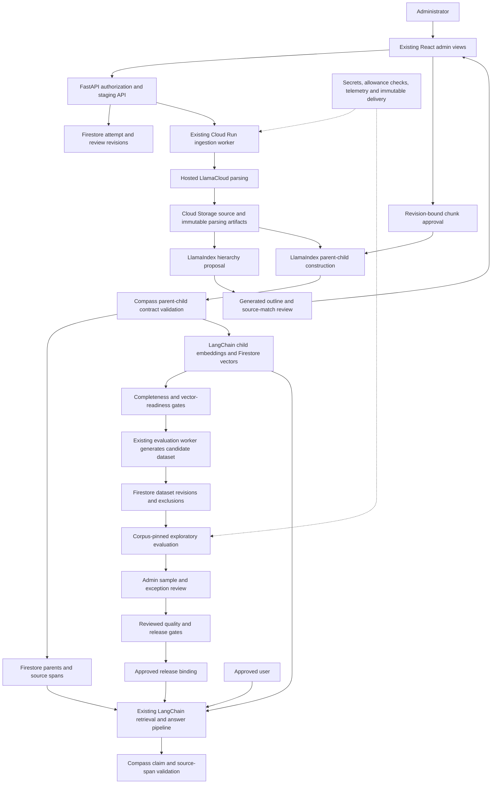

# Gate 2 - Architecture Design

**Status:** FINAL

**Version:** 2.9

**Date:** 2026-11-09

**Input reference:** DMBOK Compass BRD v0.3, 2026-11-03. Architecture v2.8 and origin/development at c6b9bbec16b3ef1fe209d6ed0dcc7193bdae7c90. Sponsor-approved architecture impact and follow-up decisions, 2026-11-09, covering hosted LlamaCloud parsing, LlamaIndex structural processing, generated evaluation datasets, optional row additions/removals, batch review and free-tier-first operation.

**Author:** Software Architect Agent

**Implementation readiness:** Design ready for orchestration. Hosted parsing, its account allowance, actual-DMBOK provenance, generated-dataset quality and the extended contracts require implementation and candidate-specific verification. The baseline contains guided paired-file staging, structure-map proposals, selected-item evaluation and individual/batch evidence review. This document specifies their evolution.

## 1. Executive Summary

DMBOK Compass combines the existing FastAPI/React application and Cloud Run jobs with hosted LlamaParse through LlamaCloud.
LlamaIndex constructs reviewed structural sections and bounded parent/child nodes inside the existing ingestion worker.
Compass owns durable identities, page-linked source spans, metadata validation, corpus lifecycle, citations and release decisions.
LangChain supplies the existing embedding, Firestore vector, retrieval and model integrations.
The administrator supplies the PDF, reviews the generated hierarchy and approves chunk creation through the staging view.
Each validated staged corpus automatically produces an approximately 200-row candidate evaluation dataset and an exploratory run.
Optional admin additions/removals create new dataset revisions, with durable exclusions and immutable run snapshots.
Release evidence requires batch review of the representative sample and exceptions, 40–50 approved gold items with at least 20 answerable and 20 unanswerable cases, passing metrics and a durable release decision.

## 2. Business Context & Drivers

DMBOK Compass supports English-language DMBOK lookup, comparison, synthesis, study and scenario guidance for at most ten approved users and three simultaneous users. The sponsor also acts as administrator, corpus owner, evaluator and release approver. Applicants, approved users, hosted parsing and model providers are additional actors.

The scope covers guided PDF staging, generated hierarchy review, parent/child ingestion, automatic evaluation-dataset creation, optional row addition/removal, full or selected-item runs, batch evidence review, quotas, aggregate administration, backup and recovery. Existing individual review and optional JSON-import interfaces support compatible callers. The normal staging and evaluation journeys use application-managed artifacts and datasets.

The 2026-11-09 sponsor decisions supersede the BRD v0.3 requirements for an administrator-supplied structure JSON and mandatory evaluation JSON preparation. Section 3 preserves their identifiers and records the amended behavior. BRD synchronization is a subsequent requirements-maintenance task. The 2026-11-04 strict unmatched-passage gate, safe operational interruption, stage/count progress and explicit chunk-creation approval govern staging. Source matching must be resolved before chunk creation.

The revised MIG-01 assigns hosted parsing and structural processing to LlamaCloud/LlamaIndex and embedding, vector access and generation integrations to LangChain. The current modular monolith, existing jobs, Firebase, Firestore, Cloud Storage, Vertex embeddings and OpenRouter answer gateway provide reuse. A parsing integration and an in-process structural-processing module supply the additional capabilities.

Primary drivers are trustworthy source references, reproducible evaluation, a single-admin workflow, ephemeral production interactions, at least 95% complete responses within 30 seconds and the €5 monthly GCP constraint plus separately controlled provider usage. Free-tier-first parsing and generation require allowance checks and explicit sponsor action when available allowance is insufficient or uncertain. The actual book's fit requires account-specific verification. The publisher-rights risk and provider processing/retention decisions are validation obligations.

## 3. Requirements Traceability

Existing BRD identifiers are preserved. The 2026-11-09 sponsor amendments below take precedence for staging and evaluation input behavior. `LI-01`–`LI-07` identify the new decisions. Every original BRD objective, success measure, business process, functional requirement and NFR is traced, including superseded input methods. `MIG-01`–`MIG-04` identify the sponsor migration instruction and supplied engineering standards. `QW-01`–`QW-10` preserve prior quick-win traceability. `R04`, `R05`, `R06`, `R14`, `R15`, `R16`, `R17`, `R18` and `R21` identify the nine selected review findings; they add implementation traceability without changing BRD acceptance thresholds. Component classifications refer to the existing codebase; release, evaluation, ingestion and telemetry work extends reused components.

| Req ID | Requirement | Design decision | Component(s) | Reused/New |
|--------|-------------|-----------------|--------------|------------|
| OBJ-01 | Reduce corpus lookup effort | Preserve authenticated English lookup and complete cited responses. | Web Application; Backend API; LangChain RAG Pipeline | Reused |
| OBJ-02 | Evidence-backed comparison and synthesis | Compose retrieved passages and preserve explicit synthesis labels. | LangChain RAG Pipeline; LangChain Chat Model Integration | Reused |
| OBJ-03 | Grounding and verifiable citations | Evidence policy plus provenance-derived citations and claim review. | Backend API; Corpus Ingestion and Evaluation Worker | Reused |
| OBJ-04 | Evidence-gated release | New corpus/chain requires reviewed, version-bound passing evidence. | Backend API; Corpus Ingestion and Evaluation Worker | Reused |
| OBJ-05 | Secure, recoverable, affordable service | Keep ten-user ceiling, budgets, access controls, backups, and 24-hour recovery. | Backend API; Google Cloud Operations and Delivery Platform | Reused |
| OBJ-06 | Guided administrator corpus preparation | Generate the hierarchy from the uploaded PDF, review page matches and approve chunk creation with server-managed artifacts. | Web Application; Backend API; Corpus Ingestion and Evaluation Worker; LlamaIndex Structural Processor | Reused + New |
| SM-09 | Administrator staging acceptance | Verify PDF-only submission, generated outline review, corrective exceptions, explicit approval and staged counts. | Web Application; Backend API; Corpus Ingestion and Evaluation Worker | Reused |
| BPR-001 | Registration and approval | Firebase handles registration and verification; backend approval state gates answering. | Firebase Authentication; Backend API; Web Application | Reused |
| BPR-002 | Grounded question answering | Native LangChain score-preserving retrieval/generation permits answer, qualified answer, or refusal and validates citations. | Backend API; LangChain RAG Pipeline; Firestore Data and Vector Store; LangChain Chat Model Integration | Reused |
| BPR-003 | Guided corpus staging and maintenance | Parse the uploaded PDF through LlamaCloud, review the generated structure and stage approved parent/child records. | Corpus Ingestion and Evaluation Worker; Hosted LlamaCloud Parsing; LlamaIndex Structural Processor | Reused + New |
| BPR-004 | Pre-release evaluation | Versioned evaluation runs report every release metric and block promotion on failure. | Corpus Ingestion and Evaluation Worker; Backend API; Firestore Data and Vector Store | Reused |
| BPR-005 | Release decision | Sponsor approval is persisted against immutable configuration and evaluation identifiers. | Backend API; Firestore Data and Vector Store; Web Application | Reused |
| BPR-006 | Backup and recovery | Daily Firestore backups retain no more than 30 copies; corpus index is reproducible from source. | Firestore Data and Vector Store; Cloud Storage Corpus Repository; Google Cloud Operations and Delivery Platform | Reused |
| BPR-007 | Evaluation dataset lifecycle | Generate a corpus-bound dataset automatically and support optional additions/removals and compatible imports through versioned transactions. | Web Application; Backend API; Corpus Ingestion and Evaluation Worker; Firestore Data and Vector Store | Reused |
| SM-01 | Top-five retrieval success ≥90% | At least one approved relevant child-chunk ID appears in the first five dense-retrieval results; preserve corpus filter and cosine score semantics. | LangChain RAG Pipeline; Corpus Ingestion and Evaluation Worker | Reused |
| SM-02 | Grounded factual claims ≥95% | Atomic claims are supported by retrieved parent context and underlying source spans; citation presence alone is insufficient. | Corpus Ingestion and Evaluation Worker; Backend API | Reused |
| SM-03 | Citation correctness ≥95% | Chapter, section, page, and verbatim bounded excerpt provenance are correct and the source span supports the claim. | Backend API; Corpus Ingestion and Evaluation Worker | Reused |
| SM-04 | Answer quality ≥85% | Approved correctness/usefulness rubric evaluates the migrated chain against the legacy baseline. | Corpus Ingestion and Evaluation Worker | Reused |
| SM-05 | Correct refusal ≥95% | Gold unanswerable cases exercise absent-evidence refusal without generation. | LangChain RAG Pipeline; Corpus Ingestion and Evaluation Worker | Reused |
| SM-06 | At least 95% within 30 seconds | Measure complete browser responses, citations, and retrieval status under three-user normal load; report 15-second completion as a diagnostic. | Backend API; Google Cloud Operations and Delivery Platform | Reused |
| SM-07 | Approved-user ceiling | Transactional approval enforces 10 active users. | Backend API; Firestore Data and Vector Store | Reused |
| SM-08 | GCP and provider cost | Track €5 monthly GCP infrastructure and separately capped OpenRouter usage, including configured fallback. | Google Cloud Operations and Delivery Platform; LangChain Chat Model Integration | Reused |
| FR-001 | Submit registration request | Firebase sign-up plus a pending Firestore profile records email and username after validation. | Web Application; Firebase Authentication; Backend API; Firestore Data and Vector Store | Reused |
| FR-002 | Verify submitted email | Firebase email verification is mandatory before approval. | Firebase Authentication; Backend API | Reused |
| FR-003 | Approve, reject, or deactivate users | Administrator endpoints and UI update authorization state immediately. | Web Application; Backend API; Firestore Data and Vector Store | Reused |
| FR-004 | Maximum 10 approved users | Approval uses a Firestore transaction that rejects an eleventh active user. | Backend API; Firestore Data and Vector Store | Reused |
| FR-005 | Sign-in, sign-out, and password reset | Firebase Authentication provides credential and recovery flows; backend checks approval on every request. | Firebase Authentication; Web Application; Backend API | Reused |
| FR-006 | Submit an English DMBOK question | Responsive chat UI sends an authenticated request and presents processing, result, or operational error. | Web Application; Backend API | Reused |
| FR-007 | Corpus-only answers | LangChain prompt restricts generation to retrieved evidence; application evidence/citation policy and claim-level evaluation validate grounding. | Backend API; LangChain RAG Pipeline; LangChain Chat Model Integration; Firestore Data and Vector Store | Reused |
| FR-008 | Required question categories | Versioned evaluation dataset covers definitions, explanations, comparisons, study, and scenarios. | Corpus Ingestion and Evaluation Worker; Firestore Data and Vector Store | Reused |
| FR-009 | Label supported synthesis | Response schema marks synthesis and maps material claims to retrieved citations. | Backend API; LangChain Chat Model Integration; Web Application | Reused |
| FR-010 | Page, section, and excerpt citations | Immutable child/source-span provenance is rendered by the application, not invented by the model; displayed excerpts are verbatim and at most 500 characters. | Firestore Data and Vector Store; Backend API; Web Application | Reused |
| FR-011 | Strong, partial, and absent evidence outcomes | Retrieval thresholds and response policy select normal, qualified, or refusal behavior. | Backend API; LangChain Chat Model Integration | Reused |
| FR-012 | Request-scoped retrieval trace | API returns retrieved passages and preserved scores, model/attempts, raw-output and timing fields in the live response only. | Backend API; Web Application | Reused |
| FR-013 | No retained interaction content | Questions, retrieved passages, answers, and traces stay in request memory and are excluded from storage and logs. | Backend API; Google Cloud Operations and Delivery Platform | Reused |
| FR-014 | Automatic fallback model | Native LangChain chat models route eligible failures according to effective configuration; approved production uses OpenRouter primary/fallback models. | LangChain RAG Pipeline; LangChain Chat Model Integration; External Hosted Answer Models | Reused |
| FR-015 | Configurable per-user daily limit, default 100 | Firestore transactions enforce per-user counters and administrator-editable configuration. | Backend API; Firestore Data and Vector Store; Web Application | Reused |
| FR-016 | Configurable global daily limit | A transactional global counter defaults to 100 requests per UTC day and is editable without deployment. | Backend API; Firestore Data and Vector Store; Web Application | Reused |
| FR-017 | Explain quota block and reset | API returns the applicable limit and UTC reset time without exposing other users. | Backend API; Web Application | Reused |
| FR-018 | Anonymous aggregate administration | Content-free counters, provider failures, and cost indicators feed the admin view. | Backend API; Web Application; Firestore Data and Vector Store; Google Cloud Operations and Delivery Platform | Reused |
| FR-019 | Run full or selected evaluation | Automatically run the generated dataset exploratorily. Later full/subset runs pin the server-selected dataset revision and corpus. | Web Application; Backend API; Corpus Ingestion and Evaluation Worker | Reused |
| FR-020 | Calculate all release metrics | Evaluation worker reports definitions, applicable counts, numerator/denominator for percentage metrics, thresholds, and pass/fail for each gate; operational errors are excluded from successful refusals and fast completions. | Corpus Ingestion and Evaluation Worker; Firestore Data and Vector Store | Reused |
| FR-021 | Evaluation dataset | Persist generated and admin-authored rows, provenance, generator configuration, exclusion decisions and reviewed run-bound evidence. | Corpus Ingestion and Evaluation Worker; Firestore Data and Vector Store | Reused |
| FR-022 | Persist reproducible evaluation evidence | Current-dataset questions, annotations, run inputs/results, and decisions are durable and version-bound; superseded runs are excluded from available release evidence. | Firestore Data and Vector Store; Corpus Ingestion and Evaluation Worker; Google Cloud Operations and Delivery Platform | Reused |
| FR-023 | Evaluation input, amended by sponsor | Automatically generate the initial dataset. Support optional direct row entry and the existing bounded import interface. | Web Application; Backend API; Corpus Ingestion and Evaluation Worker | Reused |
| FR-024 | Required evaluation fields | Require question, category, expected outcome and answer/rubric. Answerable rows require source support. Refusal rows carry a corpus-scope rationale and zero relevant child IDs. | Backend API; Corpus Ingestion and Evaluation Worker; Firestore Data and Vector Store | Reused |
| FR-025 | Allowed categories | Validate against definitions, explanations, comparisons, study, and scenarios; report unknown values. | Backend API; Web Application | Reused |
| FR-026 | Per-row validation | Apply the shared schema to generated rows, optional additions and imports. Report invalid candidates and publish only valid, durable rows. | Backend API; Corpus Ingestion and Evaluation Worker; Firestore Data and Vector Store | Reused |
| FR-027 | Reject empty valid dataset | Failed or zero-valid generation/import leaves the current dataset available and reports a safe failure. | Backend API; Corpus Ingestion and Evaluation Worker; Firestore Data and Vector Store | Reused |
| FR-028 | Preparation report | Display requested, generated, accepted, excluded and invalid counts, coverage gaps and safe per-row correction reasons. | Backend API; Web Application; Corpus Ingestion and Evaluation Worker | Reused |
| FR-029 | Version dataset changes | Atomically publish a corpus-scoped dataset revision. Runs pin their original revisions and eligibility queries exclude superseded evidence. | Backend API; Firestore Data and Vector Store; Web Application | Reused |
| FR-030 | Automatic dataset selection | Server resolves the dataset paired with the staging attempt or current serving release and supplies all technical bindings. | Backend API; Corpus Ingestion and Evaluation Worker | Reused |
| EVAL-SIMPLE-01 | Automatic preparation and exploration | Validated staged corpus triggers dataset generation, persistence and one exploratory full run within verified allowances. | Corpus Ingestion and Evaluation Worker; Backend API; Web Application | Reused |
| EVAL-SIMPLE-02 | Automatic technical context | Resolve the attempt-bound candidate for staging evaluation and the release-bound corpus for serving evaluation. Accept optional row selection. | Backend API; Corpus Ingestion and Evaluation Worker | Reused |
| EVAL-SIMPLE-03 | Aggregate-first results | Show submitted/valid/invalid counts, run status, scope, and aggregate metrics. Technical-identity controls are not exposed. | Web Application; Backend API; Corpus Ingestion and Evaluation Worker | Reused |
| FR-031 | Immediate exploratory run | Valid generated or optionally imported rows can run before gold approval. Budget or capacity shortage yields a resumable status. | Backend API; Corpus Ingestion and Evaluation Worker | Reused |
| FR-032 | Human gold review | Default to admin batch review of a representative sample and every exception. Support individual decisions and explicit corpus-scope refusal confirmation. | Web Application; Backend API; Firestore Data and Vector Store | Reused |
| FR-033 | Gold-count release gate | Only the current generation with 40–50 approved, run-bound support items, including at least 20 answerable and 20 unanswerable or out-of-domain cases, and passing release metrics may support a release decision. | Backend API; Corpus Ingestion and Evaluation Worker; Firestore Data and Vector Store | Reused |
| FR-034 | Human-validated hierarchical ingestion | Generate the outline from parsed content and require reviewed, complete source matches before chunk creation. | Corpus Ingestion and Evaluation Worker; LlamaIndex Structural Processor; Cloud Storage Corpus Repository | Reused + New |
| FR-035 | Dense child retrieval with bounded parent expansion | Embed only 200–300-token children; search the top five within the pinned corpus, fetch distinct 600–1,000-token parents, rank and bound selected context to the provisional 6,000-token budget with comparison-subject coverage. | LangChain RAG Pipeline; Firestore Data and Vector Store; Backend API | Reused |
| FR-036 | Preserve lists and tables | Segment only at complete item/row boundaries with repeated table headers; preserve short sections; flag any indivisible item exceeding the provisional 1,500-token parent maximum for corpus-owner review and block promotion until resolved. | Corpus Ingestion and Evaluation Worker; Cloud Storage Corpus Repository | Reused |
| FR-037 | New version, fresh evidence and rollback | New derivation and child IDs replace old IDs in candidate evidence; discard old gold bindings for the new run, review new bindings, evaluate before activation, and retain the former corpus solely for rollback until post-promotion verification. | Corpus Ingestion and Evaluation Worker; Firestore Data and Vector Store; Backend API; Google Cloud Operations and Delivery Platform | Reused |
| EVAL-REVIEW-01 | Candidate binding | Propose support from source spans and independently validate against the same candidate corpus used by evaluation. | Backend API; Corpus Ingestion and Evaluation Worker | Reused |
| EVAL-REVIEW-02 | Exception-based review | Ambiguous, missing, changed, invalid, or low-confidence proposals enter an exception queue. Exact matching, provenance and hash checks occur server-side. | Backend API; Web Application; Firestore Data and Vector Store | Reused |
| EVAL-REVIEW-03 | Batch attestation | One decision binds the reviewed sample, eligible mappings, semantic assessments and explicit refusal confirmations to an immutable run. Exceptions need resolution or exclusion. | Web Application; Backend API; Firestore Data and Vector Store | Reused |
| EVAL-REVIEW-04 | Auditable semantic assessment | The evaluator records reviewed run-bound claim/citation/rubric/refusal outcomes separately from retrieval; unassessed items do not contribute to semantic release metrics. | Corpus Ingestion and Evaluation Worker; Backend API; Firestore Data and Vector Store | Reused |
| FR-038 | Structure assistance, amended by sponsor | Present a generated editable outline and page matches in the staging view. Retain the existing template endpoint as an optional compatibility interface. | Web Application; Backend API; LlamaIndex Structural Processor | Reused + New |
| FR-039 | Submit source, amended by sponsor | Accept the PDF alone and generate parsing/map artifacts internally. Pin every artifact generation and digest server-side. | Web Application; Backend API; Cloud Storage Corpus Repository; Hosted LlamaCloud Parsing | Reused + New |
| FR-040 | Validate before chunking | Validate PDF bytes, parsing completeness, generated-map schema, page coverage and heading/source matches. Unresolved matches block chunk creation. | Backend API; Corpus Ingestion and Evaluation Worker; LlamaIndex Structural Processor | Reused + New |
| FR-041 | Review generated hierarchy | Review and correct the generated tree in the staging view. Each correction creates a new review revision bound to source and parsing digests. | Web Application; Backend API; Firestore Data and Vector Store | Reused |
| FR-042 | Approve and create chunks | Authenticated admin approval compares the reviewed attempt revision, pins an approval artifact and starts the existing ingestion job once; it cannot activate the corpus. | Web Application; Backend API; Corpus Ingestion and Evaluation Worker; Google Cloud Operations and Delivery Platform | Reused |
| FR-043 | Progress and outcome | Persist parsing, allowance, review, chunking and dataset/run stages with counts, corrective status and safe resume behavior. | Web Application; Backend API; Corpus Ingestion and Evaluation Worker; Firestore Data and Vector Store | Reused |
| NFR-001 | 95% within 30 seconds | Stage budgets, bounded model timeouts, scale settings, and performance gates enforce the end-to-end browser target; 15-second completion remains a diagnostic. | Backend API; LangChain Chat Model Integration; Google Cloud Operations and Delivery Platform | Reused |
| NFR-002 | Three simultaneous users | Cloud Run starts at concurrency 8, maximum two instances, and is load-tested with three users. | Google Cloud Operations and Delivery Platform; Backend API | Reused |
| NFR-003 | GCP and provider budgets | Enforce the €5 GCP limit and independent parsing, dataset-generation and judging allowance checks. Pause for sponsor action on insufficient or unverifiable allowance. | Google Cloud Operations and Delivery Platform; Hosted LlamaCloud Parsing; Corpus Ingestion and Evaluation Worker | Reused + New |
| NFR-004 | HTTPS for protected traffic | Firebase Hosting, Cloud Run, Firebase Auth, and provider APIs use HTTPS only. | Google Cloud Operations and Delivery Platform; Firebase Authentication; External Hosted Answer Models | Reused |
| NFR-005 | Safe password storage | Firebase Authentication owns salted password hashing; passwords never enter application storage or logs. | Firebase Authentication | Reused |
| NFR-006 | Login throttling and secure reset | Firebase Authentication supplies throttling and expiring recovery flows; tests verify behavior. | Firebase Authentication | Reused |
| NFR-007 | Current desktop and mobile browsers | Responsive React UI receives automated viewport and browser-flow testing. | Web Application | Reused |
| NFR-008 | Basic WCAG 2.1 AA | Semantic UI, keyboard operation, focus management, contrast, and automated/manual checks are release gates. | Web Application | Reused |
| NFR-009 | Daily backups, maximum 30 copies | Firestore managed backup schedule and retention are infrastructure-as-code controls. | Firestore Data and Vector Store; Google Cloud Operations and Delivery Platform | Reused |
| NFR-010 | Restore within 24 hours | Restore application data and rebuild the index using retained source, parse artifact and reviewed map. | Firestore Data and Vector Store; Cloud Storage Corpus Repository; Corpus Ingestion and Evaluation Worker | Reused |
| NFR-011 | Ephemeral interactions excluded from persistence | Allowlisted telemetry and storage tests prove production request content is absent. | Backend API; Google Cloud Operations and Delivery Platform | Reused |
| NFR-012 | Reproducible evaluation | Bind parsing output digest, map, tokenizer, dataset revision, generator, judge, corpus, retrieval and answer configuration in evidence. | Corpus Ingestion and Evaluation Worker; Firestore Data and Vector Store | Reused |
| NFR-013 | Best-effort availability and clear failures | Bounded retries, fallback, circuit breaking, and honest operational errors avoid ungrounded output. | Backend API; LangChain Chat Model Integration; Web Application | Reused |
| NFR-014 | User isolation and admin authorization | Role checks are enforced server-side and covered by negative authorization tests. | Backend API; Firebase Authentication; Firestore Data and Vector Store | Reused |
| NFR-015 | Failure isolation for datasets | Prepare each revision completely before compare-and-set publication. Generation, edit or import failure preserves the previously committed revision. | Backend API; Corpus Ingestion and Evaluation Worker; Firestore Data and Vector Store | Reused |
| NFR-016 | Evaluation state survives restart | Store active dataset, annotations, and runs in Firestore rather than process memory. | Backend API; Corpus Ingestion and Evaluation Worker; Firestore Data and Vector Store | Reused |
| NFR-017 | Exploratory versus release evidence | Persist and display explicit report eligibility; only active-dataset gold-eligible reports can support release. | Backend API; Web Application; Firestore Data and Vector Store | Reused |
| NFR-018 | Failure isolation and retry | Validation and job failure retain the serving corpus, keep incomplete versions non-serving, and return a corrective status tied to the staging attempt. | Backend API; Corpus Ingestion and Evaluation Worker; Firestore Data and Vector Store | Reused |
| INT-01 | Primary and fallback hosted answer models | Native LangChain OpenRouter chat integration calls two configured models through OpenRouter; model IDs remain release-gated. | LangChain RAG Pipeline; LangChain Chat Model Integration; External Hosted Answer Models | Reused |
| INT-02 | Embedding service | LangChain Vertex-configured embeddings call `gemini-embedding-001` to produce 768-dimensional document and query embeddings. | Vertex AI Embedding Service; LangChain RAG Pipeline | Reused |
| INT-03 | Email verification and recovery delivery | Firebase Authentication provides managed verification and reset email workflows. | Firebase Authentication | Reused |
| CON-01 | GCP-first hosting with approved external providers | Host application workloads and data on GCP/Firebase. Use hosted LlamaCloud parsing and configured model gateways as external integrations. | Google Cloud Operations and Delivery Platform; Hosted LlamaCloud Parsing; External Hosted Answer Models | Reused + New |
| CON-02 | Python backend and TypeScript frontend | FastAPI/Pydantic and React/Vite/TypeScript are the implementation standards. | Backend API; Web Application | Reused |
| CON-03 | Firestore application and vector data | Firestore Native mode consolidates application records and native vector search. | Firestore Data and Vector Store | Reused |
| CON-04 | One searchable DMBOK PDF | Ingestion accepts one versioned source corpus and rejects unapproved source types. | Cloud Storage Corpus Repository; Corpus Ingestion and Evaluation Worker | Reused |
| CON-05 | Maximum 10 approved users | Transactional approval ceiling and tests prevent excess activation. | Backend API; Firestore Data and Vector Store | Reused |
| CON-06 | No saved production conversations | No chat-history entity or analytics payload is designed. | Backend API; Firestore Data and Vector Store; Google Cloud Operations and Delivery Platform | Reused |
| CON-07 | No fixed deadline; readiness-gated release | Delivery follows evidence and approval gates rather than calendar release. | Google Cloud Operations and Delivery Platform; evaluation workflow | Reused |
| MIG-01 | Revised RAG ownership | LlamaCloud parses, LlamaIndex constructs structural nodes, Compass validates domain records, and LangChain supplies embeddings, vector access, retrieval and model composition. | Hosted LlamaCloud Parsing; LlamaIndex Structural Processor; LangChain RAG Pipeline; LangChain Chat Model Integration | Reused + New |
| MIG-02 | Preserve user-facing RAG functionality | Preserve provider configuration, provenance, evidence thresholds, fallback, quotas, admin/evaluation workflows and ephemeral traces; explicitly version the operational-error HTTP correction. | Web Application; Backend API; LangChain RAG Pipeline | Reused |
| MIG-03 | Analyze before updating architecture | Impact assessment completed and approved; this version incorporates its decisions, assumptions, and implementation gates. | Architecture and delivery process | Reused |
| MIG-04 | Twelve-Factor engineering | Locked declared dependencies, external configuration/backing services, reproducible build/release/run, stateless processes, own HTTP port, external scaling, graceful termination, environment parity, structured stdout, and same-image admin jobs. | Google Cloud Operations and Delivery Platform; Backend API; Corpus Ingestion and Evaluation Worker | Reused |
| QW-01 | Block non-promotable evidence | The evidence verifier fails closed; promotion requires a durable approved decision for an exact candidate manifest. | Backend API; Firestore Data and Vector Store; Google Cloud Operations and Delivery Platform | Reused |
| QW-02 | Prove installed dependency lock | Package the canonical installed lock in the final image, hash it in the candidate snapshot, and smoke the snapshot inside that image. | LangChain RAG Pipeline; Google Cloud Operations and Delivery Platform | Reused |
| QW-03 | Deliver structured telemetry | Configure the application telemetry logger under shipped runtime settings; emit safe JSON to stdout and prove alert filters match emitted fields. | Backend API; Google Cloud Operations and Delivery Platform | Reused |
| QW-04 | Classify operational errors | Use a typed operational-failure outcome and non-2xx HTTP status; exclude those requests from successful-answer performance measures. | Backend API; Web Application; Google Cloud Operations and Delivery Platform | Reused |
| QW-05 | Enforce serving chunk limits | Validate staged children and parents against their contracts; split oversized sections only at allowed semantic boundaries and block an indivisible oversized row/item pending reviewed resolution. | Corpus Ingestion and Evaluation Worker; LangChain RAG Pipeline; Backend API | Reused |
| QW-06 | Measure retrieval independently | Score ranked retrieved chunk IDs against approved gold support, without requiring an answer digest or generation. | Corpus Ingestion and Evaluation Worker; Firestore Data and Vector Store | Reused |
| QW-07 | Separate outage from refusal | Operational/model/retrieval errors fail the operational gate and cannot receive refusal-correctness credit. | Backend API; Corpus Ingestion and Evaluation Worker | Reused |
| QW-08 | Prove vector readiness | Probe the staged collection with a candidate-filtered vector query; retain completeness and search-readiness as separate evidence. | Corpus Ingestion and Evaluation Worker; Firestore Data and Vector Store | Reused |
| QW-09 | Bound answer output tokens | Both model routes use an explicit versioned maximum output token setting and record actual usage. | LangChain Chat Model Integration; External Hosted Answer Models; Google Cloud Operations and Delivery Platform | Reused |
| QW-10 | Preserve source generations for recovery | Exempt active and rollback source generations from age-only deletion; collect only generations unreferenced by retained releases. | Cloud Storage Corpus Repository; Firestore Data and Vector Store; Google Cloud Operations and Delivery Platform | Reused |
| R04 | Evaluation packaging | Hash the installed `requirements.lock` from the final API/job image and prove candidate snapshot creation in that image. | LangChain RAG Pipeline; Google Cloud Operations and Delivery Platform | Reused |
| R05 | Generated evaluation and binding | Generate corpus-linked candidates, preserve optional authored rows, validate fresh child/span bindings and require reviewed assessments. | Backend API; Corpus Ingestion and Evaluation Worker; Web Application | Reused |
| R06 | Independent evaluation metrics | Compute ranked-ID retrieval before answer review; evaluate the exact candidate output separately and exclude operational errors from refusal credit. | Corpus Ingestion and Evaluation Worker; Backend API | Reused |
| R14 | Measured retrieval quality | Establish a reviewed answerable/unanswerable baseline, rank metrics and slices; calibrate evidence thresholds on a held-out set. | LangChain RAG Pipeline; Corpus Ingestion and Evaluation Worker | Reused |
| R15 | Optional hybrid/reranked retrieval | Compare an immutable corpus-scoped lexical candidate index and fusion/reranking strategy against dense-only search; enable only on measured quality, latency and cost gains. | LangChain RAG Pipeline; Cloud Storage Corpus Repository; Corpus Ingestion and Evaluation Worker | Reused |
| R16 | Prompt-injection resistance | Separate stable policy from user question and untrusted retrieved text; test direct and source-borne attacks and enforce output checks. | LangChain RAG Pipeline; LangChain Chat Model Integration; Backend API | Reused |
| R17 | Claim-to-source citation support | Reject unknown source IDs, bind each factual claim to retrieved chunk and exact excerpt span, and assess semantic support independently. | Backend API; Web Application; Corpus Ingestion and Evaluation Worker | Reused |
| R18 | Evidence refusal versus service failure | Keep `refusal` for completed no-evidence requests; return typed operational errors with non-2xx status and separate evaluator/probe counts. | Backend API; Web Application; Corpus Ingestion and Evaluation Worker | Reused |
| R21 | Validated startup and readiness | Centralize required settings, pin secret references, fail startup on invalid configuration and expose bounded liveness/readiness checks. | Backend API; Corpus Ingestion and Evaluation Worker; Google Cloud Operations and Delivery Platform | Reused |
| DEPLOY-CORPUS-01 | Automatically select the deployed corpus | After target-project authentication, resolve `corpus_state/active` and validate its referenced `CorpusVersion` before Cloud Run or Terraform mutation. | Google Cloud Operations and Delivery Platform; Firestore Data and Vector Store | Reused |
| DEPLOY-CORPUS-02 | Keep deployment consumers aligned | Pass one resolver output to `RAG_CORPUS_VERSION_ID` for API/ingestion/evaluation and to Terraform `corpus_version_id`; remove manually maintained `vars.CORPUS_VERSION_ID`. | Google Cloud Operations and Delivery Platform | Reused |
| DEPLOY-CORPUS-03 | Fail closed on corpus drift | Reject missing, malformed, inactive, unbound or unready corpus records with bounded diagnostics and no downstream deployment mutation. | Google Cloud Operations and Delivery Platform; Firestore Data and Vector Store | Reused |
| LI-01 | Hosted parsing | Call LlamaCloud from the ingestion workload with a managed secret and persisted remote-job state. | Hosted LlamaCloud Parsing; Corpus Ingestion and Evaluation Worker | Reused + New |
| LI-02 | Structural node processing | Build semantic parents and children within approved sections and translate library nodes into Compass records. | LlamaIndex Structural Processor; Corpus Ingestion and Evaluation Worker | Reused + New |
| LI-03 | File-free preparation | Generate parsing results, structure maps, manifests and evaluation datasets internally from the PDF. | Backend API; Corpus Ingestion and Evaluation Worker; Cloud Storage Corpus Repository | Reused |
| LI-04 | Automatic representative dataset | Target approximately 200 valid questions across chapters, categories and answerable, partial and refusal outcomes. | Corpus Ingestion and Evaluation Worker; External Hosted Answer Models | Reused |
| LI-05 | Optional additions and removals | Version row edits, preserve manual additions and exclusion tombstones on regeneration, and pin each run snapshot. | Web Application; Backend API; Firestore Data and Vector Store | Reused |
| LI-06 | Free-tier-first controls | Estimate usage, verify available allowance before submission, reserve bounded work and pause when allowance is insufficient or uncertain. | Hosted LlamaCloud Parsing; Google Cloud Operations and Delivery Platform; Corpus Ingestion and Evaluation Worker | Reused + New |
| LI-07 | Reviewed evaluation independence | Freeze generator and judge configurations separately, use held-out cases and human-approved evidence, and report model overlap. | Corpus Ingestion and Evaluation Worker; Web Application | Reused |

## 4. Architecture Overview

The context includes approved users, the administrator, LlamaCloud, hosted models and existing GCP backing services. Firebase Hosting serves React, FastAPI handles authorized APIs, and Cloud Run jobs perform parsing preparation, ingestion, dataset generation and evaluation. The additional processing module executes inside the existing worker.

Production questions resolve the approved release manifest once per request. Staging evaluation resolves the candidate paired with the staging attempt. Dataset publication is scoped to that corpus, so preparation of a new candidate cannot redirect serving evaluation. The deployment-time active-corpus resolver supplies environment configuration to the API, jobs and Terraform. Release publication binds the complete approved tuple.



LlamaCloud processes the approved source PDF. Parsing results and generated evaluation material are corpus-maintenance data with controlled retention. Production question, passage, answer and trace content is request-scoped.

## 5. Component Design

### 5.1 Web Application

- **Purpose** Provide PDF-only staging, generated outline correction, progress, dataset rows, optional additions/removals, full/subset runs and batch sample/exception review.
- **Classification** Reused. Existing React admin panels and API clients already implement staging, individual checks and evidence review. Extend those screens.
- **Interfaces and owned data** Use typed domain responses with actor-visible attempt and revision tokens, keyboard/mobile support and safe status announcements. Technical identities are server-owned.
- **Technology** React/Vite/TypeScript on Firebase Hosting.

### 5.2 Backend API

- **Purpose** Authorize staging, dataset mutations, evidence review and run launch. Resolve candidate or serving bindings server-side and enforce transactional revisions.
- **Classification** Reused. Extend FastAPI routers, corpus staging services, generation stores and release repositories.
- **Interfaces and owned data** PDF upload creates one durable attempt. Outline approval and row mutations compare expected revisions. Run launch pins the complete dataset/corpus/configuration snapshot. Existing optional import endpoints use the shared row validator.
- **Technology** Python/FastAPI/Pydantic on Cloud Run. Convert library objects at internal boundaries.

### 5.3 Corpus Ingestion and Evaluation Worker

- **Purpose** Coordinate parsing, review preparation, approved chunk creation, completeness/probe validation, automatic dataset generation and exploratory evaluation.
- **Classification** Reused. Reuse job entrypoints, durable dispatch, source manifests, structure-map proposals, run stores and batch review.
- **Interfaces and owned data** Use explicit staging states validating, awaiting_budget, parsing, awaiting_review, queued, running, staged and failed, with a separately recorded failed/resumable stage. Persist each completed stage and remote-job reference. Dispatch generation once per validated corpus/generator policy. Publish complete datasets atomically. Persist stage-specific failures and resume from durable checkpoints. Operational interruption uses existing SIGTERM handling.
- **Technology** Same locked Python image and environment-specific configuration as the API. Separate job stages share backing stores and bounded batches.

### 5.4 LangChain Chat Model Integration

- **Purpose** Generate grounded answer candidates, dataset candidates and offline judge proposals through explicit versioned configurations.
- **Classification** Reused. The baseline model adapters already use native LangChain chat integrations and eligible fallback.
- **Interfaces and owned data** Pin generation and judge model, prompt, rubric, seed where supported, output cap and configuration independently. Each operation has a bounded deadline, usage reservation and safe error mapping. Primary/fallback share one attempt budget.
- **Technology** Existing OpenRouter and configured Vertex integrations. Verify route-specific schema, usage, timeout and fallback behavior. Preserve the verified OpenRouter millisecond timeout and explicit SDK retry_config=None configuration, since max_retries=0 alone retained SDK retries in the baseline probe. At most two answer-model attempts share the configured deadline and quota reservation.

### 5.5 LangChain RAG Pipeline

- **Purpose** Embed child records, write/query the corpus-scoped Firestore index and assemble ranked parent context for production and pinned evaluation.
- **Classification** Reused. Reuse app/rag.py, the native Firestore integration, embedding configuration and application evidence policies.
- **Interfaces and owned data** Keep finite cosine similarity as 1-distance and top-five child IDs. Resolve distinct parents in the pinned corpus, preserve comparison coverage and enforce the context budget. Validate claim/source-span identity and reconstruct precise citation pages.
- **Technology** Existing gemini-embedding-001 Vertex configuration with 768 dimensions and explicit document/query tasks. Retain compatibility tests for the maintained Firestore patch.

### 5.6 Firebase Authentication

- **Purpose** Own password identity, verification, reset, throttling and token issuance.
- **Classification** Reused. The existing managed service provides these capabilities.
- **Interfaces and owned data** Backend role and approval checks protect all staging, dataset and review operations. Application stores profiles and quotas separately.
- **Technology** Existing Firebase Authentication integration.

### 5.7 Firestore Data and Vector Store

- **Purpose** Persist attempts, parser-job references, parent/child records, allowance reservations, dataset revisions, exclusion tombstones, run snapshots, reviewed evidence and release decisions.
- **Classification** Reused. Use existing stores, transactions and vector index. Additional records extend the domain. Transactions serialize active revision and allowance reservations. Transactions serialize active revision and allowance reservations. Transactions serialize active revision and allowance reservations.
- **Interfaces and owned data** Explicit schema/corpus binding, compare-and-set publication, parent-link verification and generation-aware eligibility queries. Child vectors have a corpus filter. Parent records carry ordered page-linked spans.
- **Technology** Firestore Native mode and existing application/vector indexes. Managed daily backup retains at most 30 copies.

### 5.8 Cloud Storage Corpus Repository

- **Purpose** Own immutable source, parsing result, reviewed map, approval and generation artifacts needed for rebuild and audit.
- **Classification** Reused. Extend existing generation-bound staging artifacts and reference-aware retention.
- **Interfaces and owned data** Pin object generation and digest for every processing artifact. Protect source, parsing result and map referenced by active or rollback releases. Failed attempts use reference-aware cleanup.
- **Technology** Existing regional Cloud Storage and least-privilege service accounts.

### 5.9 Vertex AI Embedding Service

- **Purpose** Produce matching child-document and query embeddings.
- **Classification** Reused. Reuse the selected managed embedding model and LangChain integration.
- **Interfaces and owned data** Workload identity, project/region, 768 dimensions, RETRIEVAL_DOCUMENT and RETRIEVAL_QUERY. Changing model, dimensions or embedding text creates a new derived corpus.
- **Technology** Existing Vertex AI integration.

### 5.10 External Hosted Answer Models

- **Purpose** Serve production answers, corpus-driven dataset generation and offline judgment through separately frozen routes.
- **Classification** Reused. Reuse configured hosted model capacity and existing provider boundaries.
- **Interfaces and owned data** Review gateway/upstream privacy and capacity. Track separate generator, answer and judge quotas and record model overlap in evaluation evidence.
- **Technology** OpenRouter production gateway plus currently enabled explicit Vertex mode according to environment configuration.

### 5.11 Google Cloud Operations and Delivery Platform

- **Purpose** Deliver secrets, immutable builds, runtime configuration, jobs, budgets, content-free telemetry, backups and recovery.
- **Classification** Reused. Reuse GitHub Actions, Artifact Registry, Terraform, Secret Manager, Logging and Monitoring.
- **Interfaces and owned data** Provide LlamaCloud credentials only to parsing-capable jobs. Pin secret versions and full dependency lock. Resolve authenticated target-environment corpus configuration and verify identical image digest across development and production.
- **Technology** Existing GCP/Firebase deployment family. New IAM/configuration work is subject to review and budget validation.

### 5.12 Hosted LlamaCloud Parsing

- **Purpose** Extract ordered text/layout blocks, headings, lists, tables and source-page information from the submitted PDF.
- **Classification** New. The current local PyPDFLoader cannot supply the selected hosted layout-aware parsing workflow. This external integration supplies that capability.
- **Interfaces and owned data** HTTPS submission, remote-job reference, status and result retrieval. Persist safe job metadata and exact output digest. Available page/block fields, allowance reporting, idempotency and retention require account-specific validation.
- **Technology** Hosted LlamaParse through the sponsor LlamaCloud account. Lock the selected supported client and route configuration after the spike.

### 5.13 LlamaIndex Structural Processor

- **Purpose** Convert parsed blocks and a reviewed H1–H4 hierarchy into logical sections, bounded parents and child nodes.
- **Classification** New. Current page-bounded splitting and page-level map application need block/span-aware structural processing and library-node relationship mapping.
- **Interfaces and owned data** Translate node relationships into validated Compass parent_id/source-span records. Use deterministic IDs scoped to the derived corpus. Persist chapter, section/topic path, physical page, printed page label and transformation provenance.
- **Technology** Minimal locked LlamaIndex core and selected parsing/reader integration inside the existing worker. Use explicit tiktoken cl100k_base counting and block-aware splitting.

## 6. Reuse Inventory

| Existing asset | Used for | Why it fits |
|----------------|----------|-------------|
| BRD v0.3 and prior release gates | Product scope and quality baseline | Sponsor amendments are explicitly traced in section 3. |
| React staging/evaluation panels | Generated outline review, row management and evidence review | Existing status, individual-check and review controls provide the UI seams. |
| FastAPI staging and evaluation routers | PDF submission, revision checks, optional edits and run launch | Existing role checks and typed contracts provide the trust boundary. |
| Corpus staging store, approval service and job dispatcher | Attempts, durable progress and reviewed chunk creation | Extend the existing lifecycle with parsing stages and generated maps. |
| Structure-map proposal and source-span helpers | Hierarchy proposal, correction and provenance | Adapt page-level assumptions to ordered block/span coverage. |
| Source manifest and corpus lifecycle stores | Derived identity, completeness, readiness and rollback | Include parsing output and structural policy in the existing fingerprint. |
| Evaluation generation/run/support/assessment stores | Automatic datasets, immutable runs and batch attestation | Extend provenance, revision and exclusion fields within existing domain ownership. |
| Native LangChain embeddings, Firestore and chat integrations | Embedding, retrieval, answers, candidate generation and judging | Preserve score semantics, model policy and compatible backing services. |
| Firebase, Firestore, Cloud Storage and Vertex | Identity, domain/vector records, artifacts and inference | Existing low-operations platform supports the proposed flow. |
| GitHub Actions, Artifact Registry, Terraform and Secret Manager | Locked builds, credentials, immutable promotion and recovery | Verify additions through the existing delivery boundary. |

Hosted LlamaCloud Parsing and LlamaIndex Structural Processor are the two new components. Dataset generation extends the existing evaluation worker and model integration.

## 7. Data Architecture

### 7.1 Corpus schema, identity and lifecycle

`CorpusStagingAttempt` pins actor, source generation/digest, parser route/settings, remote-job reference, parsing-output artifact/digest, structure-map review revision, approval artifact, safe stage status/counts and candidate identity. `ParsingArtifact` stores ordered blocks with physical one-based PDF pages, available printed labels, block IDs, reading order and table/list structure. Map corrections create immutable review revisions and reuse the saved parsing result.

`StructureMap` records reviewed chapter/section/topic paths, block/span anchors, complete source coverage, reviewer and digest. LlamaIndex constructs semantic parents within approved sections. Parents target 600–1,000 tokens with a provisional 1,500-token maximum. Children target 200–300 tokens without overlap or crossing a parent boundary. Pin tiktoken package and cl100k_base encoding and verify actual provider input limits independently. Preserve short sections and complete list items/table rows with repeated headers. An indivisible oversized item is a blocking review exception.

Firestore parent records hold corpus identity, parent ID, path, text/hash, token count and ordered page-linked raw-source spans. The configured document_chunks_v2 vector collection contains children with top-level text, embedding and nested metadata including child/parent IDs, corpus version, chapter/path, source-span references, page range, ordinal and content hash. Embed structural breadcrumbs deliberately. A versioned GenerationContext carries selected parents, page-addressable spans and their backing child IDs separately from RetrievalResult ranked child hits. The generation citation allowlist includes only evidence actually supplied in that bounded context. A versioned GenerationContext carries selected parents, page-addressable spans and their backing child IDs separately from RetrievalResult ranked child hits. The generation citation allowlist includes only evidence actually supplied in that bounded context. A versioned GenerationContext carries selected parents, page-addressable spans and their backing child IDs separately from RetrievalResult ranked child hits. The generation citation allowlist includes only evidence actually supplied in that bounded context. Citable raw spans and embedding text have distinct fields. Record synthetic repeated headers and normalization mappings so a citation resolves to the original physical page. A multi-page parent carries a span-to-page map. Validate that map through serving round trips.

The derived fingerprint includes immutable source identity, exact parsing-output digest, available parser/service version, parsing options, client version, reviewed map digest, normalization/span schema, tokenizer, segmentation and embedding-text policy, model/dimensions/tasks and storage schema. Hosted output can vary for identical settings. Content-address each result and reuse a saved approved artifact for rebuild. New output or boundaries yield fresh parent/child IDs. Source/map approval compares the exact review revision and parsing digest.

Persist complete parent/child counts, hashes, links, source coverage and vectors before candidate readiness. Run the candidate-filtered vector probe independently. The approval dispatches chunk creation once. A validated candidate then triggers dataset generation once per corpus/generator-policy fingerprint. Release publication requires reviewed evaluation and the approved image/corpus/configuration tuple. Retain the prior release inputs for rollback and reference-aware cleanup.

### 7.2 Generated datasets, optional edits and evaluation evidence

`DatasetGeneration` records corpus, parsing/map digests, generator model/prompt/configuration, target/actual counts, coverage, stage/usage status and result digest. Initial target is approximately 200 valid rows across chapters, definitions, explanations, comparisons, study and scenarios. Include answerable, partial-evidence, corpus-scope unanswerable and out-of-domain cases. Model-generated questions, reference answers and judge proposals have candidate status until reviewed.

The versioned evaluation-row-v2 contract owns stable item identity, origin (generated/admin/imported), question, category, expected outcome and answer/rubric. Existing imported rows map into that domain contract at the compatibility boundary. Answerable/partial cases carry exact source-span support and proposed child/parent bindings. Refusal cases carry an explicit expected_refusal flag and scope rationale with zero relevant child IDs. Validate against the candidate corpus before admitting rows. Near-duplicate detection and chapter/category/outcome coverage checks prevent easy repeated questions from dominating the set. Report rejected rows, gaps and achievable size when allowance is exhausted.

Write valid rows under a provisional revision. Publish only after durable validation by comparing the expected corpus-scoped dataset head. A failed or empty generation preserves the previous committed dataset and sets a safe corrective status. The server automatically dispatches one full exploratory run for the published candidate revision within verified usage allowance. Existing datasets can seed manually authored cases after fresh corpus binding. The normal flow requires the uploaded PDF and admin review actions.

The administrator may add or remove generated and manually authored rows. Additions use the shared validator. Removal writes an actor/time exclusion tombstone and creates a new revision. Persist exclusions across regeneration using stable item lineage plus normalized-question identity. Apply exact and near-duplicate checks against exclusions. Ambiguous cross-corpus matches enter review. Preserve manual additions for revalidation against the new corpus. Removed content is excluded from subsequent run selection and coverage counts. Each mutation checks expected revision and is idempotent by operation key. Concurrent edits cause a safe conflict with refresh guidance.

Every run pins an immutable item snapshot, dataset revision, corpus/configuration and selected scope. A later edit creates new eligibility evidence requirements while the historical run retains its reproducible snapshot. Failure never partially changes a run. Preparing a staged-corpus dataset cannot switch the serving release's dataset. Publication selects its matching corpus/dataset/review tuple. Existing optional JSON import uses the same validation and revision transaction, with indexed errors and bounded inputs.

Generate questions/reference material with one frozen generator configuration and use a separately frozen judge configuration. Report shared model/provider use as a bias limitation. Reserve a prespecified reviewed held-out subset for final quality measurement and threshold calibration separation. Corpus-wide support checks and explicit reviewer refusal confirmation establish unanswerable ground truth. Retrieval failure alone cannot establish that a question is unanswerable.

Default review is one admin batch action after inspection of a server-selected representative sample and every exception. Exact unique support-span matches require valid parent/child links, content hashes and provenance. Ambiguous, missing, stale, low-confidence and contradictory rows need a decision or exclusion. Each selected refusal case requires recorded corpus-scope confirmation, which may be included explicitly in the batch decision. Individual review is available. The decision binds the precise run snapshot, sampled IDs, eligible items, refusal confirmations, exact-output semantic assessments, actor and time. Automation proposes support and scores. Human attestation establishes approved evidence.

Release requires 40–50 approved run-bound gold items including at least 20 answerable and 20 unanswerable/out-of-domain cases. Approximately 200 generated rows can support exploration without all rows becoming gold. Removing rows recalculates coverage and eligibility. Full/subset reports declare scope, denominators, unreviewed counts and exploratory/release-evidence status. Frozen approved cases measure hit@5 ≥90%, grounded claims/citations/refusal ≥95%, answer-quality mean ≥85/100 and at least 95% complete browser responses within 30 seconds under three-user load.

Retrieval scoring consumes ranked child IDs and approved relevant child sets independently of answer generation. Semantic scoring consumes the exact run output and frozen rubric. Operational failures fail operational/latency gates and receive zero successful-refusal credit. Changed corpus, dataset revision, answer digest, policy or judge configuration requires appropriate new candidate evidence. Unresolved gold review blocks release eligibility.

### 7.3 Retention and recovery

Daily Firestore backups retain at most 30 copies and application restore targets 24 hours. Active and retained rollback release references protect exact source, parsing-result, reviewed-map and approval generations plus dataset/review snapshots required for reconstruction. Rebuild the index from those saved inputs. Reference-aware cleanup verifies a recovery path before deletion. Account retention and post-promotion rollback windows are sponsor-controlled.

Generated/admin-authored evaluation material is admin-restricted durable maintenance data. Provisionally delete raw evaluated outputs at run finalization or after 30 days, whichever occurs first, retaining output digests and assessments. Content-free operational metadata has a provisional 30-day retention period. Production interactions are ephemeral and excluded from persistence, tracing, logs and backups. Secret values live in Secret Manager. Cloud parsing retention/deletion and location are account-specific checks under A-30.

## 8. Interfaces & Integrations

The browser authenticates with Firebase and calls protected FastAPI routes over HTTPS. Server-side admin checks cover PDF upload, hierarchy correction/approval, status, dataset additions/removals, selection and evidence review. Domain schemas define the browser boundary. Library nodes and raw provider responses are internal.

The staging API accepts a bounded PDF alone, calculates immutable source identity and returns an attempt ID. The worker checks allowance, submits/reconciles the parsing job, saves the exact result and proposes the hierarchy. Review reads expose paths, page/block matches and bounded excerpts. Corrections compare an expected review revision. Explicit approval binds source, parsing/map digests and review revision before one chunk-creation dispatch. Status reports durable stage/count progress, failures and resume guidance. Existing paired-upload/template callers can use a compatibility path with the same validation and approval gates.

The dataset API exposes server-selected corpus-scoped dataset rows, coverage and revision. Optional row addition/removal compares the expected revision and returns the resulting revision or conflict. Full/subset evaluation uses the resolved candidate paired with the staging attempt, or the current serving release. A browser can select visible row IDs. Corpus, model, provider, hashes, object locations and serving bindings are server-owned. Existing bounded import follows the shared lifecycle and per-row validation.

Run status and evidence reads return safe progress, scope, aggregate metrics, representative sample, every exception and bounded evidence. Batch/individual review verifies the actor, current revision, corpus links, content hashes, source provenance and exact output identity. Batch decisions enumerate refusal confirmations and reviewed semantic proposals. Release approval consumes only a current passing candidate snapshot with required coverage.

LlamaCloud submission/status/result interfaces execute in the ingestion workload over HTTPS with a managed secret. Persist remote-job references before progressing to later stages. If the selected API exposes an idempotency key, use the attempt operation key. Reconcile unknown submission outcomes against durable/provider state before resubmission. Unresolvable outcomes pause for admin action. Record actual output digests and available usage metadata. Validate the supported API/client and response fields during the spike. Poll with bounded backoff and a worker execution deadline, saving resumable state on interruption.

LangChain invokes Vertex embeddings using workload identity, matching retrieval tasks and 768 dimensions. Firestore search prefilters the corpus, returns five scored children and preserves similarity as 1-distance. Parent expansion fetches corpus-matched records, deduplicates/ranks them and bounds context to a provisional 6,000 tokenizer units, including provider prompt overhead checks. Missing parents, links or provenance cause a typed operational failure. A cited exact source span resolves chapter/section and physical page, with a verbatim displayed excerpt of at most 500 characters.

The shared chat integration applies explicit output limits, bounded timeouts and eligible fallback. Authentication, policy or malformed-output failures follow typed errors. Keep answer, generator and judge configurations separately versioned. User answers preserve answer, qualified, evidence-refusal and operational-error outcomes. Operational errors use safe non-2xx API responses and distinct evaluator/telemetry counts.

Runtime settings contain explicit parser route/options, parsing secret reference, allowance policy, generator/judge configuration and existing embedding/retrieval/answer settings. Validate startup syntax locally. Serving readiness checks the selected release and required serving dependencies with bounded cached checks. Parsing readiness and allowance checks run in the staging workflow. Secret Manager delivers the parsing key to authorized ingestion jobs and model credentials to the workloads that invoke them. Deployment authenticates the target project and resolves its validated active corpus once for all existing consumers.

## 9. Cross-Cutting Concerns

**Security and privacy (NFR-004–NFR-006, NFR-011, NFR-014).** HTTPS, Firebase credential ownership/throttling/reset, server-side approval/role/ownership checks, default-deny browser Firestore access, least-privilege API/worker/scheduler/build accounts, and external secret delivery remain mandatory. Quota and authorization run before billable RAG stages. Never persist production questions, prompts, passages, answers, model output or traces in databases, object storage, logs, analytics, backups or artifacts. Retain only allowlisted structured metadata on stdout: counts, outcome, duration, model/provider ID, usage/cost estimate, quota utilization, corpus/config versions and safe error class. Do not log exception representations or SDK/provider bodies containing content; verify adapter success/error paths under the shipped logging configuration.

Disable environment-driven LangSmith/LangChain tracing, debug/verbose content logging, persistent model caches, history/checkpoints and content-bearing callbacks. Reject caller-supplied callbacks/configuration that bypass the privacy boundary. A transitive LangSmith dependency does not authorize external tracing or another downstream recipient. Existing warning against confidential/personal input and sponsor review of hosted-provider terms remain unchanged. Evaluator-authored datasets/results have the distinct durable treatment in section 7.

Evaluation executes asynchronously through the existing Cloud Run job. Persist generated/admin-authored questions, rubrics, candidate support excerpts, run-bound evidence and assessments under the restricted evaluation-retention policy. Content-free logs report preparation counts, stage/run status, aggregate metrics, duration, usage and safe error classes. Corpus/evaluation excerpts are confined to authorized review responses and restricted records. Apply the existing telemetry allowlist to model/configuration identifiers. Each run transitions once to a terminal status. Idempotent generation/import operation keys select one exploratory dispatch per published dataset revision.

For R16, test direct instructions in the question and indirect instructions embedded in retrieved passages, including requests to ignore corpus policy, fabricate citations or reveal secrets. The trusted system policy and untrusted content boundaries are defense layers, while authorization stays in the API/retrieval data path. For R17, exact span membership and source lineage are deterministic checks; semantic entailment is measured with reviewed evaluator-authored cases. Reject or safely fail candidates with unknown IDs, missing claim links or altered excerpts. A valid citation ID alone never satisfies SM-02 or SM-03.

**Performance and concurrency (SM-06, NFR-001–NFR-002).** At least 95% of complete browser responses with citations and retrieval status must finish within 30 seconds under three-user normal load; 15-second completion remains a diagnostic. The numerator requires the expected functional outcome and no operational error; HTTP 2xx alone is insufficient. Report operational failures and evidence refusals in separate denominators. Initial external Cloud Run settings remain min instances zero, max two, concurrency eight, one vCPU and 512 MiB, subject to measurement and the cost ceiling. Use native async embedding/chat/store interfaces where verified; run unavoidable synchronous Firestore work in a bounded executor off the event loop, with underlying RPC timeouts. Cancelling a thread wait does not prove cancellation of its network work. Verify three-user isolation, no shared mutable corpus filters, cold starts and graceful shutdown.

Retain a provisional 14-second backend request deadline as a stricter latency diagnostic while the user-facing release gate is 30 seconds; measure and adjust the internal budget only with evidence. Initial stage ceilings are 0.5 seconds auth/quota, 2 seconds query embedding, 1.5 seconds child retrieval/parent expansion/prompt, 8 seconds generation shared by primary and eligible fallback, and 1 second validation/serialization, leaving one second backend contingency. Reserve approximately five seconds primary and up to three seconds fallback within the shared generation ceiling; actual attempts receive only remaining time. Unused stage time does not expand the whole-request ceiling. Provider/RPC timeouts, retry counts, job timeouts and resource limits stay externally configured. These are proposed budgets, not measured results: reconcile the current 16-second generation and 28-second request defaults in factories/Terraform/delivery before promotion, and prove the representative fallback mix meets the BRD. Measure the added parent reads, context size, comparison coverage and complete-response p95 at three users. An operational timeout does not count as a successful complete answer.

Trace retrieval/generation/total timing consistently. Existing policy `total_ms` begins after retrieval; migrated total timing must include the full backend path, with separate browser/network end-to-end measurement for the release gate. Preserve existing field names and document measurement semantics; no hidden LangChain tracing is needed.

**Retrieval and answer quality (SM-01–SM-05, FR-007–FR-012, FR-034–FR-037).** Fix embedding dimensions/tasks and cosine distance per corpus version; build and review the curated hierarchy first, then create bounded parent chunks and dense child chunks without crossing structural boundaries. Target 600–1,000 tokens per parent and 200–300 per child, with provisional 1,500-token parent and 6,000-token total-context limits measured by a pinned tokenizer. Keep tables and lists structurally intact; an indivisible oversized row/item blocks promotion until corpus-owner resolution. Preserve normalization, ordered page-linked source spans and section paths; create a new derived corpus for any boundary change, clear old child bindings from new release evidence and review new support. Reject unmatched hierarchy before chunk creation in the guided staging flow; legacy `Unclassified` proposals cannot be approved through it. Structural completeness, filtered child-vector readiness, parent-expansion correctness and measured gold retrieval quality are distinct gates. Tests cover passages crossing pages/child boundaries, repeated table headers, short sections and comparison questions whose subjects compete for the context budget.

For support proposals, match the complete normalized passage against the run-pinned parent source spans, including passages crossing children. Verify parent/child hashes, corpus identity, links and provenance before human attestation. Multiple matches, missing support and invalid metadata enter the exception queue. Refusal rows require an explicit corpus-scope confirmation recorded individually or in the batch decision. Release eligibility requires the full approved gold count and exact-output claim, citation, rubric and refusal assessment. Reports expose unresolved and excluded counts.

Evidence accepts only finite scores within the current supported range up to 1. Rank descending score, then ascending chunk ID for ties, cap at five, and discard scores below 0.45. Top score ≥0.75 is strong; ≥0.45 and <0.75 is partial; no eligible score is absent. Partial forces qualified output; absent produces the existing refusal without any generation call. Use exact `1-cosine_distance` semantics, without clamping/renormalization or invented rank scores. Test below/at/above thresholds, missing/non-finite/out-of-range scores, ties and mixed corpus versions.

Those existing 0.75/0.45 values are provisional, not a proven corpus calibration (R14). Freeze an evaluator-reviewed answerable/unanswerable dataset before tuning, separate tuning and held-out slices, and record threshold choice, false-refusal rate, unsupported-answer rate and hit@5 on held-out cases. The release gate retains SM-01 ≥90% for answerable gold items; recall@5, MRR, nDCG and category/section slices diagnose ranking. R15 compares a versioned dense baseline with lexical fusion and optional reranking on the same held-out cases. The provisional adoption target is at least five percentage points more hit@5 on a prespecified held-out terminology/numbered-section slice of at least 40 cases, no overall hit@5 loss, and no violation of SM-02, SM-05, SM-06, NFR-003 or privacy (A-20). If the slice is too small or the target fails, retain dense-only and record the result. Fusion scores are not cosine similarities: evidence thresholds must be calibrated to a strategy-specific score or applied only to a preserved dense score, never reused blindly.

Citations are reconstructed from retrieved authoritative page/section/excerpt records; schema parsing and citation membership alone do not prove every claim's support. Require reviewed relevant-child retrieval ≥90%, grounded factual claims ≥95%, citation correctness ≥95%, answer rubric quality ≥85%, and correct refusal ≥95% on applicable gold cases. Retrieval hit uses approved relevant child IDs before answer assessment; changed answer punctuation cannot change that score. Refusal correctness applies only to completed evidence-based refusals. Operational failures fail a separate gate and receive no refusal credit. Release requires 40–50 approved gold items, including at least 20 answerable and 20 unanswerable/out-of-domain cases, with current candidate bindings and explicit report eligibility. Changed outputs/support receive human adjudication. Existing cited-answer/nonempty-answer evaluator proxies cannot by themselves establish semantic BRD gates.

**Reliability and recovery (BPR-006, NFR-009–NFR-010, NFR-013, NFR-015–NFR-017).** Availability remains best effort. Bound retries with backoff/jitter for safe reads/embeddings and idempotent explicit-ID indexing; user POSTs and quota reservation are not blindly retried. Accepted requests consume quota even on downstream failure. Model fallback is restricted to the existing eligible normalized errors and shared deadline; gateway failure yields a safe operational response. Do not imply unsupported content was successfully answered. Preserve any circuit-breaker policy and avoid adding implicit library retries.

Dataset import retains staged durable writes, transactional generation switching and failure isolation. Corpus ingestion separately requires persisted completeness and a candidate-filtered vector probe; publication requires a durable approved release decision and compare-and-set switch of the serving release. Roll back the serving image/configuration, collection/schema/index and corpus binding together; a pointer to v2 data is not a valid rollback for a v1 reader. Retain previous valid resources and exact source generations until promotion and rollback checks pass. Daily backups retain at most 30 copies; restore accounts/configuration/usage/evaluation/release decisions within 24 hours and prove corpus rebuild from immutable source.

**Observability and cost (SM-08, NFR-003, NFR-011).** Dashboards retain safe counts, stage/end-to-end latency, normalized errors, fallback rate, quota use, provider usage/cost, active corpus/configuration, ingestion/evaluation/backup status and infrastructure indicators. Alerts cover repeated failures, quota/cost forecasts, latency regression, backup/ingestion failure and retrieval below 90%. Diagnose content-dependent issues using authored test questions and live request traces. Forecast re-embedding, temporary duplicate vectors/indexes, artifact storage and larger dependency cold-start/memory cost before promotion. GCP infrastructure stays ≤€5/month plus separately approved provider hard cap; free/paid routes both require quality/privacy/capacity evidence.

The shipped Uvicorn configuration must enable `dmbok_compass.telemetry` and emit structured, content-free JSON to stdout on success and operational failure. Include random request ID, stage durations, typed outcome/error code, release/corpus/prompt/policy/model IDs, attempts, actual token usage and estimated cost where available. Administrative release/ingestion actions use actor-linked audit records; production query content is never retained. Synthetic events must match Terraform log metric filters and deliver alerts in a preview environment before promotion. Both model routes enforce a versioned output-token cap; absence of usage metadata is reported as unknown, not zero cost.

For R21, container startup fails before receiving traffic if the required route credentials, secret references, collection, model, embedding, timing or output-limit configuration is missing or invalid. Liveness only checks that the process can respond; readiness checks the selected release/configuration and required dependency access within a bounded budget. Secret rotation creates a new pinned version and candidate/release configuration digest. A passing liveness response must never be used as evidence that RAG is ready or that a release is compatible.

**Accessibility and UI parity (NFR-007–NFR-008).** Preserve responsive desktop/mobile flows, keyboard operation, focus, labels, status announcements, contrast, quota/reset explanations and safe errors. Core user/admin flows receive accessibility regression checks. Version new dataset and staging responses and exercise compatible answer/quota/error mappings. Library objects stay behind domain contracts.

**Deployment and Twelve-Factor standards (MIG-04).** Keep one canonical repository and explicit environment/release branches or tags. Declare and lock the entire Python integration stack, transitive dependencies and any patched artifact/source/hash; install and package one canonical lock in the final image and CI. Package the installed `requirements.lock` that candidate snapshot creation hashes and verify its identity in the final API/job image. Do not depend on global packages. Existing frontend lock remains required. Separate immutable build, release configuration and runtime; promote the exact tested image digest and Firebase artifact after preview/zero-traffic validation and approved evidence. Externalize provider/model/output cap/endpoint, project/region, credentials, collection/schema, splitter/task/dimension settings, deadlines and batch/scaling limits; document validated defaults in `.env.example` and secret names without values. Backing services remain externally configured and replaceable behind native integration contracts.

For DEPLOY-CORPUS-01–03, the active corpus version is runtime-injected configuration resolved from the target environment's Firestore backing service after WIF authentication. The resolver performs two bounded point reads, validates readiness, emits the version as a workflow output, and fails closed before Cloud Run/Terraform mutation. Development verification must prove that API and both jobs receive the same resolved ID and that Terraform plans with it. The immutable image/digest promotion path and the approved release manifest remain unchanged.

The final image must contain the exact installed lock that `backend/app/rag.py:_dependency_lock_sha256` hashes; CI starts that image and creates a candidate snapshot before accepting its build. Delivery treats `promotable=false`, missing/stale evidence, a missing durable approval, or any manifest/artifact mismatch as a failing promotion check. The configured output-token limit and source-generation retention policy are release settings, not process-local defaults. Terraform source-object lifecycle rules must be compatible with references in active and rollback releases.

Requests stay stateless; durable state is service-owned. API binds its HTTP port, terminates gracefully and honors Cloud Run signals; jobs stop safely between idempotent batches and exit nonzero on failure. Development and production use structurally similar container/dependency/schema configurations. Maintenance/migration/evaluation use the application image and configuration family. Terraform remains infrastructure source of truth, with explicit target and legacy vector indexes during migration. CI validates contracts, relevant policy/integration/privacy/evaluation tests, dependency resolution/lock, container/dependency scans and Terraform. Architecture approval does not execute deployment or IAM changes.

**Staging safety and verification (SM-09, FR-038–FR-043, NFR-018).** Validate PDF signatures, upload bounds and parser response schema. Require complete page/block/source matching before chunk approval. Test malformed output, missing/duplicate coverage, multi-section pages, table/list structure, stale/double approval, remote submission uncertainty, interruption, resume and concurrent attempts. Confirm one staged version and one dataset/run trigger under retries. Exercise PDF-only staging, generated-outline corrections, refresh, row additions/removals, preserved exclusions and revision conflicts through keyboard/mobile flows. Stage/count progress reports measured duration.

**Hosted parsing and free-tier-first budgets (LI-01/LI-06, NFR-003).** Verify the source page count, selected parsing mode and account's current allowance before submission. Reserve projected parsing/generator/judge usage transactionally across concurrent jobs, include bounded retries, and record actual usage where supplied. A reservation is valid only while its allowance observation is current. Insufficient or unverifiable allowance yields awaiting_budget status and explicit sponsor action. Use provider-enforced limits where available. Persist artifacts and checkpoints to minimize repeated calls. Pricing, free quotas and account APIs are validation inputs rather than numeric assumptions. Parsing, generation and judging each consume their own provider allowance.

**Twelve-Factor and release verification.** Declare and lock the LlamaIndex/client/tokenizer stack into the same immutable application image. Inject backing-service URLs, settings and secret versions at runtime. Independent PR review and required GitHub checks precede merge. A trusted post-merge development build records the integration commit, installed lock and image digest. Deploy and verify that digest in development, then promote the same digest through the human-approved production gate. Exercise final-image imports, startup, graceful SIGTERM, selected-release health, corpus/dataset migration, held-out quality, privacy, cost and coupled rollback. Missing checks or protected-environment controls become implementation prerequisites.

## 10. Alternatives Considered & Trade-offs

| Option | Pros | Cons | Decision | Driver |
|--------|------|------|----------|--------|
| FastAPI modular monolith and Cloud Run jobs | Existing boundaries, scale to zero, one maintainable codebase | Shared release/failure boundary | Retain | Three concurrent users, €5 infrastructure ceiling, MIG-02 |
| Microservices, GKE or additional agent runtime | Independent scaling, more orchestration features | Added operations/cost without a requirement | Reject | No scale/team/workflow driver |
| Firestore native vectors through LangChain | Reuses existing backing service and domain transactions | Inspected integration has dependency/score gaps | Retain with compatibility gate | CON-03 and MIG-01 |
| Cloud SQL/pgvector or Vertex AI Vector Search | Mature alternatives for relational/specialized vector needs | New backing service, cost and migration; changes current constraint | Reject as default; separate approval needed if spike fails | Existing store and budget |
| React/Vite SPA on Firebase Hosting | Existing flows, low static hosting cost | No SSR | Retain; Next.js/SSR unnecessary | Authenticated tool has no SEO requirement |
| Reuse LangChain alone for parsing and structural splitting | Uses the existing ingestion dependencies | Current page-based processing lacks the selected hosted parsing and library-node workflow | Superseded by the 2026-11-09 LlamaCloud/LlamaIndex decision | Revised MIG-01 and LI-01/02 |
| Supported score-preserving compatible LangChain Firestore release | Meets full replacement without patch ownership | No verified suitable set established | Preferred; prove in spike | Dependency intersection and score semantics |
| Narrow maintained LangChain Firestore patch/upstream contribution | Preserves library search/storage and existing architecture | Requires compatibility/score tests, pinned distribution and maintenance | Conditional fallback under approved recommendation; assumption A-14 | Verified integration gaps |
| Fully stock older LangChain stack | Avoids owning a patch | Support/security/provider capabilities and compatible releases unverified | No downgrade selected; consider only with documented evidence/decision | Reproducible supported dependencies |
| Native ChatOpenRouter and LangChain Google chat integration | Replaces custom transports, supports shared chain/configuration | Route schema/usage/error behavior needs validation | Select according to existing effective provider mode | MIG-01/MIG-02 |
| Change production answer provider during migration | May offer provider diversity | Changes approved production routing and parity baseline | Reject implicit change; retain OpenRouter production and existing explicit modes elsewhere | Approved provider decision and configuration drift finding |
| Primary/fallback models on OpenRouter | One configured gateway, model-level resilience | Gateway-wide outage defeats fallback | Retain production decision | FR-014, INT-01, best-effort availability |
| Add Vertex as a new production fallback | Provider diversity | Changes approved production answer routing | Not selected; existing enabled Vertex mode remains a parity case | Separate route approval required |
| Firebase Authentication instead of custom identity | Managed hashing, verification/recovery/throttling | Platform dependency; no MFA in scope | Retain | Identity/security/cost requirements |
| Persist production questions or enable remote content tracing/history | Easier debugging and chain inspection | Violates FR-013/NFR-011 | Reject | Ephemeral interaction requirement |
| Persist evaluator-authored datasets and versioned evidence | Reproducible gold/release review | Must stay distinct from interactions | Retain | FR-021/FR-022 |
| New derived corpus and staged v2 collection/index | Avoids source-ID reuse and legacy overwrite; enables coupled rollback | Temporary storage/rebuild cost, annotation remapping | Select | Parser/splitter/schema impacts and lifecycle gaps |
| Reuse source-only corpus IDs / overwrite active vectors | Less migration bookkeeping | Same PDF may bypass rebuild, corrupt rollback and stale gold references | Reject | Verified manifest identity and early-exit behavior |
| Preserve page-bounded 700/70 whitespace-word settings via a native splitter | Matches current units and page boundary policy | Conflicts with the approved structural hierarchy and parent-child retrieval requirements | Reject for the v2.9 baseline; use curated structural segmentation and versioned child/parent bindings | BRD v0.2 FR-034–FR-037 |
| Carry old child IDs or their gold approvals into the new corpus | Avoids fresh review work | Boundaries and evidence meaning changed; false release quality | Reject; keep authored questions/rubrics, generate new child IDs and review new support; retain old corpus only for rollback | Sponsor decision 2026-11-02; FR-037 |
| Split an oversized table row/list item at a fixed token or character window | Always meets the parent cap automatically | Breaks FR-036 structural integrity and can detach a citation from its label/header | Reject; block promotion and obtain a reviewed bounded representation for the exceptional item | Sponsor decision 2026-11-02; FR-036 |
| Atomic active-dataset generation with superseded history | Failure isolation and audit without old release evidence | Generation-aware queries/cleanup | Retain | FR-022/FR-029/NFR-015/NFR-016 |
| Delete all old evaluation records on import | Simple replacement | Destroys reproducibility and recovery | Reject | Historical identification requirement |
| Require gold approval before every evaluation | Ensures all runs have reviewed data | Prevents immediate exploration | Reject; preserve exploratory runs | FR-031 and NFR-017 |
| Count citation presence/nonempty output as full quality proof | Cheap automated proxies | Cannot verify grounded factual claims or rubric correctness | Reject as release proof; supplement with reviewed assessments | SM-02–SM-04 |
| Carry forward generation timeout exceeding the 30-second objective | Matches current configuration; review found a 16-second generation default and 28-second request default | Does not enforce the 30-second objective or its 15-second diagnostic | Replace with measured whole-request/shared-attempt budgets before promotion | SM-06/NFR-001 |
| One minimum instance or multi-region availability | Better startup/availability | Higher cost | No initial change; consider minimum instance only within approved budget | €5 ceiling and best-effort availability |
| Two isolated GCP projects with preview validation | Environment isolation and exact-artifact tests | Duplicate low-volume resources | Retain placement assumption and verify | Development/production parity |
| Proceed without publisher permission | Sponsor can continue project work | High-severity rights/release risk remains | Existing sponsor acceptance remains; architecture is not legal clearance | BRD risk decision |
| Let ingestion activate the mutable corpus pointer | Small code change | Traffic can switch before evaluation and release approval | Reject; ingestion stages, publisher activates an approved manifest | QW-01, QW-08 and reviewed binding defect |
| Keep release decisions only in process memory | Simple local tests | Restart loses the approval authority and CI cannot verify it | Reject; reuse Firestore for durable decisions and exact candidate reference | BPR-005, FR-022, QW-01 |
| Treat a valid evidence JSON file as sufficient for promotion | Easy CI integration | Blocked bundle still exits zero; review can be bypassed | Reject; nonzero verifier and durable decision check are both required | QW-01 |
| Use HTTP 200 for provider/retrieval outages | Preserves current route behavior | Availability, latency and refusal metrics can count failure as success | Reject; retain safe error schema with non-2xx status and typed operational outcome | FR-006, NFR-013, QW-04, QW-07 |
| Add model judge to every answer | Potential online semantic check | New latency, cost and provider exposure without measured benefit | Defer; split offline retrieval/answer evaluation and keep deterministic citation checks | SM-01–SM-05, QW-06 |
| Retain every source generation forever | Simplest recovery guarantee | Unbounded storage cost | Reject; reference-aware cleanup after active/rollback releases expire | NFR-003, NFR-010, QW-10 |
| Delete source objects by age only | Cheap lifecycle rule | May remove active or rollback rebuild input | Reject; release references govern retention | QW-10 |
| Couple the nine findings into one large implementation change | One coordinated merge point | Prevents independent review, attribution and rollback | Reject; freeze six small contracts and integrate at candidate gates | Sponsor's independent-workstream direction; R04–R21 |
| Approve imported placeholder passage IDs | Fast gold review | `imported-passage-*` cannot prove retrieval against the selected corpus | Reject; keep exploratory import and require real chunk binding before release | R05, SM-01, FR-021 |
| Ask administrators to enter candidate digests and chunk hashes | Avoids backend matching work | Values are internal, error-prone and derivable from the pinned candidate | Reject; resolve identities server-side, propose exact unique verified support, require batch attestation, and keep ambiguous/missing matches reviewable | EVAL-REVIEW-01–04 |
| Require serving bindings or technical IDs for evaluation | Supports detailed governance | Burdens the administrator and exposes internal candidate identity | Reject; keep server-owned context while supporting BRD-required subset runs and individual gold review alongside optional batch attestation | FR-019, FR-032, EVAL-SIMPLE-01–03, EVAL-REVIEW-01–04 |
| Silently approve every top retrieval result | Fastest path to nonzero metrics | A semantically wrong but retrievable chunk could become false release evidence | Reject; proposals remain candidates, exceptions block attestation, and the administrator attests only to eligible mappings for the immutable run | EVAL-REVIEW-01–04, R05 |
| Reuse a prior answer digest as current semantic proof | Avoids reviewing a new candidate response | Nondeterministic answers become false failures or unreviewed passes | Reject; score retrieval by IDs and review the exact current run output | R06, SM-02–SM-05 |
| Ship hybrid search by default | Better lexical recall is plausible | No measured corpus gain; new index, startup and cost risks | Benchmark behind a versioned strategy; promote only if held-out gates improve | R14/R15, SM-01, SM-06, NFR-003 |
| Treat prompt wording and valid citation IDs as sufficient grounding | Minimal response validation | Poisoned text can redirect output and valid IDs can support false claims | Reject; isolate untrusted inputs, validate claim/span links and review entailment | R16/R17, FR-007/FR-010 |
| Run a semantic model judge on every user request | Potential online claim checks | Adds latency, provider exposure and cost without measured benefit | Defer; deterministic source/span checks online, human-reviewed candidate cases offline | R17, NFR-001/NFR-003/NFR-011 |
| Use one health endpoint and `latest` secret versions | Simple probes and rotation | A process may be alive with unusable config; identical artifact may drift | Split liveness/readiness and pin secret references to release identity | R21, NFR-012/NFR-013 |
| Keep `CORPUS_VERSION_ID` as a manually maintained GitHub variable | Simple workflow input | Proven drift (`1.0` deployed while the active corpus is `v-99d7b197d843f847e6c5b923`) and no readiness guarantee | Reject; resolve the authenticated target project's active ready corpus | DEPLOY-CORPUS-01–03 |
| Resolve only `corpus_state/active.version_id` | Minimal lookup | Can deploy an inactive, unbound or unready record | Reject; validate the version, serving binding and search-readiness evidence | DEPLOY-CORPUS-01/03 |
| Write the resolved ID back to GitHub variables | Makes configuration UI appear current | Creates a second mutable source and expands CI write authority | Reject; pass a read-only workflow output to consumers | DEPLOY-CORPUS-02, NFR-004 |
| Accept uncertain hierarchy before chunk creation | Can progress with partial labels | Conflicts with the strict complete-match gate retained from v2.8 | Keep uncertain blocks in the proposed outline and require reviewed resolution before chunking | FR-034/FR-040 |
| Administrator-provided artifact identities | Reduces server derivation | Permits stale/mismatched source approval and burdens the user | Compute source/parse/map identities and bind review revisions server-side | FR-039/FR-041 |
| Add a new ingestion service or user cancel endpoint | Independent control surface | Duplicates the existing Cloud Run job and introduces undefined cancellation semantics | Reject; reuse job, durable status and safe interruption; no user-facing cancel | BPR-003/FR-042/FR-043; sponsor decision |
| Promise ingestion completion time | Predictable wait expectation | No BRD target or measured real-PDF baseline | Report stage/count progress only; measure actual time operationally | OQ-10; sponsor decision |

| Hosted LlamaCloud parsing plus LlamaIndex structural processing | Layout-aware proposal and parent/child relationships inside existing jobs | External source processing, quota and dependency validation | Selected by sponsor | LI-01/02 and source fidelity |
| Require structure and evaluation JSON uploads | Existing compatible interfaces | Manual preparation conflicts with the approved workflow | Use generated defaults with review and optional row controls | LI-03/04/05 |
| Automatically approve synthetic gold answers | Minimal admin effort | Self-generated references and judge bias can inflate quality | Generate exploratory candidates and require sample/exception batch approval | SM-01–SM-05 and LI-07 |
| Hard-delete dataset rows and mutate running inputs | Simple row removal | Destroys reproducibility and allows regeneration to restore removed cases | Version edits, persist exclusions and snapshot every run | LI-05 and NFR-012 |
| Assume the full book fits a published free tier | Avoids account checks | Page mode, allowance and concurrent consumption vary | Verify account-specific allowance and pause when uncertain | LI-06 and sponsor free-tier-first decision |

The sponsor approved the impact recommendation before this document was updated. Unverified technology choices are bounded assumptions with validation owners; failed gates are reported rather than silently changing providers, store, budgets or functional policy.

## 11. Assumptions

1. **A-01 — Current baseline.** Reuse current FastAPI/React contracts, policy helpers, job entrypoints, source controls, durable evaluation wiring, Terraform and release services; verify actual behavior instead of older descriptions of missing wiring. **Owner:** implementation owner. **Validation:** freeze source/configuration and reviewed parity fixtures before replacing RAG mechanisms.
2. **A-02 — Placement.** Retain two isolated GCP projects in `europe-west1`, `dev-dmbok-compass` and `prod-dmbok-compass`, with isolated Firebase/Firestore/storage/secrets/runtime resources. **Owner:** sponsor. **Validation:** confirm project and immutable database placement before infrastructure changes.
3. **A-03 — Effective provider routing.** OpenRouter remains the approved production gateway. Explicit Vertex answer mode and its existing fallback configuration remain supported wherever currently enabled. Code defaults to Vertex while Terraform/delivery select OpenRouter, and `.env.example` uses different OpenRouter IDs; no source of defaults overrides effective deployed settings by assumption. **Owner:** sponsor/implementation owner. **Validation:** record routes, schema capabilities, eligible failures and budgets per environment; verify native integration parity before enabling a migrated mode. The existing nested Vertex-to-OpenRouter fallback can attempt more than the public two-attempt trace limit; reconcile this failure-path inconsistency explicitly before enabling it, rather than silently widening/truncating the contract or changing routes.
4. **A-04 — Provider privacy/capacity.** Applicable gateway and upstream no-training/minimal-retention terms, availability and capacity must pass sponsor review for each effective route. **Owner:** sponsor. **Validation:** retain decision/terms evidence and live route checks before release.
5. **A-05 — Quota defaults.** Per-user/global defaults remain 100 accepted requests per UTC day, administrator-configurable; fallback consumes no extra quota reservation. **Owner:** sponsor. **Validation:** contract/transaction/fallback tests and cost baseline.
6. **A-06 — Cost.** GCP infrastructure stays ≤€5/month with separate approved provider hard cap, including temporary migration resources and re-embedding. **Owner:** sponsor. **Validation:** rebuild/dependency/runtime forecast and billing review before promotion.
7. **A-07 — Provenance.** Hosted parsing supplies ordered page/block information sufficient for precise raw-span citations. Verify physical pages and printed labels against the actual PDF before accepting the parser mode. **Owner** corpus owner. **Validation** Inspect chapter openings, multi-section pages, headers/footers, tables, lists, cross-page structures and final pages. Persist reviewed findings against source and output digests.
8. **A-08 — Generated coverage.** The generator can produce approximately 200 useful, diverse candidates within available allowance. Release uses 40–50 approved items with at least 20 answerable and 20 unanswerable/out-of-domain cases. **Owner** evaluation owner. **Validation** Measure acceptance, duplicates, chapter/category/outcome coverage and held-out quality. Report shortfalls and preserve exploratory status until gates pass.
9. **A-09 — Data separation.** Production interactions remain ephemeral; authored evaluation questions/annotations/results are durable as required by FR-021/FR-022. **Owner:** sponsor/implementation owner. **Validation:** storage/log/callback/cache/exception privacy checks.
10. **A-10 — Publisher rights.** Existing sponsor acceptance of proceeding without permission remains; multi-user release risk is unresolved. **Owner:** sponsor. **Validation:** reconsider permission/qualified advice and record final risk decision before release.
11. **A-11 — Validation scope.** The inspected baseline supports existing staging and evaluation seams. Hosted parsing and automatic dataset preparation are target extensions. **Owner** implementation owner. **Validation** Exercise final-image contracts, actual-DMBOK quality, account limits, deployed workflows and recovery before promotion.
12. **A-12 — Safe metadata retention.** Content-free logs/metrics retain a provisional 30 days; never include interaction content. **Owner:** administrator. **Validation:** infrastructure retention and privacy inspection.
13. **A-13 — Managed email.** Firebase verification/reset delivery remains acceptable for first release. **Owner:** sponsor. **Validation:** existing end-to-end identity/regression flows before onboarding.
14. **A-14 — LangChain integration boundary.** Sponsor agreement with the recommendation is interpreted as accepting application policy retention and a narrow, maintained Firestore LangChain integration patch only if no supported compatible score-returning release is available. This does not approve a backing-store change, unverified downgrade or resolver bypass. **Owner:** implementation owner/sponsor. **Validation:** compatibility spike records the selected integration/artifact, exact lock, score semantics, maintenance/upstream plan and any necessary revised decision. If this path fails, stop dependent implementation.
15. **A-15 — Deadline allocation.** Provisional 14-second backend ceiling, eight-second shared generation budget and five/three-second primary/fallback reservation remain stricter internal diagnostics under the 30-second user-facing target. **Owner:** implementation owner/evaluator. **Validation:** measure complete responses, cold starts and representative fallback mix at three users; report 15-second completion separately without treating errors as successful answers.
16. **A-16 — Migration data boundary.** Use the existing child vector collection and separate parent storage with block/span-aware provenance. Pin tiktoken cl100k_base and include parsing-output/map digests and all segmentation settings in identity. **Owner** corpus and implementation owners. **Validation** Verify deterministic rebuild from saved output, exact source coverage, library/domain round trips, actual route token limits, fresh evidence and coupled rollback.
17. **A-17 — Release authority.** Firestore is the durable release registry and decision store; the same approved manifest selects the serving corpus and deployment tuple. This extends existing release repositories and avoids a new service. **Owner:** sponsor/implementation owner. **Validation:** restart, concurrent publication, blocked-bundle and mismatched-artifact tests; exact release rollback drill.
18. **A-18 — Output cap.** A product-specific output-token ceiling is selected from a measured answer-length distribution and is supported by both approved model routes; no numeric cap is asserted before route validation. **Owner:** sponsor/evaluator. **Validation:** route-level cap probe, completeness rubric, p95 latency and actual token/cost reports at three users.
19. **A-19 — Source retention.** Active and one validated rollback release remain recoverable only through post-promotion verification; the prior derived corpus is removed from serving immediately and becomes cleanup-eligible once rollback acceptance passes and no retained release/recovery reference needs it. The exact calendar retention period remains sponsor-controlled and cost-bounded. **Owner:** sponsor/administrator. **Validation:** reference inventory, post-promotion checks, lifecycle dry-run, restore/rebuild drill and budget review before automatic cleanup.
20. **A-20 — Optional lexical strategy.** A one-PDF, immutable lexical index artifact can fit the approved Cloud Run memory, cold-start and cost budgets. The provisional adoption target is at least five percentage points more hit@5 on a prespecified held-out terminology/numbered-section slice of at least 40 cases, with no overall hit@5 loss or regression against SM-02, SM-05, SM-06, NFR-003 and privacy. This is an experiment, not an approved serving strategy. **Owner:** retrieval/evaluator owner. **Validation:** build from the pinned chunk set, measure artifact size/load time and held-out quality/p95/cost before enabling R15; retain dense-only if it fails.
21. **A-21 — Evaluation-output retention.** Generated and admin-authored cases use the existing admin-restricted evaluator-output policy. Provisionally delete raw run outputs at finalization or after 30 days, whichever occurs first, retaining digests and reviewed outcomes. **Owner** sponsor/evaluator. **Validation** Approve retention and verify access/deletion controls and recovery evidence before release.
22. **A-22 — Readiness probe budget.** Start with a two-second maximum dependency check and a short cached result, with the exact interval chosen from load testing. This is a provisional operational target, not an observed current capability. **Owner:** platform owner. **Validation:** failed-config, failed-store, cold-start and three-user probe tests under NFR-001; adjust without turning liveness into readiness.
23. **A-23 — Support matching and batch review.** Unique complete supporting spans may cross child boundaries. Batch approval verifies provenance/hashes and sample inspection. Refusal rows require explicit corpus-scope confirmation. Exceptions need resolution or exclusion. **Owner** evaluation owner. **Validation** Test repeated passages, normalization, child/page boundaries, table headers, missing support and unanswerable cases. Bind decisions to exact run outputs.
24. **A-24 — Candidate selection.** Each staged corpus owns its generated dataset. Staging evaluation selects that candidate, while serving evaluation selects the approved release. Browser inputs supply visible row selection and review revision only. **Owner** corpus owner. **Validation** Test staged-versus-serving isolation, concurrent candidate preparation, selected/full scopes and publication of the matching tuple.
25. **A-25 — Delivery corpus source.** The target environment's authenticated `corpus_state/active` pointer and its validated `CorpusVersion` are the canonical source for deployment-time `RAG_CORPUS_VERSION_ID`; the approved `ReleaseManifest` remains the production serving authority. The resolver is read-only and never activates or publishes a corpus. **Owner:** platform/corpus owner. **Validation:** unit tests for malformed/unready documents, least-privilege IAM plan, and development deployment evidence showing API and both jobs match the resolved ID.
26. **A-26 — Batch-attestation sampling.** The server selects a deterministic, non-empty representative sample from eligible candidate mappings using category and confidence strata, and includes every exception. The initial sample size is min(eligible_count, 10, max(5, ceil(0.2 * eligible_count))); the evaluation owner may tighten it after observing the first release cycle. **Owner:** evaluation owner. **Validation:** fixtures prove deterministic selection, category coverage where available, exception inclusion, immutable run binding, and rejection when no eligible candidates exist.
27. **A-27 — Generator and judge independence.** Freeze dataset-generator and judge configurations separately and report model/provider overlap. Proposals require human-reviewed gold evidence and a prespecified held-out subset. **Owner** evaluation owner. **Validation** Measure quality on answerable, partial, refusal and adversarial cases. Verify unreviewed proposals cannot authorize release.

28. **A-28 — No user-facing cancellation.** An approved attempt progresses through durable states toward staged or failed. Allowance uncertainty can pause at awaiting_budget and resume after sponsor action. Operational interruption is safe and retriable. Publication requires separate release approval. **Owner:** sponsor/administrator. **Validation:** job interruption/retry and status tests.
29. **A-29 — Ingestion time.** No completion-time target is approved. Show durable stage and count progress; record actual duration for capacity/cost review without representing it as a release gate. **Owner:** sponsor/platform owner. **Validation:** real-PDF staging exercise and admin review.
30. **A-30 — LlamaCloud account capability.** The sponsor supplies an authorized account/key and selects acceptable processing region, retention/deletion and parser mode. **Owner** sponsor/platform owner. **Validation** Verify supported fields, file limits, account terms, source-handling decision and secret delivery before uploading the real PDF.
31. **A-31 — Free allowance and cost controls.** Free-tier-first is the operating preference for parsing and dataset preparation. Account-specific available allowance must be verified. Unknown or insufficient allowance pauses the affected stage for sponsor action. **Owner** sponsor/platform owner. **Validation** Establish provider-enforced limits where available and test usage reservations, stale observations, concurrent jobs, unknown charges and bounded retries.
32. **A-32 — Dataset mix.** Start near 200 candidates with chapter/category coverage and enough refusal candidates to obtain at least 20 reviewed refusal gold items. Exact generation quotas are versioned after a representative pilot. **Owner** evaluation owner. **Validation** Publish actual coverage, acceptance and costs. Confirm the release gold subset satisfies all existing thresholds.
33. **A-33 — Removal lineage.** Exclusions persist across regeneration by item lineage and normalized question identity. Cross-corpus and near-duplicate ambiguities are review exceptions. **Owner** evaluation owner. **Validation** Verify generated/manual deletions, regeneration, reworded duplicates, corpus changes and stale concurrent edits.
34. **A-34 — Parsing retries.** Remote submission can be reconciled using the selected API job lookup and available idempotency facilities. A saved parsing artifact is the deterministic rebuild input. **Owner** implementation owner. **Validation** Verify uncertain submission outcomes, worker restart, artifact hashing and retrieval without duplicate paid submission. Pause unreconciled outcomes.

## 12. Risks & Mitigations

| Risk | Impact | Likelihood | Mitigation |
|------|--------|------------|------------|
| Selected inspected integration releases have incompatible core/GenAI requirements | Blocking: proposed stock stack cannot resolve | Confirmed for inspected releases | Prove a supported compatible set or validated narrow patch; lock all dependencies/artifacts; do not use `--no-deps`. Block dependent implementation until exit evidence. |
| Firestore integration loses scores or changes normalization | Blocking: evidence/refusal outcomes regress | Confirmed score omission in inspected path | Prove pre-filtered cosine search, explicit five results, `1-distance`, metadata round trip and policy boundary tests through the native integration before selection. |
| Narrow compatibility patch becomes an unsupported fork | Upgrade/maintenance burden for one sponsor | Medium if required | Minimum integration-only scope, pinned build/source/hash, compatibility tests, named maintenance owner and upstream contribution; prefer supported release when available. |
| Loader/splitter/schema change reuses active source-only ID | Stale corpus, overwritten data, invalid rollback | High without controls | Derived fingerprint plus separate v2 collection/index, immutable IDs, staged rebuild and source-generation binding. |
| Gold chunk IDs or old reports authorize the migrated candidate | False release readiness | High without version binding | Discard old child bindings/approvals from new-corpus evidence; propose and review fresh child support; supersede incompatible reports. |
| Production lifecycle checks do not validate data or concurrent activation | Incomplete corpus activated; rollback unavailable | Existing gaps confirmed | Persisted counts/hash/provenance/vector checks, compare-and-set pointer, partial-batch/concurrent-job tests and executable revision/schema/corpus rollback. |
| Evaluator uses cited/nonempty-answer proxies as quality proof | Grounding/rubric regressions go undetected | Existing proxy limitation confirmed | Human-reviewed relevant passages, claims, citation support and rubric outcomes; retain minimum gates and legacy parity review. |
| Native route/schema/retry/fallback differs from effective config | Extra calls, wrong failure handling, invalid traces/output | Medium; defaults already differ | Freeze effective environment config; shared factory; explicit eligible errors/retry limits/deadlines; resolve enabled Vertex nested-attempt inconsistency against the public schema before migration. |
| Provider bodies, callbacks or environment tracing retain content | Violates non-retention/privacy requirements | Existing raw-body log confirmed; integration risk medium | Remove raw content log, disable content tracing/caches/history, reject unsafe callbacks and inspect SDK success/error paths. |
| Blocking sync calls or shared mutable filters under concurrency | Latency failure or corpus/request contamination | Current inline sync behavior confirmed | Native async where verified, bounded executor/RPC timeouts, immutable per-request filters and three-user isolation/load evidence. |
| Larger dependency image, cold starts and current 16-second generation/28-second request defaults | 30-second target or 15-second diagnostic missed; memory/cost regression | Unmeasured deployed overhead | Full-path timing and bounded provisional deadline, small image/startup checks, representative cold/fallback load at three users. |
| Duplicate staged vectors/re-embedding exceed cost cap | Budget breach or stalled migration | Medium | Forecast temporary resource/provider cost, bounded job batches and cleanup after rollback acceptance; no extra service/subscription. |
| Publisher restrictions prohibit ingestion/transmission/excerpts | May prevent lawful multi-user release | High | Existing sponsor risk acceptance; seek written permission/qualified advice and record release decision. Architecture approval does not resolve rights. |
| Hosted provider retains/trains on prompts or changes routes | Privacy, quality, cost and availability regression | Medium/High | Sponsor reviews upstream terms/capacity, minimizes context, warns users and revalidates exact routes before release. |
| Development OpenRouter key appeared in diagnostic output | Unauthorized use of the development provider account | Confirmed | Rotate the key at OpenRouter and update the development Secret Manager version; do not print raw provider exceptions or headers in future probes. |
| Both approved production models share one gateway | Gateway-wide outage defeats fallback | Medium | Bounded failures, honest operational errors and best-effort availability; no implicit provider change. |
| Free tiers or €5 budget conflict with normal usage/performance | Throttling or service quality failure | Medium/High | External quotas, provider hard cap, usage/cost forecasts and monthly review; stop release/continued operation if limits cannot hold. |
| Failed/concurrent dataset import or stale report eligibility | Wrong active dataset or invalid release decision | Medium | Preserve staged generation and transactional compare-and-set; current-gold/config eligibility checks; restart/concurrent/import-failure regression tests. |
| No MFA and one person owning all roles | Account takeover or delayed incident response | Medium | Existing accepted scope; managed password/recovery/throttling, least privilege, reproducible runbooks and immediate deactivation. |
| Ephemeral interactions limit incident diagnosis | Less retrospective evidence | Accepted | Content-free aggregates, live traces and authored reproduction questions; no retained conversations. |
| Hot transactional quota record | Quota contention at load | Low at three users | Reuse current counter, measure contention; shard only if requirements justify it. |
| Evidence verifier returns success for a blocked bundle | Unapproved release can be promoted | Confirmed in `scripts/verify_release_evidence.py` | Return nonzero for `promotable=false`; require durable actor decision and exact candidate digest in delivery. |
| Running image cannot hash the expected lock | Candidate snapshot/evaluation fails after deployment | Confirmed path mismatch between `backend/app/rag.py` and `backend/Dockerfile` | Package the installed lock, hash it and smoke snapshot creation in the final image. |
| Staged chunks exceed serving schema limits | Retrieval can fail for otherwise valid indexed data | Reproduced for a long-word page | Split before embedding with stable provenance/IDs and reject any remaining invalid chunk. |
| Completeness flag is mistaken for vector search readiness | Candidate activates before index/query path is usable | Confirmed: filtered scan does not query vector index | Bounded candidate-filtered vector probe with expected identity and separate evidence state. |
| Retrieval or refusal score depends on answer/operational errors | False quality pass or fail | Reproduced in review | Rank-ID-only retrieval scorer, separate answer assessment and operational-success gate. |
| Telemetry events are not emitted or matched by alert rules | Incidents stay invisible | Confirmed logger/filter mismatch | Configure shipped logger; synthetic log-to-metric-to-notification test. |
| Source generation is deleted while active or needed for rollback | Recovery/re-index fails | Confirmed unconditional 30-day GCS rule | Reference-aware retention and dry-run collection tied to release manifests. |
| Approved gold points to placeholders, stale or wrong-corpus chunks | False retrieval quality evidence | Current import creates placeholder IDs | Admin-reviewed binding validates real IDs and hashes against the pinned corpus; release eligibility checks them again. |
| Automatic matching approves duplicate, incidental or stale support | False gold approval and invalid release evidence | Medium until matcher is implemented and validated | Require full normalized passage occurrence in exactly one run-pinned chunk, verify provenance and content hash, keep zero/multiple/invalid matches reviewable, and count only run-bound approvals. |
| Current corpus is unavailable when an upload is run | Administrator cannot complete evaluation | Medium | Server validates availability before dispatch and returns one safe operational failure; it never asks for a corpus ID or binding. |
| Hybrid ranking reuses cosine thresholds on fused scores | Wrong evidence class and unsupported answers | Likely if a new strategy is inserted without a score contract | Version strategy and score semantics; calibrate on held-out answerable/unanswerable cases before promotion. |
| Prompt injection or a valid citation ID masks an unsupported claim | Grounded-looking wrong answer | Current prompt and ID-only validation leave this path open | Separate trusted policy/untrusted text; reject invalid claim/span maps; human-review support and adversarial fixtures. |
| Candidate outputs are retained without an approved policy | Evaluation privacy and storage drift | Design choice unresolved (A-21) | Approve bounded evaluator-only retention/access before R05/R06 implementation; production interactions remain ephemeral. |
| `latest` secret changes or always-green health hides unusable release | Runtime drift and false readiness | Current Terraform and `/health` behavior confirmed | Version secret references, validate startup settings and make bounded readiness depend on the selected release. |
| Manual corpus variable drifts from the active Firestore publication | API/evaluation use the wrong corpus and #269 live verification fails | Confirmed (`1.0` versus active version) | Resolve and validate the target project's active corpus after authentication; remove the manual variable and fail before downstream mutation. |
| Source/parse/map mismatch or stale approval | Incorrect chunks or unauthorized version | Medium | Validate complete matches before writes, bind approval to immutable generations/digests and attempt revision; adversarial and concurrent approval tests. |
| Job fails after partial staging | Cost or incomplete candidate evidence | Medium | Keep active pointer untouched, persist failed state, use idempotent writes and existing staging cleanup; retry and interruption test. |

| Hosted parse changes or inaccurate page/layout metadata | Incorrect chapter/page citations or lost structure | Unmeasured until real-PDF spike | Validate representative pages, block order and tables/lists. Pin output digest and require complete reviewed matches. |
| Free allowance is insufficient, stale or consumed concurrently | Unexpected charges or interrupted preparation | Account-specific and unverified | Reserve bounded usage, verify allowance, use provider-enforced limits and pause for sponsor action on uncertainty. |
| Unknown parsing submission is retried blindly | Duplicate remote work and cost | Possible on timeout/restart | Persist operation/job identity and reconcile before resubmission. Unresolved outcomes enter corrective status. |
| Synthetic evaluation repeats its own generation assumptions | Inflated retrieval, answer or refusal metrics | High without independent review | Use separately frozen judge configuration, source/corpus checks, held-out cases and sample/exception gold attestation. |
| Row removal is lost during regeneration or concurrent edits | Deleted cases return or run inputs drift | Medium | Durable exclusion lineage, normalized/near-duplicate checks, revision compare-and-set and immutable run snapshots. |
| Parser output storage is cleaned before recovery | Index cannot be reproduced after service behavior changes | Medium | Protect source/parse/map/dataset inputs through release references and verify rebuild before cleanup. |

The selected nine risks above are current implementation risks or observed design gaps, not hypothetical migration concerns. Other listed gates block promotion/release until candidate evidence or an existing sponsor risk decision is recorded; design approval itself does not assert they passed.

## 13. Notes for the Orchestrator

The implementation scope is the 2026-11-09 sponsor amendment to architecture v2.8. Freeze the existing domain contracts before parallel implementation. Candidate acceptance follows these dependencies.

| Workstream | Deliverable and reused seams | Prerequisite and exit gate | Complexity |
|---|---|---|---|
| Contracts and traceability | Extend staging attempt, parsing artifact, block/span map, parent/child, dataset revision/exclusion and allowance records. Record BRD amendments under the existing IDs. | Schema fixtures cover source identity, physical/printed pages, refusal cases, revision conflicts and exact run snapshots. | M |
| Parsing spike | Use the actual DMBOK PDF and sponsor LlamaCloud account. Validate parsing mode, fields, retention, page/layout quality and free allowance. | Reviewed source/output evidence and a bounded cost decision precede full ingestion. Key uses managed-secret delivery. | M |
| Hosted parsing and resume | Extend the existing ingestion job and attempt store with allowance check, submission/reconciliation, polling, artifact persistence and resume. | Contract fixtures and parsing spike. Fault tests prove safe retries, stale allowance handling and no duplicate submission after uncertainty. | M |
| Structural processing and review | Add LlamaIndex block/span processing to existing structure-map proposals and staging screens. Generate/correct/review the outline. | Saved parsing artifact. Complete source matches, reviewed maps, deterministic IDs, token limits and intact lists/tables precede chunk writes. | L |
| Parent/child storage and serving | Extend current writer, lifecycle validation, probe and LangChain retrieval with parent expansion and source-based citation mapping. | Approved map and structural contracts. Persisted completeness, corpus filter, cosine scores, bounded context and page-accurate serving round trips pass. | L |
| Automatic dataset generation | Extend current evaluator/model integration with corpus-scoped generation, validation, deduplication, coverage and automatic exploratory dispatch. | Validated candidate and generator allowance. Retry tests prove atomic publication, one dispatch, staged/serving isolation and correct refusal rows. | L |
| Optional row management | Extend current admin panel/API with additions/removals, revision checks, tombstones and regeneration reconciliation. | Dataset contracts. Test generated/manual deletion, preserved additions, duplicate suppression, empty sets and concurrent mutation during a run. | M |
| Human evidence and release | Extend batch sample/exception review with explicit refusal confirmations and separately frozen generator/judge/held-out evidence. | Immutable runs and fresh bindings. All gold counts, quality gates, stale-evidence checks and typed operational outcomes pass. | L |
| Delivery and migration verification | Lock packages, verify final image, inject parser secret only into authorized jobs, extend readiness/progress/usage telemetry and rehearse recovery. | Required PR checks and independent review. Trusted post-merge build to development, verification and human-approved promotion of the same digest. | M |

Complete dependency/contract and actual-PDF spike gates first. Implement parsing, map review and child/parent validation before candidate dataset generation and retrieval evaluation. Freeze corpus/dataset revisions before evidence review. Carry forward R04/R06/R14/R16/R17/R18/R21 verification through the existing acceptance suite. Optional R15 hybrid adoption requires its prespecified held-out gain and latency/cost gates.

Verify the existing native Firestore patch and full dependency intersection with the added LlamaIndex/client stack. Keep all libraries internal to the shared image and application records at API/store boundaries. Exercise installed-lock snapshot creation in the final image. The production health gate checks the selected approved release. Development testing must cover PDF-only staging to generated exploratory dataset to optional row edits to batch-reviewed release evidence, safe failure/resume and coupled image/schema/corpus/dataset rollback.

Implementation prerequisites include any missing PR checks, protected production environment, durable remote-job/allowance reservations, provider-enforced limits and reference-aware parsing-artifact retention. Actual-PDF accuracy, account quota fit, generator quality, model usage and deployment evidence are release gates with owners in section 11.

**Document verification and limits** This revision is a design artifact grounded in BRD v0.3, current development source and the sponsor decisions in this conversation. The document-only checks validate requirement coverage, component classification, assumption count, Markdown structure and YAML handoff. Actual-DMBOK parsing, LlamaCloud account limits, live provider quality/cost, final-image integration, load and recovery require implementation evidence.

## 14. Machine-Readable Handoff

```yaml
status: READY_FOR_ORCHESTRATION
open_questions: 0
assumptions_count: 34
components:
- name: Web Application
  kind: reused
- name: Backend API
  kind: reused
- name: Corpus Ingestion and Evaluation Worker
  kind: reused
- name: LangChain Chat Model Integration
  kind: reused
- name: LangChain RAG Pipeline
  kind: reused
- name: Firebase Authentication
  kind: reused
- name: Firestore Data and Vector Store
  kind: reused
- name: Cloud Storage Corpus Repository
  kind: reused
- name: Vertex AI Embedding Service
  kind: reused
- name: External Hosted Answer Models
  kind: reused
- name: Google Cloud Operations and Delivery Platform
  kind: reused
- name: Hosted LlamaCloud Parsing
  kind: new
- name: LlamaIndex Structural Processor
  kind: new
new_components:
- Hosted LlamaCloud Parsing
- LlamaIndex Structural Processor
reused_components:
- Web Application
- Backend API
- Corpus Ingestion and Evaluation Worker
- LangChain Chat Model Integration
- LangChain RAG Pipeline
- Firebase Authentication
- Firestore Data and Vector Store
- Cloud Storage Corpus Repository
- Vertex AI Embedding Service
- External Hosted Answer Models
- Google Cloud Operations and Delivery Platform
blocking_risks:
- Actual-DMBOK page, layout and complete hierarchy matching must pass the parsing spike before candidate acceptance
- LlamaCloud account capability, source-processing terms and free-allowance controls require verification before remote submission
- Generated dataset quality, reviewed gold coverage and independent candidate-specific metrics must pass before release
- Immutable corpus/dataset bindings, durable review and coupled recovery must be implemented and verified before promotion
- Existing provider credential, privacy, publisher-risk and deployed release gates require current evidence or recorded sponsor
  treatment
```
