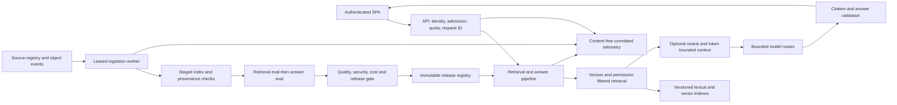

### 1. Executive assessment

**Overall maturity: 3/5 — pre-production. Production exposure is not recommended until the Phase 0 blockers are resolved.**

DMBOK Compass is a single-corpus, authenticated question-answering application with a React frontend, a FastAPI API, Firestore storage/vector search, Vertex embeddings, and hosted answer generation. It has meaningful production-oriented implementation, but several controls stop at contracts, tests, or documentation instead of governing the deployed path.

- **The main risk is disconnected controls.** Promotion accepts a nonempty release identifier without resolving its approval or evidence. The separate evidence verifier returns exit code zero even for a blocked release. [.github/workflows/delivery.yml:197](/Users/issacamara/Developer/dmbok-compass/.github/workflows/delivery.yml:197); [scripts/verify_release_evidence.py:13](/Users/issacamara/Developer/dmbok-compass/scripts/verify_release_evidence.py:13).
- **Release identity is not enforced at serving time.** Deployment records `RAG_CORPUS_VERSION_ID`, but request serving follows the mutable Firestore active pointer. Ingestion immediately activates a structurally validated corpus without a quality/release gate. [backend/app/main.py:270](/Users/issacamara/Developer/dmbok-compass/backend/app/main.py:270); [backend/app/answering/pipeline.py:452](/Users/issacamara/Developer/dmbok-compass/backend/app/answering/pipeline.py:452); [backend/app/ingestion/job.py:37](/Users/issacamara/Developer/dmbok-compass/backend/app/ingestion/job.py:37).
- **The evaluation framework exists, but its normal administration path cannot produce the evidence it requires.** Import creates placeholder chunk IDs, no semantic assessments, and no candidate binding; approval changes only review status. The production image also omits the lock file required for candidate snapshots. [backend/app/api/evaluation_datasets.py:191](/Users/issacamara/Developer/dmbok-compass/backend/app/api/evaluation_datasets.py:191); [backend/app/evaluation/generations.py:272](/Users/issacamara/Developer/dmbok-compass/backend/app/evaluation/generations.py:272); [backend/app/rag.py:203](/Users/issacamara/Developer/dmbok-compass/backend/app/rag.py:203); [backend/Dockerfile:7](/Users/issacamara/Developer/dmbok-compass/backend/Dockerfile:7).
- **Retrieval is a reasonable small-corpus baseline, not a demonstrated production-quality retriever.** It uses score-preserving cosine search, top five, immutable-version filtering, and explicit refusal thresholds. There is no reviewed corpus-specific quality result, hybrid search, reranker, or calibrated evidence threshold in the repository. [backend/app/retrieval/search.py](/Users/issacamara/Developer/dmbok-compass/backend/app/retrieval/search.py); [documents/release/langchain/quality-parity.json](/Users/issacamara/Developer/dmbok-compass/documents/release/langchain/quality-parity.json).
- **Citations are source-ID validated on the server, not just added by the UI.** However, citation existence does not establish that each answer claim is supported. The UI displays page/section labels without supporting excerpts or claim associations. [backend/app/answering/citations.py:9](/Users/issacamara/Developer/dmbok-compass/backend/app/answering/citations.py:9); [web/src/questions/QuestionPanel.tsx](/Users/issacamara/Developer/dmbok-compass/web/src/questions/QuestionPanel.tsx).
- **Authentication and quotas are substantive.** Firebase verifies tokens and revocation; backend dependencies enforce approval/admin roles; quotas are transactional. The single shared corpus has no document ACL or tenant model, consistent with current scope but insufficient for future restricted corpora. [backend/app/identity.py:63](/Users/issacamara/Developer/dmbok-compass/backend/app/identity.py:63); [backend/app/quota.py](/Users/issacamara/Developer/dmbok-compass/backend/app/quota.py); [backend/app/retrieval/search.py](/Users/issacamara/Developer/dmbok-compass/backend/app/retrieval/search.py).
- **Operational observability is incomplete and partly ineffective.** The telemetry logger is not enabled by the shipped Uvicorn logging configuration; several alert markers are never emitted; handled provider failures look like HTTP 200 refusals. There is no application request correlation or durable version/chunk-level diagnostic record. [backend/app/telemetry/adapter.py](/Users/issacamara/Developer/dmbok-compass/backend/app/telemetry/adapter.py); [infra/terraform/monitoring.tf](/Users/issacamara/Developer/dmbok-compass/infra/terraform/monitoring.tf); [backend/app/main.py:286](/Users/issacamara/Developer/dmbok-compass/backend/app/main.py:286).
- **Testing is broad but gives false confidence about integration.** This review ran **273 backend tests and 35 frontend tests successfully**, plus a successful frontend build and Terraform formatting check. Targeted checks nevertheless reproduced logging, scoring, chunk-contract, performance-gate, and release-verifier failures. Existing tests do not prove deployed retrieval quality or safe promotion.
- **Preserve the useful foundations.** Keep the current deployment shape for the approved pilot. A new vector database, microservice split, or a generic agent framework is not the shortest path to production capability. Finish the release, ingestion, evaluation, and telemetry boundaries first.

**Review basis and limits.** Reviewed on 2026-10-19 against working tree HEAD `3486df8ffdba5d8967d7eb3161daf6827f82e81c`, including pre-existing changes to delivery/configuration files. The Graphify report dated 2026-10-10 and [graphify-out/graph.json](/Users/issacamara/Developer/dmbok-compass/graphify-out/graph.json) were consulted first; their structural map guided navigation, and current source was used to validate findings because the map predates several changes. Source, application contracts, provider adapters, ingestion/evaluation workers, frontend workflows, tests, build/deployment configuration, Terraform, and operational documents were inspected. Lock files were inspected as dependency evidence; this was not an exhaustive audit of every transitive dependency or all upstream vendored code. No application or infrastructure fixes were made.

The baseline is the repository's actual product scope: **one searchable PDF, at most ten approved users, three simultaneous users, best-effort availability, a €5/month GCP target plus a separately approved model budget** ([documents/BRD.md:78](/Users/issacamara/Developer/dmbok-compass/documents/BRD.md:78), [documents/ARCHITECTURE.md:30](/Users/issacamara/Developer/dmbok-compass/documents/ARCHITECTURE.md:30)). The broader platform target is addressed separately in later phases. Production questions, evidence, answers, and traces must remain ephemeral under FR-013/NFR-011; feedback is explicitly out of scope today. Recommendations do not silently authorize retaining that content.

**Status terminology:** **Implemented** means executable code was found, not that its deployment was verified. **Partial** means a mechanism exists but has a demonstrated gap. **Implied/unverified** means documentation or configuration claims it, without sufficient execution evidence. **Missing** means **not found in codebase** within the inspected application, infrastructure, workflows, tests, and documents.

**Verification performed:** backend tests used the existing Python 3.12 local environment; CI/Docker target Python 3.11. No live GCP/provider calls, production container build, authenticated browser load test, fresh vulnerability-database audit, Terraform apply, restore drill, or GitHub protection inspection was performed. External DNS access was unavailable, including the Google skills catalog. Live infrastructure, IAM behavior, installed image contents, and provider terms remain unverified; no current CVE-free or production-performance claim is made.

### 2. Current architecture

#### Implemented components and boundaries

| Component | Actual responsibility | Evidence |
|---|---|---|
| React/Vite SPA | Firebase login/registration, approval status, questions, ephemeral answer/trace UI, administration and evaluation import/review | [web/src/AuthPanel.tsx](/Users/issacamara/Developer/dmbok-compass/web/src/AuthPanel.tsx), [web/src/questions/QuestionPanel.tsx](/Users/issacamara/Developer/dmbok-compass/web/src/questions/QuestionPanel.tsx), [web/src/admin/evaluation/EvaluationPanel.tsx](/Users/issacamara/Developer/dmbok-compass/web/src/admin/evaluation/EvaluationPanel.tsx) |
| FastAPI composition root | Route registration, identity/quota dependencies, cached live service construction, release endpoints | [backend/app/main.py:59](/Users/issacamara/Developer/dmbok-compass/backend/app/main.py:59), [backend/app/main.py:246](/Users/issacamara/Developer/dmbok-compass/backend/app/main.py:246) |
| Identity and quota repositories | Verify Firebase token, reload user profile, enforce role/approval; atomically reserve user/global daily requests | [backend/app/identity.py:63](/Users/issacamara/Developer/dmbok-compass/backend/app/identity.py:63), [backend/app/identity.py:242](/Users/issacamara/Developer/dmbok-compass/backend/app/identity.py:242), [backend/app/quota.py](/Users/issacamara/Developer/dmbok-compass/backend/app/quota.py) |
| RAG construction | Build native LangChain embedding/vector/provider integrations for requests and evaluations | [backend/app/rag.py:57](/Users/issacamara/Developer/dmbok-compass/backend/app/rag.py:57) |
| Retrieval | Query embedding plus Firestore cosine nearest-neighbor search filtered to one corpus version | [backend/app/retrieval/search.py](/Users/issacamara/Developer/dmbok-compass/backend/app/retrieval/search.py), [backend/vendor/langchain-google-firestore/langchain_google_firestore/vectorstores.py:266](/Users/issacamara/Developer/dmbok-compass/backend/vendor/langchain-google-firestore/langchain_google_firestore/vectorstores.py:266) |
| Grounded generation | Evidence thresholds, timeout budget, structured candidate parsing, citation shaping, operational refusals | [backend/app/answering/pipeline.py:162](/Users/issacamara/Developer/dmbok-compass/backend/app/answering/pipeline.py:162), [backend/app/answering/citations.py:9](/Users/issacamara/Developer/dmbok-compass/backend/app/answering/citations.py:9), [backend/model/protocol.py](/Users/issacamara/Developer/dmbok-compass/backend/model/protocol.py) |
| Ingestion job | Download one configured PDF, extract and split pages, embed/write chunks, validate persisted records, activate corpus | [backend/app/ingestion/entrypoint.py:39](/Users/issacamara/Developer/dmbok-compass/backend/app/ingestion/entrypoint.py:39), [backend/app/ingestion/job.py:37](/Users/issacamara/Developer/dmbok-compass/backend/app/ingestion/job.py:37) |
| Evaluation control/worker | Versioned dataset import/review, durable run/dispatch records, pinned generation, metric computation | [backend/app/api/evaluation_datasets.py](/Users/issacamara/Developer/dmbok-compass/backend/app/api/evaluation_datasets.py), [backend/app/evaluation/job.py](/Users/issacamara/Developer/dmbok-compass/backend/app/evaluation/job.py), [backend/app/evaluation/worker.py](/Users/issacamara/Developer/dmbok-compass/backend/app/evaluation/worker.py) |
| Release logic | Validate run binding, eligibility and six metric gates; separate evidence-bundle validation | [backend/app/release/decision.py:76](/Users/issacamara/Developer/dmbok-compass/backend/app/release/decision.py:76), [backend/app/release/evidence.py](/Users/issacamara/Developer/dmbok-compass/backend/app/release/evidence.py) |
| Infrastructure | Firebase Hosting/Auth, Cloud Run API and two jobs, Firestore vectors, source GCS bucket, secrets, backup schedule, alerts/dashboard | [infra/terraform/main.tf](/Users/issacamara/Developer/dmbok-compass/infra/terraform/main.tf), [infra/terraform/delivery.tf](/Users/issacamara/Developer/dmbok-compass/infra/terraform/delivery.tf), [infra/terraform/monitoring.tf](/Users/issacamara/Developer/dmbok-compass/infra/terraform/monitoring.tf), [infra/terraform/backup.tf](/Users/issacamara/Developer/dmbok-compass/infra/terraform/backup.tf) |

This is a modular monolith plus ingestion/evaluation jobs, sharing one backend image and Firestore project. That is appropriate for the declared pilot. Firestore is simultaneously the identity-profile store, quota coordinator, vector store, corpus registry, and evaluation store; its availability is therefore a shared failure dependency.

#### Request lifecycle

1. `AuthPanel` obtains a Firebase identity token. `questionApi.ts` posts `{question}` to `/api/questions` with `Authorization: Bearer ...`. Firebase client configuration is public client configuration, not an answer-provider secret.
2. `verify_firebase_token()` uses `auth.verify_id_token(..., check_revoked=True)`. `get_current_profile()` reloads/refreshes the durable profile; `get_approved_user()` checks verified-email and approved status. These are backend enforcement points, not prompt instructions.
3. `reserve_request_quota()` reserves a request through a Firestore transaction over policy, user counter, and global counter. Defaults are 100 per user and 100 globally per UTC day. Refusals and subsequent failures still consume the reservation; retry/idempotency semantics are not defined for client retries.
4. `configured_question_answerer()` uses the immutable runtime configuration loaded by the process lifespan. The provisional budgets are `ANSWER_REQUEST_TIMEOUT_MS=14000` and `ANSWER_GENERATION_TIMEOUT_MS=8000`; invalid or incomplete configuration fails startup before serving.
5. `LangChainRagPipeline.ainvoke()` starts its deadline and synchronously resolves `FirestoreCorpusVersionStore.active()`. It validates pointer/binding consistency, then constructs a retriever for that binding. **The declared deployment corpus ID does not select the request corpus.** Auth/profile/quota work occurred before this deadline, and the synchronous active lookup cannot be interrupted by the later async timeout.
6. `retrieve_off_event_loop()` submits synchronous embedding/search to a four-thread executor. `VertexEmbeddings.embed_query()` uses `gemini-embedding-001`, task `RETRIEVAL_QUERY`, and 768 dimensions. Firestore filters `metadata.corpus_version_id == active.version_id` and returns at most five neighbors.
7. The maintained Firestore integration returns `1 - cosine_distance`. The retriever rejects nonfinite scores, validates page/section/text provenance, and sorts descending with chunk-ID tie breaking. `classify_evidence()` keeps scores in `[0,1]` above 0.45: top score at least 0.75 is strong; otherwise partial; none is absent. Cosine similarity is **not** a calibrated probability that the answer is supported.
8. Absent evidence returns a deterministic refusal without calling the answer model. Otherwise the policy sends the question, evidence outcome, and up to five passage bodies. There is no lexical retrieval, reranking, neighbor expansion, deduplication, contradiction check, or tokenizer-based context packing.
9. By default `OpenRouterAdapter` calls `mistralai/mistral-nemo`, then `meta-llama/llama-3.1-8b-instruct` for eligible transient failures, sharing the generation deadline. Both routes share OpenRouter. Optional `ANSWER_PROVIDER=vertex` builds Gemini with an OpenRouter fallback. Structured JSON and schema validation constrain output shape; LangChain content callbacks/tracing and caches are disabled.
10. `validated_citations()` replaces candidate citation page/section fields with provenance from retrieved chunks. OpenRouter rejects IDs outside supplied evidence earlier; the shared policy filters unknown IDs and accepts a non-refusal if at least one valid citation remains. The Vertex adapter does not perform the same all-IDs-known check. No common claim-to-source entailment validator exists.
11. The route returns `AnswerResponse`, including transient retrieved excerpts, attempts, timings and raw model output. `ApiError.status` is data inside that response; it does **not** change the route's HTTP 200 status. The UI distinguishes `answer.error`, but generic HTTP monitoring and the performance probe do not.
12. `response_event()` emits a reduced event without content. It does not populate the available token, corpus-version, configuration-version or quota-utilization fields. No request ID joins events. The browser shows only page/section in passage details and does not save the trace. There is no user-feedback endpoint or collection; this is an intentional current product exclusion, not a hidden implementation.

#### Ingestion and re-indexing lifecycle

1. A Cloud Run job invokes `python -m app.ingestion.entrypoint`. It reads `GOOGLE_CLOUD_PROJECT`, `CORPUS_BUCKET_NAME`, `CORPUS_OBJECT_NAME`, and RAG settings. No new/updated/deleted-object trigger or periodic reconciliation job was found. The configured scheduler identity/API is not a scheduled ingestion implementation.
2. The job reloads the GCS blob, requires its generation, downloads the PDF, and computes SHA-256. `SourceManifest` fingerprints source URI/generation/hash and the loader/parser/splitter/embedding/schema configuration. This is materially better than naming an index by date alone.
3. `extract_pdf()` uses `PyPDFLoader(mode="page")`. It recovers the last matching chapter/numbered heading on a page and carries headings forward. It reports empty pages and unrecovered headings, but the entrypoint ignores `report.failures`, skips empty pages, and substitutes `Unclassified`. OCR, table-aware extraction and section-span provenance are **not found in codebase**.
4. `chunk_pages()` normalizes whitespace and uses `CharacterTextSplitter` with **700 whitespace-delimited words and 70-word overlap**, bounded to each page. IDs are `{version}:{page}:{ordinal}`; each chunk has a text SHA-256. These parameters are named tokens in the function but are not model tokens.
5. `CorpusEmbeddingWriter` maps chunks into LangChain `Document`s with nested metadata including source manifest/hash, version, page, section, ordinal, and content hash. It writes explicit IDs in batches of up to 500. Document embeddings use `RETRIEVAL_DOCUMENT` and 768 dimensions. The Firestore write limit is respected; embedding-service input/token limits are a separate concern.
6. `CorpusIngestionJob.run()` stages the version, reserves a staging record, writes batches, validates persisted text/hash/provenance/dimensions against expected chunks, and compare-and-set activates the new pointer. A previous active version becomes retired and is retained for rollback.
7. Structural validation sets `index_ready=True` and `filter_ready=True` after an equality-filtered document stream. It does **not** issue a vector query, verify the composite vector index is ready, or evaluate retrieval quality. Nevertheless activation proceeds.
8. SIGTERM is checked between batches; interrupted runs can retry. Hard kills can strand `running` records without lease expiry. A crash after validation but before activation leaves a `validated` version that `begin_staging()` rejects on retry. Cleanup is exact-version/dry-run first, but removes its version/run marker in the first deletion batch, making a later batch failure difficult to resume safely.
9. New source generations cause whole-corpus rebuilds. Updates are not incremental; deletions do not revoke the active corpus automatically. This is acceptable only as an explicitly operated single-PDF workflow, not the requested automatic document lifecycle.

#### Evaluation and release lifecycle

The admin imports up to 500 records/1 MiB, stages and atomically activates a dataset generation, and approves/rejects annotations. Runs resolve that active generation, select all or a subset, capture a candidate snapshot, persist a deterministic run ID, claim dispatch, and call the Cloud Run Jobs API with `EVALUATION_RUN_ID`. The worker loads the pinned dataset/corpus and invokes the same answer policy.

Metrics are retrieval hit success, grounded claims, citation correctness, answer quality, refusal correctness, and response time. Thresholds are 90/95/95/85/95 percent respectively, plus 95% within 15 seconds. Applicability denominators are represented. Semantic scoring uses frozen reviewed assessments matched to answer digests; it is not an independent automated semantic evaluator. Missing/mismatched assessments fail all semantic metrics, including retrieval. Operational refusal errors are not supplied to the scorer.

`ReleaseDecisionService` validates completed runs, current-generation eligibility, 30–50 approved gold items, candidate binding, and six gates. But its live store is in-memory, and delivery never calls it. `verify_release_evidence.py` reports promotability but exits zero for a valid blocked bundle. `quality.yml` and `delivery.yml` run independently. The separate compatibility image validates integrations, not the shipped application image or the full approval-to-promotion path.

#### Target reference architecture

Keep these as module/job boundaries initially; separate services only when measured load or ownership requires it.



### 3. Strengths

1. **Backend-enforced access and default-deny direct database access — implemented.** Firebase verifies revocation, approved/admin dependencies guard routes, and Terraform denies all browser Firestore reads/writes. Keep this boundary. [backend/app/identity.py:63](/Users/issacamara/Developer/dmbok-compass/backend/app/identity.py:63); [infra/terraform/main.tf](/Users/issacamara/Developer/dmbok-compass/infra/terraform/main.tf).
2. **Quota reservation before expensive work — implemented.** User/global daily checks and increments share a transaction. This prevents simple concurrent overspend of request allowances. [backend/app/quota.py](/Users/issacamara/Developer/dmbok-compass/backend/app/quota.py); [backend/tests/test_quota.py](/Users/issacamara/Developer/dmbok-compass/backend/tests/test_quota.py).
3. **Rich deterministic corpus lineage — implemented.** Source generation, SHA-256, derivation package versions/options, chunk hashes, schema, and serving binding are persisted. Changes to derivation create new corpus IDs. [backend/app/corpus/manifest.py](/Users/issacamara/Developer/dmbok-compass/backend/app/corpus/manifest.py); [backend/tests/test_manifest.py](/Users/issacamara/Developer/dmbok-compass/backend/tests/test_manifest.py).
4. **Persisted completeness verification and atomic active-pointer updates — implemented, with readiness/recovery gaps below.** Validation compares actual stored records; activation guards against a changed current pointer; rollback has a transactional implementation. [backend/app/corpus/firestore.py:213](/Users/issacamara/Developer/dmbok-compass/backend/app/corpus/firestore.py:213); [backend/app/corpus/firestore.py:270](/Users/issacamara/Developer/dmbok-compass/backend/app/corpus/firestore.py:270); [backend/tests/test_corpus_firestore.py](/Users/issacamara/Developer/dmbok-compass/backend/tests/test_corpus_firestore.py).
5. **Correct query/document embedding task separation and explicit dimensions — implemented.** Both paths use a shared model factory and validate 768 dimensions. [backend/app/corpus/embedding.py](/Users/issacamara/Developer/dmbok-compass/backend/app/corpus/embedding.py).
6. **Source-authoritative citation provenance and no-evidence refusal — implemented.** Citation metadata is taken from retrieved records; missing evidence avoids a paid generation call. This is stronger than trusting model page numbers. [backend/app/answering/pipeline.py:181](/Users/issacamara/Developer/dmbok-compass/backend/app/answering/pipeline.py:181); [backend/app/answering/citations.py:9](/Users/issacamara/Developer/dmbok-compass/backend/app/answering/citations.py:9); [backend/tests/test_answering.py](/Users/issacamara/Developer/dmbok-compass/backend/tests/test_answering.py).
7. **Bounded provider attempts and structured output — implemented.** OpenRouter disables SDK retries as well as wrapper retries, normalizes errors, bounds fallback by remaining time, and rejects unsupplied citation IDs. [backend/model/openrouter.py](/Users/issacamara/Developer/dmbok-compass/backend/model/openrouter.py); [backend/model/fallback.py](/Users/issacamara/Developer/dmbok-compass/backend/model/fallback.py); provider tests.
8. **Content non-retention is an explicit engineering boundary — implemented in the main telemetry/storage design.** Callbacks/tracing/debug/caches are disabled, telemetry fields are allowlisted, and privacy tests use sentinels. This deserves preservation while closing the exception-log gap. [backend/model/langchain.py](/Users/issacamara/Developer/dmbok-compass/backend/model/langchain.py); [backend/app/contracts/telemetry.py](/Users/issacamara/Developer/dmbok-compass/backend/app/contracts/telemetry.py); [backend/tests/test_privacy.py](/Users/issacamara/Developer/dmbok-compass/backend/tests/test_privacy.py).
9. **Durable dataset generations and evaluation runs — implemented.** Transactional generation activation, review transitions, stale-generation checks, run snapshots and dispatch claims exist. These are a useful base for fixing the incomplete authoring/review lifecycle. [backend/app/evaluation/generations.py](/Users/issacamara/Developer/dmbok-compass/backend/app/evaluation/generations.py); [backend/app/evaluation/job.py](/Users/issacamara/Developer/dmbok-compass/backend/app/evaluation/job.py); [backend/tests/test_evaluation_generations.py](/Users/issacamara/Developer/dmbok-compass/backend/tests/test_evaluation_generations.py).
10. **Dependency and deployment hygiene foundations — implemented.** Direct pins, hash-checked Python lock installation, npm lock/`npm ci`, maintained-wheel checksum, OIDC federation restricted to repository/main, separate environment backends, daily backups and protected legacy/v2 indexes are present. [backend/Dockerfile](/Users/issacamara/Developer/dmbok-compass/backend/Dockerfile); [.github/workflows/quality.yml](/Users/issacamara/Developer/dmbok-compass/.github/workflows/quality.yml); [infra/terraform/iam.tf](/Users/issacamara/Developer/dmbok-compass/infra/terraform/iam.tf); [infra/terraform/backends/](/Users/issacamara/Developer/dmbok-compass/infra/terraform/backends); [infra/terraform/backup.tf](/Users/issacamara/Developer/dmbok-compass/infra/terraform/backup.tf).

### 4. Gaps and risks

Severity reflects this application's current pilot and requested production target. **Critical** means a control advertised as blocking unsafe production changes can be bypassed, not that anonymous compromise was demonstrated. **High** findings are launch blockers unless a clearly bounded pilot exception is recorded. Conditional future-scope gaps are explicitly labeled.

| Area | Finding | Evidence from code | Severity (Critical / High / Medium / Low) | Why it matters in production | Recommended fix |
|---|---|---|---|---|---|
| R01 — CI/CD and release gates | **Partial:** promotion trusts any nonempty release string; no evaluation/evidence lookup or dependency on quality completion. The evidence CLI returns 0 even when `promotable=False`. | [.github/workflows/delivery.yml:197](/Users/issacamara/Developer/dmbok-compass/.github/workflows/delivery.yml:197), `:212`, `:234`; [scripts/verify_release_evidence.py:13](/Users/issacamara/Developer/dmbok-compass/scripts/verify_release_evidence.py:13); [.github/workflows/quality.yml](/Users/issacamara/Developer/dmbok-compass/.github/workflows/quality.yml) | **Critical** | An unapproved or regressing artifact can receive traffic despite blocked evidence. Reproduced: the checked-in blocked bundle prints “not promotable” and exits 0. | Persist and fetch an approved decision; bind exact image/frontend/corpus/config hashes; require quality checks for the same commit; make promotion verification return nonzero for blocked/pending/rejected evidence. Preserve a separate inspect-only mode if needed. |
| R02 — Release state and audit | **Partial:** production uses `InMemoryReleaseDecisionStore`; approval actor/time are not captured by the route/store contract. | [backend/app/main.py:122](/Users/issacamara/Developer/dmbok-compass/backend/app/main.py:122); [backend/app/release/decision.py:53](/Users/issacamara/Developer/dmbok-compass/backend/app/release/decision.py:53); [backend/app/main.py:350](/Users/issacamara/Developer/dmbok-compass/backend/app/main.py:350) | **High** | Cold starts and two instances lose/diverge decisions. Backups cannot restore decisions never stored. An admin-supplied rationale is not an authenticated decision audit. | Add immutable Firestore decisions with actor UID, timestamp, evidence hashes and conflict detection; retain safe audit events for privileged mutations. |
| R03 — Index/release coupling | **Partial:** runtime ignores deployed `RAG_CORPUS_VERSION_ID`, `RAG_SCHEMA_VERSION`, `RAG_VECTOR_INDEX`; requests follow the active pointer. Ingestion activates without release-quality checks. | [backend/app/rag.py:34](/Users/issacamara/Developer/dmbok-compass/backend/app/rag.py:34); [backend/app/answering/pipeline.py:452](/Users/issacamara/Developer/dmbok-compass/backend/app/answering/pipeline.py:452); [backend/app/ingestion/job.py:37](/Users/issacamara/Developer/dmbok-compass/backend/app/ingestion/job.py:37); [scripts/deploy_cloud_run.sh:18](/Users/issacamara/Developer/dmbok-compass/scripts/deploy_cloud_run.sh:18) | **Critical** | A new ingest changes answers for old revisions without evaluating that combination; rolling back an API revision does not restore its reviewed corpus. | Introduce one authoritative release binding. Stage/validate ingestion separately; publish only an approved binding. Make API/jobs resolve and verify the exact release ID/configuration and retain the prior binding. |
| R04 — Evaluation packaging | **Partial:** snapshot hashing reads `requirements-compat.lock`; production Docker copies only `requirements.lock`. | [backend/app/rag.py:203](/Users/issacamara/Developer/dmbok-compass/backend/app/rag.py:203); [backend/Dockerfile:7](/Users/issacamara/Developer/dmbok-compass/backend/Dockerfile:7); [backend/compat/Dockerfile](/Users/issacamara/Developer/dmbok-compass/backend/compat/Dockerfile) | **High** | A packaged candidate cannot capture its snapshot; the compatibility image passing does not test this runtime failure. The recorded hash would also describe a compatibility lock rather than necessarily the installed application lock. | Hash/package the actual installed lock as a build manifest and smoke-test candidate snapshot creation in the final production image. |
| R05 — Evaluation authoring path | **Partial:** import creates `imported-passage-*`, omits semantic assessments/bindings, and review only changes a status. Remapping tool produces an offline proposal, not a connected import operation. | [backend/app/api/evaluation_datasets.py:191](/Users/issacamara/Developer/dmbok-compass/backend/app/api/evaluation_datasets.py:191); [backend/app/evaluation/generations.py:253](/Users/issacamara/Developer/dmbok-compass/backend/app/evaluation/generations.py:253), `:272`; [scripts/remap_gold_annotations.py](/Users/issacamara/Developer/dmbok-compass/scripts/remap_gold_annotations.py); [backend/app/release/decision.py:141](/Users/issacamara/Developer/dmbok-compass/backend/app/release/decision.py:141) | **High** | Normal admin use can show approved gold items but cannot satisfy the actual semantic and candidate-binding gates. API/CLI to save the reviewed remap plus assessment is **not found in codebase**. | Add a typed, authenticated import/adjudication flow for actual chunk IDs, candidate binding, refusal labels and reviewer assessments. Validate referenced chunks against the pinned corpus. Test through public endpoints and the real evaluator. |
| R06 — Evaluation correctness | **Partial:** answer-digest mismatch fails retrieval even when the correct chunk was retrieved; expected refusals score correct for operational refusals because errors are discarded. | [backend/app/evaluation/assessments.py:38](/Users/issacamara/Developer/dmbok-compass/backend/app/evaluation/assessments.py:38), `:85`; [backend/app/evaluation/worker.py:104](/Users/issacamara/Developer/dmbok-compass/backend/app/evaluation/worker.py:104) | **High** | Retrieval regressions cannot be isolated; harmless answer variation creates false retrieval failures; outages can improve refusal scores. Both cases reproduced locally. | Compute retrieval metrics before generation/assessment validation. Score operational failures separately; use rubric/adjudication on each candidate response, not a previous answer's exact bytes. Retain reviewed digests as evidence of review, not as a semantic-equivalence metric. |
| R07 — Job dispatch and retry | **Partial:** create-once claim precedes remote job submission, with no lease, execution ID or reconciliation. Worker running state is not an execution lease. Failed runs are not redispatched by `launch()`. | [backend/app/evaluation/dispatch.py:26](/Users/issacamara/Developer/dmbok-compass/backend/app/evaluation/dispatch.py:26), `:47`, `:77`; [backend/app/evaluation/job.py:157](/Users/issacamara/Developer/dmbok-compass/backend/app/evaluation/job.py:157), `:280` | **High** | Crash after claim strands a queued run; timeout after remote acceptance can cause duplicate submissions; duplicate workers can repeat paid evaluation. Terraform grants `roles/run.invoker` while execution uses container overrides: required override permission must be verified and granted narrowly. | Use expiring claims/outbox states, recorded operation/execution IDs, reconciliation and worker compare-and-set lease. Test timeout-after-acceptance and process death. Verify `run.jobs.runWithOverrides` authorization in the target project. |
| R08 — Index readiness | **Partial:** readiness flags are set true after ordinary filtered reads, without vector search. | [backend/app/corpus/firestore.py:213](/Users/issacamara/Developer/dmbok-compass/backend/app/corpus/firestore.py:213), `:384`; [infra/terraform/firestore_vector.tf](/Users/issacamara/Developer/dmbok-compass/infra/terraform/firestore_vector.tf) | **High** | A missing/building vector index can be declared ready and activated; normal Firestore reads do not prove nearest-neighbor queries work. | Run a pinned synthetic vector search and validate returned metadata/schema before readiness. Record index identity/state and the probe outcome separately from completeness. |
| R09 — Ingestion recovery | **Partial:** no expiring ownership lease; `begin_staging()` accepts only staged versions; cleanup removes coordination records in the first batch. | [backend/app/corpus/firestore.py:104](/Users/issacamara/Developer/dmbok-compass/backend/app/corpus/firestore.py:104), `:113`, `:143`; [backend/app/ingestion/job.py:37](/Users/issacamara/Developer/dmbok-compass/backend/app/ingestion/job.py:37) | **High** | Hard kill strands `running`; failure between validation and activation makes retry fail; multi-batch cleanup can orphan remaining vectors. `stage()` also uses read-then-set instead of create-once transaction semantics. | Define resumable states and leases, atomic stage creation, per-batch checkpoints, idempotent validate/activate retries, and delete coordination metadata only after all chunk deletions complete. |
| R10 — Ingestion automation/freshness | **Missing:** new/update/delete event handling, source inventory, tombstones and reconciliation are **not found in codebase**. | [backend/app/ingestion/entrypoint.py:39](/Users/issacamara/Developer/dmbok-compass/backend/app/ingestion/entrypoint.py:39); [infra/terraform/delivery.tf](/Users/issacamara/Developer/dmbok-compass/infra/terraform/delivery.tf); [infra/terraform/main.tf](/Users/issacamara/Developer/dmbok-compass/infra/terraform/main.tf) provisions only scheduler identity/API | **Medium** | Uploaded changes are not automatically served, and deleted/withdrawn content can remain answerable. A one-PDF manual job is not the requested platform lifecycle. | First document a manual freshness/revocation SLA; add generation-aware event enqueue plus periodic reconciliation, idempotent work keys and immediate revocation when expanding sources. |
| R11 — Extraction and metadata accuracy | **Partial:** extraction failures are ignored; empty pages disappear; `Unclassified` is accepted; the last heading applies to the entire page. | [backend/app/ingestion/extract.py](/Users/issacamara/Developer/dmbok-compass/backend/app/ingestion/extract.py); [backend/app/ingestion/entrypoint.py:76](/Users/issacamara/Developer/dmbok-compass/backend/app/ingestion/entrypoint.py:76) | **High** | A partial PDF can become active; text before a mid-page heading receives misleading section provenance. Tables/layout can be flattened silently. | Persist extraction quality summaries and fail below reviewed coverage thresholds; preserve section spans/page labels; add authored fixtures for tables, multiple headings and blank/scanned pages. OCR only if required by source policy. |
| R12 — Chunking/contract mismatch | **Partial:** 700-word chunks have no character ceiling while `RetrievedPassage.excerpt` caps at 5,000 characters. Word splitting also destroys layout and cross-page context. | [backend/app/corpus/chunking.py](/Users/issacamara/Developer/dmbok-compass/backend/app/corpus/chunking.py); [backend/app/contracts/api.py:50](/Users/issacamara/Developer/dmbok-compass/backend/app/contracts/api.py:50); [backend/app/retrieval/search.py](/Users/issacamara/Developer/dmbok-compass/backend/app/retrieval/search.py) | **High** | Reproduced a valid 7,699-character ingested chunk that raises a retrieval validation error. Long technical words make this plausible. | Align ingestion/retrieval contracts; validate every staged chunk against the serving contract. Introduce measured token bounds and paragraph/section splitting; evaluate cross-page/neighbor context before changing defaults. |
| R13 — Embeddings | **Partial:** dimensions are validated, but NaN/infinity, vector count/norm, application RPC budget and content-hash embedding reuse are not explicitly enforced. | [backend/app/corpus/embedding.py](/Users/issacamara/Developer/dmbok-compass/backend/app/corpus/embedding.py); [backend/app/corpus/indexing.py](/Users/issacamara/Developer/dmbok-compass/backend/app/corpus/indexing.py); [backend/app/corpus/firestore.py:241](/Users/issacamara/Developer/dmbok-compass/backend/app/corpus/firestore.py:241) | **Medium** | Bad vectors or provider changes can fail later; partial retries re-embed already-written batches; SDK-default retry/timeout behavior is not a documented service budget. | Validate finite/count-correct vectors, define embedding RPC/token batch limits, and resume/reuse corpus-owned embeddings by content plus model/task/dimension key. |
| R14 — Retrieval quality | **Partial:** only dense top-five search with fixed thresholds and hit-any@5 measurement; no measured calibration or corpus-specific passing result. | [backend/app/retrieval/search.py](/Users/issacamara/Developer/dmbok-compass/backend/app/retrieval/search.py); [backend/app/retrieval/evidence.py](/Users/issacamara/Developer/dmbok-compass/backend/app/retrieval/evidence.py); [backend/app/answering/pipeline.py:118](/Users/issacamara/Developer/dmbok-compass/backend/app/answering/pipeline.py:118); [documents/release/langchain/quality-parity.json](/Users/issacamara/Developer/dmbok-compass/documents/release/langchain/quality-parity.json) | **High** | Exact acronyms, numbered sections, comparisons and multi-hop questions can miss evidence. One high-scoring adjacent-topic passage is labeled strong. | Build reviewed retrieval-only gold cases; report hit@5, recall@k, MRR/nDCG and slices; calibrate refusal thresholds on held-out answerable/unanswerable questions. |
| R15 — Hybrid search/reranking | **Missing:** lexical fusion, reranking and context diversification are **not found in codebase**. | Complete request retrieval path in [backend/app/retrieval/search.py](/Users/issacamara/Developer/dmbok-compass/backend/app/retrieval/search.py) and [backend/app/answering/pipeline.py](/Users/issacamara/Developer/dmbok-compass/backend/app/answering/pipeline.py) | **Medium** | Dense-only search can underperform on terminology; overlapping chunks consume all five slots; relevant evidence outside top five never reaches generation. | Benchmark lexical plus dense candidate union with rank fusion; rerank a larger candidate set only if measured gains justify latency/cost. Do not make a new search service a prerequisite without evidence. |
| R16 — Prompting/injection | **Partial:** trusted grounding instructions, question and document text are assembled into the human message; schema validation is not injection resistance. Adversarial prompt/document tests are **not found in codebase**. | [backend/app/answering/pipeline.py:55](/Users/issacamara/Developer/dmbok-compass/backend/app/answering/pipeline.py:55); [backend/model/openrouter.py](/Users/issacamara/Developer/dmbok-compass/backend/model/openrouter.py); [backend/model/gemini.py](/Users/issacamara/Developer/dmbok-compass/backend/model/gemini.py) | **High** | A question or poisoned source can ask the model to ignore evidence while still supplying a valid citation ID. No model tools are present, so the demonstrated concern is answer integrity rather than autonomous tool execution. | Put stable policy in system messages, delimit/label evidence as untrusted data, validate supported claims, and add direct/indirect injection and evidence-exfiltration fixtures. Do not treat prompt wording as access control. |
| R17 — Citations and grounding | **Partial:** source IDs/pages/sections are verified, claim support is not; common policy silently drops unknown IDs; excerpt/claim mapping is absent in displayed citations. | [backend/app/answering/citations.py:9](/Users/issacamara/Developer/dmbok-compass/backend/app/answering/citations.py:9); [backend/app/answering/pipeline.py:287](/Users/issacamara/Developer/dmbok-compass/backend/app/answering/pipeline.py:287); [backend/model/gemini.py:125](/Users/issacamara/Developer/dmbok-compass/backend/model/gemini.py:125); [web/src/questions/QuestionPanel.tsx](/Users/issacamara/Developer/dmbok-compass/web/src/questions/QuestionPanel.tsx); BRD FR-010 | **High** | A false answer with one valid citation passes. Mixed valid/invalid citations behave differently across providers. Users cannot inspect the supporting excerpt from the citation UI. | Require claim/evidence associations and reject unknown IDs uniformly; map quotes to source spans; expose bounded supporting excerpts transiently. Evaluate entailment and unsupported-claim rate separately from citation-ID validity. |
| R18 — No-answer/error semantics | **Partial:** weak-evidence refusal exists, but operational failures share outcome `refusal` and HTTP 200. | [backend/app/answering/pipeline.py:331](/Users/issacamara/Developer/dmbok-compass/backend/app/answering/pipeline.py:331), `:351`; [backend/app/main.py:286](/Users/issacamara/Developer/dmbok-compass/backend/app/main.py:286); [backend/app/telemetry/adapter.py:46](/Users/issacamara/Developer/dmbok-compass/backend/app/telemetry/adapter.py:46) | **High** | Cloud Run 5xx alerts miss provider failures; refusal quality and availability become indistinguishable downstream. | Keep evidence refusal distinct from provider/retrieval error in HTTP status, outcome/reason and metrics. Update browser and contracts together. Never count an operational refusal as a correct unanswerable result. |
| R19 — Auth/authz and isolation | **Implemented for shared corpus; missing for restricted sources.** Retriever receives no principal/tenant/ACL and filters only corpus version. | [backend/app/identity.py:265](/Users/issacamara/Developer/dmbok-compass/backend/app/identity.py:265); [backend/app/answering/pipeline.py:404](/Users/issacamara/Developer/dmbok-compass/backend/app/answering/pipeline.py:404); [backend/app/retrieval/search.py](/Users/issacamara/Developer/dmbok-compass/backend/app/retrieval/search.py) | **Medium** | All approved users can access the full corpus. That is current design, not an observed cross-tenant leak; it becomes a launch blocker before private/multi-tenant data is introduced. | Preserve shared-corpus scope now. Before expansion, attach document tenant/ACL metadata, pass a server-created access scope, filter before ranking, and test denied-document non-disclosure. |
| R20 — Identity freshness and privileged audit | **Partial:** verified-email state is sticky (`stored_verified OR current_claim`); admin mutations discard the authenticated actor. | [backend/app/identity.py:129](/Users/issacamara/Developer/dmbok-compass/backend/app/identity.py:129), `:159`; [backend/app/main.py:313](/Users/issacamara/Developer/dmbok-compass/backend/app/main.py:313), `:332`; [backend/app/api/evaluation_datasets.py:162](/Users/issacamara/Developer/dmbok-compass/backend/app/api/evaluation_datasets.py:162) | **Medium** | A previously verified profile can remain verified after current claims become unverified; approval/quota/review changes lack actor-linked history. Exploitability depends on allowed Firebase email-change flows. | Bind verification to current verified email/claims; test email change/revocation. Record immutable actor/action/target/version/time audit events without production query content. |
| R21 — Secrets/config and startup | **Partial:** [.env.example](/Users/issacamara/Developer/dmbok-compass/.env.example) and Secret Manager exist, but secrets use `latest`, runtime settings are scattered/lazy, and `/health` always succeeds. | [.env.example](/Users/issacamara/Developer/dmbok-compass/.env.example); [infra/terraform/delivery.tf](/Users/issacamara/Developer/dmbok-compass/infra/terraform/delivery.tf); [backend/app/rag.py:34](/Users/issacamara/Developer/dmbok-compass/backend/app/rag.py:34); [backend/app/main.py:185](/Users/issacamara/Developer/dmbok-compass/backend/app/main.py:185) | **High** | Missing provider settings or incompatible corpus can pass health checks; secret rotation/config drift can change an otherwise identical release. | Centralize validated settings, version non-secret configuration/secret references, validate required settings at startup, and separate liveness from bounded dependency/readiness checks. Keep secret values out of manifests. |
| R22 — Observability delivery | **Partial:** logger is not configured at INFO/stdout; alert filters expect markers never emitted and use a `global` resource selector unlike Cloud Run logs. | [backend/app/telemetry/adapter.py:32](/Users/issacamara/Developer/dmbok-compass/backend/app/telemetry/adapter.py:32); [backend/Dockerfile:17](/Users/issacamara/Developer/dmbok-compass/backend/Dockerfile:17); [infra/terraform/monitoring.tf](/Users/issacamara/Developer/dmbok-compass/infra/terraform/monitoring.tf); [backend/tests/test_telemetry.py](/Users/issacamara/Developer/dmbok-compass/backend/tests/test_telemetry.py) explicitly enables INFO | **High** | Reproduced `logger.isEnabledFor(INFO) == False` under shipped Uvicorn config. Ingestion/retrieval/backup/quota alerts cannot be trusted from their declarations. | Configure structured JSON stdout logging, typed event codes and matching resource filters; exercise every alert with synthetic events and an actual notification channel. `notification_channel_ids=[]` is not a delivered alert. |
| R23 — Traceability, metrics and feedback | **Partial:** live browser trace exists, but no request/span IDs; version/token fields are unpopulated, admin aggregate metrics have no production writer. Feedback is intentionally absent. | [backend/app/contracts/telemetry.py](/Users/issacamara/Developer/dmbok-compass/backend/app/contracts/telemetry.py); [backend/app/telemetry/adapter.py:46](/Users/issacamara/Developer/dmbok-compass/backend/app/telemetry/adapter.py:46); [backend/app/metrics.py](/Users/issacamara/Developer/dmbok-compass/backend/app/metrics.py); [web/src/questions/QuestionPanel.tsx](/Users/issacamara/Developer/dmbok-compass/web/src/questions/QuestionPanel.tsx); [documents/BRD.md:94](/Users/issacamara/Developer/dmbok-compass/documents/BRD.md:94) | **High** | A bad answer cannot be investigated end to end after the page is closed. Aggregate model/outcome counts cannot identify the release, corpus or failing stage. | Add content-free correlation and stage metrics, exact release/index/prompt/model IDs and safe error codes; wire aggregate updates. Any persistent chunk selections or user-feedback collection require an explicit privacy/product change; do not enable LangSmith content tracing. |
| R24 — Exception privacy/security | **Partial:** sanitized adapter logging does not sanitize uncaught ASGI exceptions. Retrieval validation and setup errors can escape; default exception rendering may include input values. | [backend/app/main.py:297](/Users/issacamara/Developer/dmbok-compass/backend/app/main.py:297); [backend/app/answering/pipeline.py:452](/Users/issacamara/Developer/dmbok-compass/backend/app/answering/pipeline.py:452); [backend/app/retrieval/search.py](/Users/issacamara/Developer/dmbok-compass/backend/app/retrieval/search.py); [backend/app/api/evaluation_datasets.py:191](/Users/issacamara/Developer/dmbok-compass/backend/app/api/evaluation_datasets.py:191) | **High** | For example, the reproduced overlong chunk raises a Pydantic error containing source-text input; an unhandled traceback can defeat non-retention guarantees. No actual production leak was observed. | Normalize failures at application boundaries, log only safe classes/codes/correlation, and return safe error bodies. Run process-level sentinel tests against stderr/ASGI/provider logs, not only the telemetry adapter. |
| R25 — Performance/reliability | **Partial:** four retrieval workers but unbounded executor queue; timeout cancels awaiting work, not an already-running synchronous RPC; active pointer and async import handlers call synchronous Firestore inline. | [backend/app/retrieval/search.py](/Users/issacamara/Developer/dmbok-compass/backend/app/retrieval/search.py); [backend/app/answering/pipeline.py:452](/Users/issacamara/Developer/dmbok-compass/backend/app/answering/pipeline.py:452); [backend/app/api/evaluation_datasets.py](/Users/issacamara/Developer/dmbok-compass/backend/app/api/evaluation_datasets.py); [backend/app/corpus/embedding.py](/Users/issacamara/Developer/dmbok-compass/backend/app/corpus/embedding.py) | **High** | Slow dependencies can occupy all workers after caller timeout and block other requests. The “whole-request” deadline excludes identity/quota and cannot interrupt synchronous pointer lookup. | Apply explicit RPC deadlines and bounded admission; move all blocking calls off the event loop or use async clients; include queue/auth/quota/pointer time in measurement. Test three-user stalls, overload and recovery before increasing concurrency. |
| R26 — Cost control | **Partial:** request quotas, max instances, budget alerts and forecast scripts exist; output-token caps, per-route actual usage accounting, evaluation spend limits and enforced provider budget are missing. | [backend/model/openrouter.py](/Users/issacamara/Developer/dmbok-compass/backend/model/openrouter.py); [backend/model/gemini.py](/Users/issacamara/Developer/dmbok-compass/backend/model/gemini.py); [backend/model/protocol.py](/Users/issacamara/Developer/dmbok-compass/backend/model/protocol.py); [backend/app/telemetry/adapter.py:46](/Users/issacamara/Developer/dmbok-compass/backend/app/telemetry/adapter.py:46); [documents/release/langchain/cost-provider.md](/Users/issacamara/Developer/dmbok-compass/documents/release/langchain/cost-provider.md) | **High** | Request count does not bound tokens; fallback can bill both attempts; partial re-ingestion re-embeds; admin evaluations bypass user quota. GCP budget alerts do not cap spend or cover OpenRouter. | Set model output and packed-context token ceilings, preserve attempt-level usage, enforce a reviewed provider hard cap and separate evaluation/ingestion budgets. Forecast from actual corpus/query distributions. |
| R27 — Testing/performance evidence | **Partial:** broad unit/fake tests pass; probe success is HTTP 2xx only, and the script drops `payload.error`. | [backend/app/performance.py:82](/Users/issacamara/Developer/dmbok-compass/backend/app/performance.py:82); [scripts/run_performance_probe.py](/Users/issacamara/Developer/dmbok-compass/scripts/run_performance_probe.py); [backend/tests/test_integrated_release_journey.py](/Users/issacamara/Developer/dmbok-compass/backend/tests/test_integrated_release_journey.py); [backend/tests/test_delivery_rollback.py](/Users/issacamara/Developer/dmbok-compass/backend/tests/test_delivery_rollback.py) | **High** | Reproduced a passing performance report containing only HTTP 200 refusals. Integrated release tests inject booleans/direct store calls; workflow tests inspect strings, not deployed behavior. | Classify functional success with explicit expected outcome and no operational error; include cold/warm/fallback distributions. Test shipped-image/API/evaluator/promotion contracts and real denied-access paths. |
| R28 — Preview/deployment isolation | **Partial:** preview Hosting rewrite targets the traffic-serving service, not the zero-traffic revision; preview deploy overwrites the named ingestion/evaluation jobs before approval. | [.github/workflows/delivery.yml:140](/Users/issacamara/Developer/dmbok-compass/.github/workflows/delivery.yml:140), `:161`, `:169`; [infra/terraform/delivery.tf](/Users/issacamara/Developer/dmbok-compass/infra/terraform/delivery.tf) | **High** | A preview may exercise the old backend while background work starts using new code. Terraform still declares 100% latest traffic, creating drift risk if applied outside promotion. | Use a tagged/revision-pinned preview backend and candidate-specific jobs; smoke the exact artifact tuple; make Terraform and promotion ownership explicit. Verify frontend hash and observed revision before traffic change. |
| R29 — Rollback/recovery | **Partial:** corpus rollback and a rollback preflight plan exist; coupled API/frontend/jobs/corpus rollback execution and a completed drill are **not found in codebase**. Source bucket deletes objects by age after 30 days without protecting active/recovery sources. | [scripts/delivery/rollback.py](/Users/issacamara/Developer/dmbok-compass/scripts/delivery/rollback.py); [.github/workflows/delivery.yml:261](/Users/issacamara/Developer/dmbok-compass/.github/workflows/delivery.yml:261); [infra/terraform/storage.tf:12](/Users/issacamara/Developer/dmbok-compass/infra/terraform/storage.tf:12); [documents/release/langchain/recovery.md](/Users/issacamara/Developer/dmbok-compass/documents/release/langchain/recovery.md) | **High** | Rollback job depends on preview, which first deploys candidate resources; its plan omits frontend restoration. Age-only deletion can remove immutable source generations needed to rebuild the active index. | Make rollback independent of candidate build/deploy; restore a verified complete release tuple with compensation checks. Protect active/rollback source generations; garbage-collect only unreferenced data. Execute and record an isolated restore drill. |
| R30 — Maintainability/dependencies | **Partial:** evidence classification duplicated; active/compatibility lock and release schema versions drift; mutable base/action/tool tags; vendored integration excluded from registry vulnerability audit. | [backend/app/retrieval/evidence.py](/Users/issacamara/Developer/dmbok-compass/backend/app/retrieval/evidence.py); [backend/app/answering/pipeline.py:118](/Users/issacamara/Developer/dmbok-compass/backend/app/answering/pipeline.py:118); [backend/app/rag.py:157](/Users/issacamara/Developer/dmbok-compass/backend/app/rag.py:157); `backend/requirements*.lock`; [.github/workflows/quality.yml](/Users/issacamara/Developer/dmbok-compass/.github/workflows/quality.yml); [cloudbuild.yaml](/Users/issacamara/Developer/dmbok-compass/cloudbuild.yaml) | **Medium** | Policy and release evidence can diverge while isolated tests pass. Native-library ownership does not remove maintenance responsibility for the local wheel. | Consolidate evidence policy and canonical manifest generation; maintain one active lock; publish patch/upstream diff/SBOM; pin build tooling and validate the actual wheel/image. Retire the legacy pipeline after confirming no live trigger. |
| R31 — Web/API hardening | **Partial:** safe JSX and bearer auth exist; CSP/security-header configuration, pre-parse general body limits, and per-user concurrent-request limits are **not found in codebase**. Import checks bytes only after buffering. | [web/src/questions/QuestionPanel.tsx](/Users/issacamara/Developer/dmbok-compass/web/src/questions/QuestionPanel.tsx); [web/nginx.conf](/Users/issacamara/Developer/dmbok-compass/web/nginx.conf); [firebase.json](/Users/issacamara/Developer/dmbok-compass/firebase.json); [backend/app/api/evaluation_datasets.py](/Users/issacamara/Developer/dmbok-compass/backend/app/api/evaluation_datasets.py); [backend/app/main.py:59](/Users/issacamara/Developer/dmbok-compass/backend/app/main.py:59) | **Medium** | Public API invocation permits resource abuse before/around expensive work; CSP defense in depth is absent from checked-in hosting configuration. This is not evidence of an existing XSS exploit. | Apply compatible edge headers/body bounds, streaming import size checks, per-user admission limits and deployment header tests. Firebase SDK-managed token persistence should be reviewed for the intended shared-device/session policy. |
| R32 — Governance/release evidence | **Implied/unverified:** reviewed provider capacity/schema/data terms, provider hard cap, publisher-rights release outcome, performance and restore evidence remain explicitly blocked. | [documents/release/langchain/release-evidence.json](/Users/issacamara/Developer/dmbok-compass/documents/release/langchain/release-evidence.json); [documents/release/langchain/cost-provider.md](/Users/issacamara/Developer/dmbok-compass/documents/release/langchain/cost-provider.md); [documents/decisions/rights.md](/Users/issacamara/Developer/dmbok-compass/documents/decisions/rights.md) | **High** | Technical approval cannot substitute for the repo's existing owner decisions. The bundle's placeholder passing flags are explicitly not a completed candidate run. | Resolve and date existing owner gates; bind evidence to the actual candidate; enforce it in promotion. Do not infer provider privacy or publisher permission from source-code controls. |

**Specific false-confidence patterns present:** a release identifier mistaken for approval (R01); stored flags mistaken for vector readiness (R08); real citation IDs mistaken for supported claims (R17); passing mocked tests mistaken for usable evaluation (R05–R07/R27); declared alerts mistaken for emitted/received signals (R22); recorded corpus environment variables mistaken for enforced serving identity (R03); and HTTP success mistaken for answer availability (R18/R27).

**Retrieval versus generation:** R11–R15 concern what evidence is available and selected. R16–R18 concern what the model does with evidence and what the application accepts. R06 prevents the current metrics from cleanly separating those two failure classes. R30 is maintainability debt; R01/R03/R05/R07 are architectural/control-flow defects and cannot be solved by naming or formatting cleanup.

### 5. Production-readiness scorecard

Scores assess the current implementation plus demonstrated evidence, not the ambition of the documents. They are judgment-based, not an average of test pass rates.

| Domain | Score /10 | Evidence | Blocking issues |
|---|---:|---|---|
| Architecture | 6 | Useful module/job boundaries and typed contracts in [backend/app/](/Users/issacamara/Developer/dmbok-compass/backend/app); coherent factory | Mutable serving identity, auto-activation, disconnected release authority (R01/R03) |
| Retrieval quality | 4 | Version-filtered cosine top five, task-correct embeddings, rich chunk lineage | No reviewed real quality baseline; extraction and chunk contract defects; readiness unproven (R08/R11–R14) |
| Grounded generation | 5 | Deterministic no-evidence refusal, schema validation, server citation provenance | Claim support and injection tests absent; operational errors conflated with refusal (R16–R18) |
| Security | 6 | Firebase revocation, approval/admin dependencies, deny-all client Firestore, backend secrets | Exception-log privacy, incomplete audit, unverified provider terms; ACL required before restricted sources (R19–R24/R32) |
| Observability | 3 | Safe telemetry schema, Terraform dashboard/alerts, ephemeral UI trace | Logger disabled; event/filter mismatch; missing correlation/versions/cost; errors masked (R18/R22–R24) |
| Evaluation | 3 | Durable generations/runs, candidate snapshots, six gates, offline parity tooling | Packaged snapshot failure, unusable authoring-to-evaluation path, scoring errors, no approved dataset/result (R04–R07) |
| Reliability | 4 | Transactional quotas/pointers, bounded model attempts, signal handling, backup schedule | Leases/retries incomplete, blocking RPCs, readiness and recovery not proven (R07–R09/R21/R25/R29) |
| Performance | 4 | Offloaded vector search, bounded response context count, concurrency cap, probe script | No real p95 evidence; queue/RPC/deadline gaps; probe can pass errors (R25/R27) |
| Cost control | 4 | Daily quotas, two-instance ceiling, €5 alert budget, deterministic forecast tools | No enforced provider cap, actual token accounting or admin-job budget (R26/R32) |
| Deployment readiness | 3 | Docker, OIDC, hashed artifacts, environment backends, CI checks | Promotion bypass, wrong preview target, candidate jobs mutate early, rollback is preflight (R01–R04/R28/R29) |
| Maintainability | 6 | Clear packages, 273 backend/35 web passing tests, locked dependencies | Duplicated policy, configuration/schema drift, vendored integration ownership, insufficient cross-boundary tests (R30) |

### 6. Prioritized roadmap

**Effort scale:** S = roughly 1–3 focused engineering days; M = 4–10 days; L = 2–4 engineer-weeks. These are order-of-magnitude implementation and validation estimates, not delivery commitments. Provider/legal review and corpus adjudication have external lead times. Suggested owners identify responsibilities, not existing staffed teams.

#### Phase 0: critical blockers before any production exposure

Objective: make unsafe release impossible, make evidence attainable, and stop known false-success paths. Preserve current controlled pre-release validation while resolving the repository's owner gates.

| Work item / suggested owner | Concrete code/infrastructure changes | Expected impact / exit evidence | Dependencies | Rough effort |
|---|---|---|---|---|
| Release authority — platform owner | Fix evidence CLI exit semantics; persist `ReleaseDecisionStore`; connect promotion to approved exact-artifact evidence and same-commit quality checks | Pending/missing/mismatched/failed decisions cannot change traffic; decision survives restart and multiple instances | None; R01/R02 | M |
| Serving identity — platform + corpus owner | Replace unused deployment flags with a verified immutable release binding; remove activation from ingestion; separate staged index from publish | Old/new revisions each serve their reviewed corpus; rejected corpus never becomes active | Release manifest design; R03/R08 | M |
| Evaluation unblock — backend + evaluation owner | Package/hash installed lock; connect remap/semantic assessment import; compute retrieval independently; exclude operational errors from quality success | Real admin-to-worker-to-release run on authored data; container snapshot smoke passes; partial/absent/error cases correctly scored | Reviewed corpus binding; R04–R06 | L |
| Baseline quality evidence — corpus/evaluation owner | Prepare 30–50 approved, candidate-bound cases across all five categories plus answerable/partial/unanswerable coverage; test actual retrieval and model routes | Meets existing 90/95/95/85/95 quality thresholds with inspectable denominators and reviewed candidate output | Evaluation flow; no synthetic “always true” scoring | M–L |
| Ingestion/contract safety — backend owner | Align chunk bounds; gate extraction coverage; vector-query readiness probe; prevent age-only deletion of active source | All corpus chunks pass serving schema; incomplete extraction/index is blocked; active source survives retention policy | Source inventory; R08/R11/R12/R29 | M |
| Operational truth — backend/operations owner | Distinguish refusal from failure in API/metrics/probe; enable safe structured logging; add minimum request/release correlation; sanitize uncaught errors | Simulated provider failure causes failed probe and delivered alert, with no content in logs | Contract update; R18/R22/R24/R27 | M |
| Existing owner decisions — sponsor | Complete provider route/schema smoke, gateway/upstream data-terms review, hard-cap approval, publisher-rights release decision | Dated candidate evidence replaces blocked/template records; automated promotion enforces it | External decisions; [documents/decisions/](/Users/issacamara/Developer/dmbok-compass/documents/decisions) | S engineering, external lead time |

**Phase 0 acceptance:** negative promotion tests pass; final image can evaluate; the reviewed corpus meets quality thresholds; no operational failure is counted as success; provider/privacy/rights gates are resolved. Passing existing unit tests alone is insufficient.

#### Phase 1: minimum production baseline

Objective: operate the approved three-concurrent-user service predictably and recover it.

| Work item / suggested owner | Concrete code/infrastructure changes | Expected impact / exit evidence | Dependencies | Rough effort |
|---|---|---|---|---|
| Durable job lifecycle — backend/platform | Leased ingestion/evaluation state, batch checkpoints, dispatch reconciliation and operation IDs, worker ownership, override IAM verification | Kill/timeout/retry scenarios complete once logically; partial work resumes without uncontrolled cost | Phase 0 states/bindings; R07/R09 | M–L |
| Full-path latency bounds — backend | Bounded admission; explicit embedding/Firestore deadlines; offload pointer/import I/O; client abort/timeout handling; record queue/auth/quota/retrieval/model times | At least 95% of successful responses within 15s at three simultaneous users, including representative cold/fallback paths; outages recover | Correct error/probe semantics; R25/R27 | M |
| Preview and promotion integrity — delivery owner | Tagged exact-revision preview, isolated candidate jobs, actual frontend archive hash verification, observed revision/config check, clarify Terraform traffic ownership | Preview tests exercise exactly what is promoted; candidate background code cannot mutate production before approval | Release binding; R28 | M |
| Rollback and recovery — operations | Independent rollback workflow for API/frontend/jobs/config/corpus; retain prior artifacts and source; execute isolated backup restore/rebuild | Measured recovery within existing 24h objective; complete binding preserved; forward recovery tested | Durable decisions and retained artifacts; R29 | M |
| Safe operational telemetry — operations/backend | Correlated metadata-only spans/events, stage histograms, error/fallback/token/cost metrics, actual alert channels, admin audit log | An incident can be tied to a version/stage without saving user content; alert tests prove delivery | Privacy allowlist review; R20/R22/R23/R26 | M |
| Startup and perimeter — platform/security | Validated settings manifest; separate liveness/readiness; body/admission limits; compatible browser headers; secret-reference rotation procedure | Broken config cannot look ready; auth and quotas remain enforced under load | R21/R31 | S–M |

#### Phase 2: scaling and hardening

Objective: improve measured retrieval and automate the document lifecycle before expanding usage.

| Work item | Concrete changes | Expected impact | Dependencies | Rough effort |
|---|---|---|---|---|
| Automated source lifecycle | Add source registry, object-generation events, idempotent queue, periodic reconciliation, deletion tombstones/revocation, freshness dashboard | New/updated/deleted sources converge to an approved index; stale/deleted evidence has a defined bound | Stable leased ingestion and release publication | L |
| Retrieval experiment track | Add lexical candidate retrieval and rank fusion behind a versioned policy; benchmark reranker and neighbor/section expansion; token-budgeted context packing | Better acronym/exact-term/comparison retrieval without uncontrolled latency | Retrieval-only gold baseline and cost metrics | M–L |
| Context/provenance quality | Section-span extraction, table/layout fixtures, document/page labels, content deduplication and corpus-owned embedding cache | Fewer mislabeled citations, less duplicated context and cheaper rebuilds | New corpus derivation version; re-map gold | M |
| Capacity and resilience | Stress the current global quota/pointer/Firestore dependencies; add overload protection, tuned pooling and circuit-breaker cooldown where evidence warrants | Predictable saturation behavior; reduced repeated provider-failure costs | Real telemetry/load results | M |
| Continuous regression evaluation | Run representative retrieval tests per change; scheduled/staging model-route evaluations on authored data; track drift by model/prompt/index policy | Detect changes in provider behavior and corpus quality before users do | Correct evaluation/adjudication and spend cap | M |

Do not shard quotas or introduce independent services solely because the target says “platform.” The current global transaction is reasonable for three simultaneous users; scale it when measured contention or a changed requirement justifies the complexity.

#### Phase 3: advanced governance and optimization

Objective: support restricted corpora and wider teams only after the baseline is proven.

| Work item | Concrete changes | Expected impact | Dependencies | Rough effort |
|---|---|---|---|---|
| Permission-aware multi-corpus retrieval | Server-derived `AccessScope`; document/tenant/ACL version metadata; pre-ranking filters; deletion/revocation reconciliation and isolation tests | Restricted documents never enter another user's candidates or context | Explicit product scope and identity/ACL source | L |
| Governance and evaluation independence | Versioned threat model, separation of author/reviewer/releaser, signed evidence attestations, adjudication agreement and representative larger eval sets | Auditable changes with less self-approval and narrow-test bias | Durable audit/release/evaluation records | M–L |
| Cost/latency optimization | Tune retrieval/rerank/model routing from measured quality/cost; batch/reuse source embeddings; artifact/client pooling | Lower cost and latency without weakening answer quality | Stable scorecards and per-attempt metering | M |
| Optional feedback and richer diagnosis | Define opt-in issue reporting/feedback and retention/access/deletion policy before implementation | Allows user-reported failures to feed authored regression cases | Explicit amendment to current non-retention/feedback exclusions | M |

#### Proposed CI gate design

| Gate | Execution and artifact | Must block |
|---|---|---|
| Pull request | Existing tests/build/audits; add Python lint/type checks, TS lint, secret scan, Terraform tests, maintained-wheel provenance check | Failed correctness/security/contract checks |
| Built image | Build production Dockerfile once; test startup/readiness, manifest/lock availability, offline candidate snapshot and sanitized failure logging inside that image | Missing runtime assets, bad configuration, privacy sentinel leakage |
| Retrieval regression | Approved corpus/index fixture or isolated staging corpus; per-category hit/recall/ranking/no-answer tests | Regression from approved baseline or missing indexed evidence |
| Answer regression | Authored held-out questions, claim/citation rubric, injection/unanswerable/error cases; provider calls budgeted | Below existing quality thresholds; operational errors counted as success; missing adjudication |
| Staging candidate | Exact preview API/frontend/jobs/binding; real auth, quotas, denied access, cold/fallback/load, notification checks | Wrong artifact target, missed latency target, failed route/schema or alert delivery |
| Promotion | Resolve durable approved decision and all evidence; compare observed artifact digests/config/corpus; protected environment approval | Missing/stale/mismatched/blocked evidence or missing same-commit checks |
| Post-release | Smoke plus latency/error/refusal/fallback/cost checks with an observation window; execute coupled rollback on defined failure policy | Continuing a failed rollout without a recorded decision |

Current branch protection and GitHub required reviewers are **implied but not verified**: README requests them, but their active configuration is **not found in codebase**. Export or document their reviewed settings and test that an unauthorized/missing-check promotion fails.

### 7. Quick wins

These are the ten best small changes. They reduce risk but do not replace the Phase 0 integration work.

1. **Make `verify_release_evidence.py` return nonzero for non-promotable bundles.** Add a blocked-bundle CLI regression test. R01.
2. **Package/hash the installed application lock and smoke candidate snapshot creation in the final image.** Remove reliance on an unpackaged compatibility filename. R04.
3. **Configure the telemetry logger explicitly for structured stdout output.** Test with the shipped Uvicorn configuration rather than enabling INFO only inside `caplog`. R22.
4. **Classify `AnswerResponse.error` as operational failure in telemetry and the performance probe.** A 200 response must not by itself pass availability/latency gates. R18/R27.
5. **Apply the retrieval response schema to every staged chunk.** Reject or split an overlong chunk before paying for embedding and activation. R12.
6. **Calculate retrieval success independently of the answer digest.** Add the reproduced perfect-retrieval/changed-punctuation case. R06.
7. **Do not award refusal correctness when generation/retrieval failed.** Pass error status to evaluation and fail the operational-success gate. R06/R18.
8. **Replace assumed index readiness with an actual candidate-filtered vector-query probe.** Keep completeness and search-readiness evidence distinct. R08.
9. **Set explicit maximum output tokens on both model adapters.** Start with a reviewed bound that fits the answer product, then meter actual use. R26.
10. **Protect the active and rollback source generations from the bucket's unconditional 30-day deletion.** Retention must follow release references, not just object age. R29.

### 8. Deep refactor recommendations

#### A. Make release identity a domain object used everywhere

Today there are three incompatible notions of “the candidate”: environment/CI manifest fields (`schema_version: v2`), `CorpusServingBinding` (`vector_schema_version: 2`), and the mutable active pointer. `candidate_snapshot()` also records literal policy version strings without verifying their content against the executing code. `_pinned_answerer()` reconstructs current code with the recorded route but does not prove the current image/prompt/lock matches the snapshot.

Introduce a single immutable `ReleaseManifest` containing application image digest, frontend digest, corpus binding, prompt/policy content hashes, provider route/model identifiers, installed-lock hash, non-secret settings hash, and approved evaluation/evidence IDs. Build it once; API startup, evaluation workers, promotion and rollback must validate the same object. A release ID should select a verified binding, not act as a label next to mutable configuration. Pin or explicitly govern provider model aliases whose underlying weights/routing can change outside Git.

Keep `CorpusVersion` for corpus artifacts and `ReleaseManifest` for the tested combination. Changing either prompt, model route, retrieval policy or corpus produces a new candidate release. Credentials remain separate; record secret-reference/version identifiers, never values.

#### B. Separate ingestion construction from publication

Replace `run = stage + write + validate + activate` with explicit recoverable operations:

`discover source → acquire lease → extract/validate → chunk → embed/write → verify persisted completeness → probe vector readiness → mark candidate ready → evaluate → publish approved binding`.

The publisher owns activation; the ingestion worker does not. Persist work ownership, source generation, progress, retry state and safe error class. A document registry becomes necessary when moving beyond one PDF: document ID, immutable source revision, content hash, tenant/ACL scope, parser/chunker/embedding versions, deletion state and freshness timestamps. Do not overload `page` as document identity when introducing multiple documents.

#### C. Split retrieval measurement, answer assessment and release eligibility

`score_assessment()` currently conflates all three. Create independent boundaries:

- `RetrievalEvaluator`: query/gold support → ranked IDs/scores → hit/recall/MRR/nDCG and evidence-outcome calibration. It does not require generation or a prior answer digest.
- `AnswerEvaluator`: pinned question/evidence/generated candidate → claim support, citation support, completeness/rubric, abstention and injection results. Human adjudication and any automated judge must have explicit versions and calibrated agreement.
- `ReleaseEligibility`: required coverage, current candidate binding, minimum sample counts, approved assessments, nonzero denominators, performance/security/provider/owner evidence and permitted exceptions.

Evaluator-authored datasets already have a different persistence policy from production chats. Use that distinction deliberately to support review of candidate outputs in an approved evaluation workspace, rather than enabling production transcript retention. Preserve immutable review digests and reviewer audit history. Provide a new execution/attempt identity when rerunning the same candidate, so deterministic deduplication does not prevent repeated stochastic measurements or recovery from failed runs.

#### D. Separate operational errors from semantic outcomes

Use a typed result that distinguishes successful answer/qualified/evidence refusal from operational failure. Expose safe HTTP semantics and reason codes. One shared error boundary should normalize provider, retrieval, validation, storage, timeout and admission errors. It should own safe logging and correlation; low-level adapters should not decide whether an outage is an evidence-based refusal.

Measure latency from HTTP admission through identity/quota/pointer, queue, embedding, vector search, context selection, generation and validation. Explicit RPC deadlines are required even when work is offloaded to threads. A bounded executor is not bounded admission if its queue can grow indefinitely.

#### E. Keep evidence policy and citation validation in one place

There are duplicate `EvidenceBundle`/`classify_evidence()` implementations in [backend/app/retrieval/evidence.py](/Users/issacamara/Developer/dmbok-compass/backend/app/retrieval/evidence.py) and [backend/app/answering/pipeline.py](/Users/issacamara/Developer/dmbok-compass/backend/app/answering/pipeline.py). Consolidate the thresholds, candidate filtering and outcome classification into a pure versioned policy. Keep retrieved-record provenance separate from model-authored content. Make provider adapters return one candidate contract; apply unknown-ID, citation-span and claim checks uniformly after either provider.

Do not add an LLM judge on every request by default. Start with deterministic provenance/span checks, an appropriate fail-closed answer policy, and offline semantic evaluation. Use online semantic validation only if risk and measured quality warrant its latency/cost.

#### F. Create a privacy-safe operational evidence plane

The current all-or-nothing choice between transient UI traces and forbidden content tracing is too coarse. Add a reviewed content-free event contract: random request ID, stage, elapsed/queue time, outcome/error code, release/corpus/prompt/policy/model identity, attempt counts, token usage and cost estimate. Administrative actions need actor-linked audit records separate from user-query telemetry.

The existing BRD excludes persistent traces. Amend its allowlist explicitly for correlation metadata before retaining it. Retrieved chunk selections can reveal topic/intent even without text: keep them transient under the current policy, or adopt an explicitly approved access/retention design. For a bad answer today, ask for an evaluator-authored reproduction or inspect the still-open transient response; do not promise historical replay the system cannot provide.

#### Proposed repository boundaries

Reuse existing packages and move ownership gradually; this is not a proposed rewrite.

```text
backend/app/
  api/                 # HTTP transport, auth dependencies, safe error mapping
  identity.py          # Firebase identity and approval policy
  quota.py             # request/admission reservations
  configuration/       # validated settings and release manifest loading
  corpus/              # source registry, provenance, serving contracts
  ingestion/           # leased extraction/index construction, no publication
  retrieval/           # candidate search/fusion/rerank + one evidence policy
  answering/           # context budget, prompt, candidate/citation validation
  evaluation/          # independent retrieval/answer scoring + adjudication
  release/             # durable decisions, publication, coupled rollback
  telemetry/           # safe event contract, correlation, operational audit
backend/model/         # provider adapters and token/timeout accounting
backend/tests/
  unit/                # pure policy and contracts
  integration/         # real application/store/worker boundaries
  release/             # image/evidence/promotion/rollback failure paths
evaluation/
  authored/            # approved non-production cases or secured artifact refs
  rubrics/             # versioned claim/citation/refusal criteria
  adversarial/         # injection, unanswerable, conflicting/withdrawn evidence
scripts/               # thin entrypoints into shared application contracts
infra/terraform/       # environment resources and tested alert/IAM definitions
documents/             # decisions, runbooks, threat model, evidence references
```

`main.py` can remain the composition root, but route implementations should move into their existing `api/` boundary as related work is done. Avoid redundant wrappers with no policy. Keep the current provider-neutral contract; document and test the maintained Firestore wheel patch. The deprecated `langchain-community` warning observed in the test run is maintenance evidence, not by itself a security vulnerability; plan a supported loader path after the launch blockers.

### 9. Missing assets

“Not found in codebase” does not mean an asset cannot exist in a private operational system. If it does, add an access-controlled reference, owner, date and candidate digest rather than inventing success from the implementation.

| Asset / capability | Current evidence and status | What should exist |
|---|---|---|
| Real approved golden evaluation dataset | **Not found in codebase.** Test-generated records, dataset contracts and a remap guide exist; `quality-parity.json` explicitly says template/ineligible. | 30–50 reviewed candidate-bound pilot cases, category/outcome coverage, support IDs/spans, rubrics, reviewer metadata; secure artifact reference if source rights preclude Git storage. |
| Retrieval-only baseline and calibration | **Not found in codebase.** Hit-any@5 helpers/tests exist. | Measured recall/ranking/abstention results and slice analysis on the actual corpus; documented threshold selection and held-out validation. |
| Prompt-injection/adversarial suite | **Not found in codebase.** Structured-output/invalid-ID/privacy tests are narrower. | Direct and indirect injection, conflicting sources, unsupported claims, no-evidence, denied/deleted source, long/Unicode input and outage cases. |
| Threat model | **Not found in codebase.** Architecture risk tables and identity controls exist. | Trust boundaries and threats for public API, Firebase, admin imports, publisher source, model gateway, CI identity, maintained wheel and data egress; owners/mitigations. |
| Operational runbook | **Partial, not absent.** Ingestion, immutable delivery, performance and Firestore restore runbooks already exist. | Tested incident procedures for queue stalls, provider outage/rate limits, bad corpus, quota contention, alert triage and compromised admin/credential; on-call owner and escalation. |
| Dashboards and alerting | **Partial, not absent.** Terraform dashboard, log metrics, native request alerts and billing budget exist. | Verified event-to-metric-to-notification evidence; latency/error/refusal/fallback/token/cost/source freshness/quality views scoped to service/environment/release. |
| ADRs / architecture decisions | **Partial, not absent.** [documents/ARCHITECTURE.md](/Users/issacamara/Developer/dmbok-compass/documents/ARCHITECTURE.md) and provider/rights decisions exist. | Focused decisions for release authority, non-retention-compatible audit, permission model, ingestion publication, supported wheel maintenance, and retrieval tradeoffs. |
| Load tests | **Partial, not absent.** Three-user HTTP probe and performance unit tests exist. | Correct functional-success criteria, browser-to-answer/cold/fallback/stall scenarios, candidate-bound p50/p95/p99 results, recovery and saturation evidence. |
| Prompt/version registry | **Partial.** Prompt constant and literal version strings exist. Content-addressed executable registry is **not found in codebase**. | Prompt/policy hashes tied to the exact image, model routes, settings and evaluation, with rollback selection and startup verification. |
| Index versioning strategy | **Partial, not absent.** Immutable corpus binding, manifest and previous pointer exist. | Authoritative release-to-index binding, vector readiness probe, quality-gated publication, retention/GC rules and executable full-release rollback. |
| Source freshness/deletion policy | **Not found in codebase** as an operational lifecycle policy. | Source owner, allowed formats/quality, maximum age, update/delete/revocation SLA, event reconciliation and expired-source behavior. |
| Durable release/audit store | **Not found in codebase** as a production implementation; in-memory reference exists. | Append-only decisions and privileged-action audits with authenticated actor/time, evidence identity and restore coverage. |
| Successful candidate release evidence | **Not found in codebase.** Checked-in candidate bundle is explicitly blocked and contains placeholders. | Real build/preview/evaluation/performance/provider/cost/accessibility/privacy/rights/restore/rollback evidence, all bound to one candidate. |
| Runtime request correlation | **Not found in codebase.** UI trace is transient and uncorrelated. | Reviewed metadata-only correlation/event schema and retention/access policy; no raw production content. |
| SBOM / maintained wheel provenance | **Partial.** Wheel source, license, checksum and lock exist. Generated SBOM and image provenance are **not found in codebase**. | Audited upstream patch diff, rebuild instructions, dependency/image SBOM, vulnerability ownership and artifact attestation. |
| Live deployment protections | **Implied/unverified.** README asks for GitHub environment reviewers; Terraform declares IAM and secrets. | Reviewed active environment/branch protection settings, deployed IAM/override probe, secret rotation record, startup/readiness and preview-routing evidence. |

### 10. Final verdict

**This application is pre-production, with a useful foundation and several launch-blocking integration defects.** It is more developed than a demo, but it cannot yet make its own production-readiness claims reliably.

What prevents production-grade status is not merely the lack of hybrid retrieval. It is that **promotion is not bound to approval, serving is not bound to the reviewed release, evaluation is not achievable through the normal workflow, and monitoring/scoring can misclassify failures as success**. Ingestion has unproven index readiness and incomplete crash recovery; source retention can undermine rebuilds; claim-level grounding and a measured real-corpus baseline remain unproven.

The shortest path to **production-capable status (4/5) for the existing pilot** is to finish the current architecture: one durable release manifest/decision, one staged-to-approved corpus publication path, one usable independent evaluation flow, truthful operational outcomes, effective privacy-safe telemetry, and a demonstrated exact-artifact rollout/rollback/restore. Then meet the repository's existing quality and three-user/15-second targets on actual candidate evidence and resolve the documented provider/rights/budget gates. Do not begin with a vector-database migration or a microservice rewrite.

**Do not postpone:** the promotion/evidence bypass fixes; immutable serving binding; production-image/evaluation repair; vector readiness and chunk-schema validation; operational-error scoring and alerting; content-safe exception handling; active-source retention; durable audit/release decisions; and the existing owner release gates.

The broader requested platform additionally needs automatic document update/deletion, measured retrieval improvements, and permission-aware filtering before restricted or multi-tenant data is introduced. Those are distinct expansion requirements; they should not obscure the defects already affecting the current single-corpus pilot.

**Minimum release checklist customized to this repository:**

- [ ] Blocked/pending/missing/stale release evidence returns failure and cannot promote.
- [ ] API/frontend/jobs/config/corpus hashes match the reviewed candidate and survive restart.
- [ ] Ingestion cannot publish before extraction, completeness, vector readiness and quality gates pass.
- [ ] Every indexed chunk can be represented by the serving contract.
- [ ] Real authored gold cases are imported, remapped, adjudicated and scored through the actual worker.
- [ ] Retrieval scores are independent of generated-answer bytes; operational refusals fail availability and never earn refusal credit.
- [ ] Candidate meets 90% retrieval, 95% grounded claims, 95% citation correctness, 85% answer quality and 95% refusal correctness, with meaningful applicable denominators.
- [ ] At least 95% of successful responses complete within 15 seconds under the approved three-user conditions, with separate failure/fallback reporting.
- [ ] Synthetic failures produce safe, correlated logs and delivered alerts; no production content appears in process/provider logs.
- [ ] Expired/killed/dispatched jobs reconcile without stranded work or uncontrolled repeated cost.
- [ ] Coupled rollback and isolated restore/rebuild have been exercised with retained source generations and durable decisions.
- [ ] Current provider capacity/schema/data terms, model spending cap and publisher-rights release requirements are resolved and enforced.

**Verification limit:** the review establishes code-level findings and local test outcomes, not live production compliance or performance. Production configuration, external protections, provider behavior and recovery success require the candidate-specific execution evidence described above.
